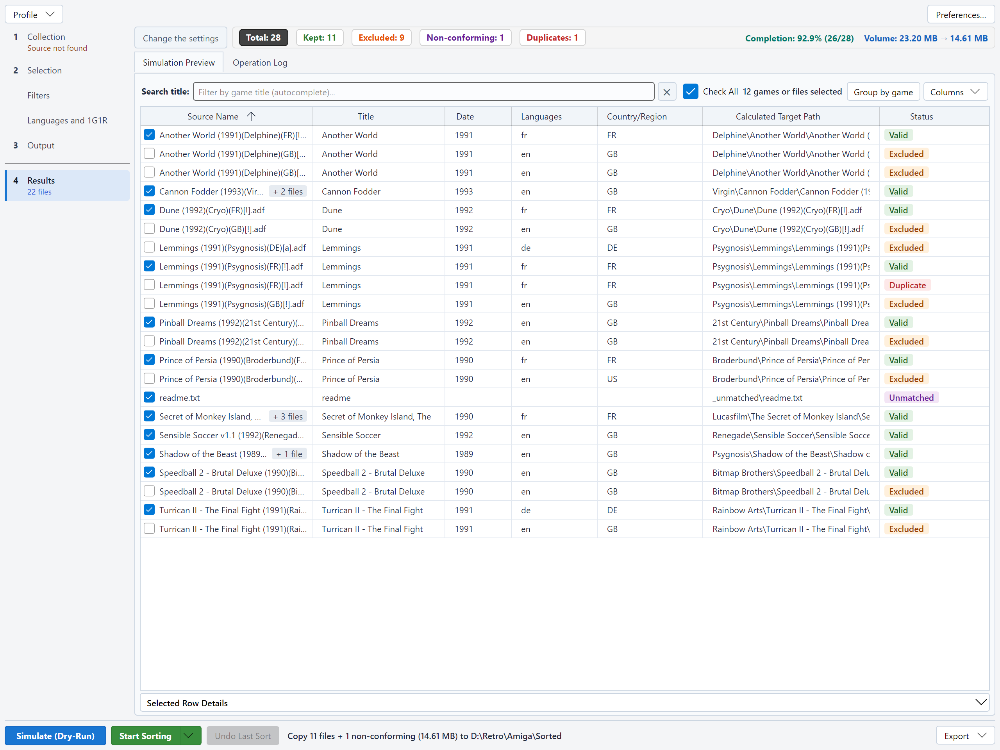
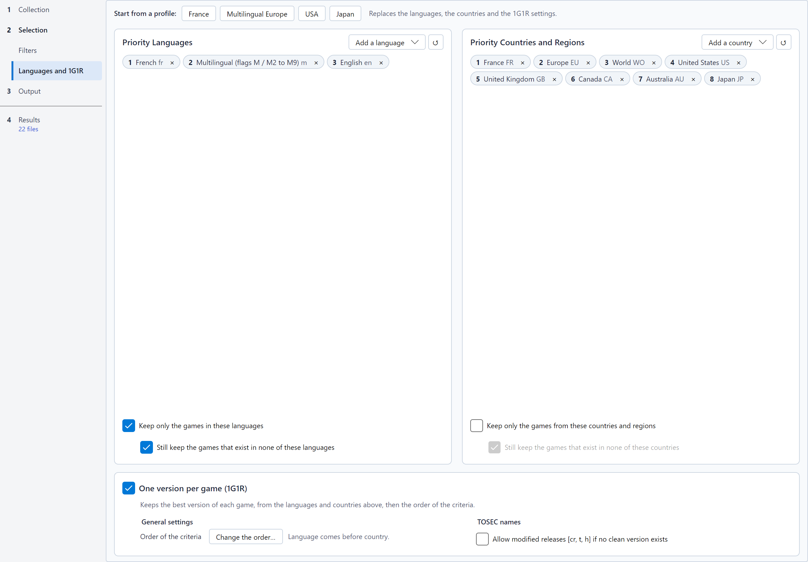
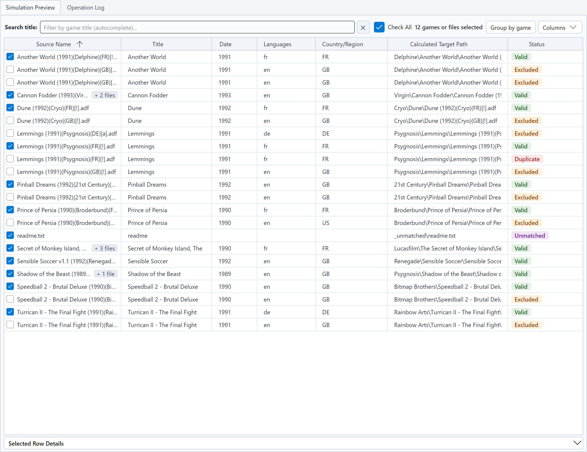

# RomSieve

A cross-platform ROM organizer for Linux and Windows. RomSieve audits a collection against its DAT, keeps one release
per game (1G1R) and rebuilds a clean folder tree, with a full preview before anything is written.

It supports the three preservation standards:

* **TOSEC**: vintage computers (Amiga, Atari ST, Amstrad CPC, C64, ZX Spectrum...) and early consoles.
* **No-Intro**: cartridge consoles (NES, SNES, Mega Drive, Game Boy, GBA, N64...).
* **Redump**: optical media (PlayStation, Saturn, Dreamcast, Amiga CD32...).

It also sorts **MAME** arcade sets (non-merged or merged), archive by archive, with a MAME DAT, and the software of a
**MAME software list** (Mega Drive cartridges, Amstrad CPC disks...) into the folder of its list, with the DAT of the
list or the hash file of MAME.



## Highlights

**Full TOSEC support.** Most tools only check TOSEC files by checksum. RomSieve reads the whole TOSEC naming
convention: title, version, date, publisher, system, video standard, countries, languages, media (*Disk 1 of 3*,
*Side B*) and dump flags (`[!]`, `[a]`, `[cr]`, `[t]`, `[h]`, `[tr Fr]`...). Computers get the same treatment as
consoles: incomplete multi-disk sets are completed with clean disks from other dumps, and folders can be built from
the publisher and the year.

**Deterministic 1G1R.** Among all the releases of a game, RomSieve keeps the best one for you, using your languages
and countries in priority order, the video standard (PAL or NTSC), dump quality, complete multi-disk sets, media
fidelity, version and revision. You can change the order of the criteria, and four presets (France, Europe, USA, Japan) set
everything up in one click. The same input always gives the same result.



**Simulation first.** The window follows the steps of a sort (collection, selection, output), then shows the results
over its whole height. A dry run fills a table with every file: its status, the reason for it, and where the file will
go. You can filter the table by status, search it, and right-click a game to force another release as the 1G1R winner.
Running the simulation again only updates what changed. Every game is checked after a simulation: uncheck the ones you do
not want (or filter the table) to sort only a part of it, each game with all its disks, tracks and playlist.



**DAT audit.** Files are identified by size and CRC32 (SHA-1 optional), even badly named ones. RomSieve reads Logiqx
XML and ClrMamePro DATs, including parent/clone relations, shows how complete the collection is, and exports a miss
list or a fixdat. A whole No-Intro, Redump or TOSEC pack can be used at once: choose its folder of DATs, or the ZIP, 7z
or RAR archive it was downloaded as, and each file is sorted with the DAT that knows it, each DAT with its own
convention, filters, 1G1R and folder in the destination. Only the DATs the source needs are read in full.

**Safe file operations.** RomSieve can copy, move, create hard links or symbolic links, or write one TorrentZip archive per game,
into folder patterns such as `{publisher}/{title}/` or `{country}/{title}/`. Files that do not match go to
`_unmatched/`, and a cancelled transfer leaves no partial file behind. Purging a destination deletes nothing: its
content is set aside in `_purged/`. Every real sort is logged, so the last one can be undone.

**Also included:** ZIP, 7z and RAR archives read without extraction, CHD headers, `.cue`/`.gdi`/`.ccd` sets kept with
their tracks, `.m3u` playlists, a CRC cache, configuration profiles, light and dark themes, and an interface in
English, French and Spanish.

## Command line

`romsieve-cli` runs the same pipeline with the options saved by the interface or from a profile. It only simulates
unless `--execute` is given.

```bash
romsieve-cli run --report report.json --miss-list missing.txt
romsieve-cli run --profile "Amiga 1G1R" --execute
romsieve-cli run --dat /dats/No-Intro --dat-recursive --execute
romsieve-cli undo --yes
```

## Download

Download the latest version from the [releases page](https://github.com/madvintager/RomSieve/releases/latest). Each
release ships a self-contained archive for Windows x64 (`.zip`) and Linux x64 (`.tar.gz`). It contains the
interface (`RomSieve`), the command line (`romsieve-cli`), the user guide in HTML (`docs/index.html`) and the licenses
of the components they embed (`THIRD-PARTY-NOTICES.txt`), and needs no .NET installation. You can check a download
with `sha256sum -c <archive>.sha256`. The binaries are not signed, so Windows SmartScreen may warn on first launch.

## Documentation

The [user guide](docs/README.md), in [English](docs/en/index.md) and [French](docs/fr/index.md), covers every feature:
[quick start](docs/en/quick-start.md), [naming conventions and DATs](docs/en/naming-conventions-and-dats.md),
[1G1R](docs/en/languages-regions-1g1r.md), [safety and undo](docs/en/safety-and-undo.md) and
[command line](docs/en/command-line.md) (all options and exit codes). It is also online, for the latest release:
[madvintager.github.io/RomSieve](https://madvintager.github.io/RomSieve/).

## Building from source

This is only needed to work on RomSieve: to use it, [download](#download) a release.

You need the [.NET 10 SDK](https://dotnet.microsoft.com/download/dotnet/10.0). These commands work in any terminal,
PowerShell and the Windows command prompt included:

```bash
dotnet test                                # build and run the test suite
dotnet run --project src/RomSieve.App     # launch the interface
dotnet run --project src/RomSieve.Cli -- --help   # run the command line
```

To get a self-contained executable, publish the interface (`src/RomSieve.App`, executable `RomSieve.App`) or the
command line (`src/RomSieve.Cli`, executable `romsieve-cli`) for your platform (`win-x64` or `linux-x64`):

```bash
dotnet publish src/RomSieve.App -c Release -r win-x64 --self-contained true -p:PublishSingleFile=true -p:IncludeNativeLibrariesForSelfExtract=true -o publish
```

### Release archive

`scripts/package-release.sh` builds the archive of a release into `dist/`, as releases ship it: both executables, the
README, the licenses, the user guide in HTML and the `.sha256` checksum. It is a bash script: PowerShell and the command
prompt cannot run it. On Windows, run it from Git Bash, installed with [Git for Windows](https://gitforwindows.org/).
It also needs:

* [pandoc](https://pandoc.org/installing.html) 3.1 or later, for the user guide (or its path in the `PANDOC` variable);
* for the Windows archive, `zip`, [Python 3](https://www.python.org/downloads/) or
  [PowerShell 7](https://learn.microsoft.com/powershell/scripting/install/installing-powershell-on-windows) (`pwsh`),
  to write the `.zip`: Git Bash has no `zip`, and Windows PowerShell 5 cannot write a portable archive.

The script checks these tools before building, and names those that are missing.

```bash
bash scripts/package-release.sh win-x64 1.0.0     # Windows archive, from Git Bash
bash scripts/package-release.sh linux-x64 1.0.0   # Linux archive, on Linux only
```

The Linux archive is refused from Git Bash, where its executables would lose their execute permission. From WSL, the
script runs in the Linux distribution: the .NET SDK and pandoc must be installed there, not on Windows.

## Use of AI

AI was used in the development of RomSieve to write unit tests, to write github workflows, to write the documentation, to create tooltips on each control and to track down bugs that were very hard to locate.

## License

Copyright (C) 2026 MadVintager.

RomSieve is free software: you can redistribute it and/or modify it under the terms of the
[GNU General Public License v3.0](LICENSE), or (at your option) any later version. It comes with absolutely no
warranty. RomSieve embeds components by other authors (.NET, Avalonia, SkiaSharp, SharpCompress...), each under its own
license: see [THIRD-PARTY-NOTICES.txt](THIRD-PARTY-NOTICES.txt).

**Additional permission under GNU GPL version 3 section 7.** If you modify this Program, or any covered work, by linking
or combining it with the libraries listed in THIRD-PARTY-NOTICES.txt (or a modified version of those libraries),
containing parts covered by the terms of their own licenses, including the Microsoft Public License (Ms-PL) and the
UnRAR license, the licensors of this Program grant you additional permission to convey the resulting work.
Corresponding Source for a non-source form of such a combination shall include the source code for the parts of those
libraries used as well as that of the covered work.
