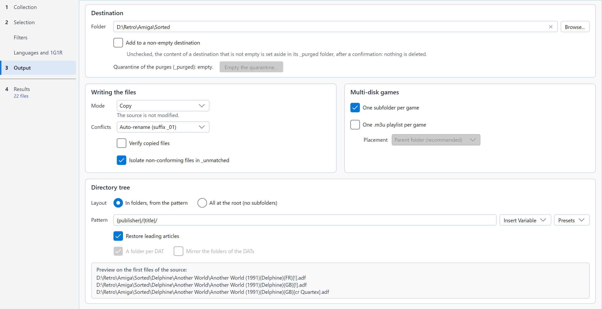

# Destination and transfers

Everything on this page is set in the **Output** step, in four frames: **Destination** (the folder, and what to do
when it is not empty), **Writing the files** (mode, conflicts, verification), **Multi-disk games** (subfolder, playlist)
and **Directory tree** (pattern, articles, folders of the DATs of a lot, preview). The cross at the end of the
destination field empties it.

## Folder pattern

The **Pattern** describes the folders created for each game, with variables in braces. For instance, with
`{publisher}/{year}/{title}/`, the file `Another World (1991)(Delphine)(FR)[!].adf` goes to
`Delphine/1991/Another World/`.

Type the pattern in the field, or use the two menus under it:

* **Insert Variable** inserts a variable at the caret (at the end, as a new folder, if you have not clicked in the
  field). The variables of every convention come first; those of TOSEC names (publisher, year, chipset...) follow, then
  those of the MAME categories (genre, category), then that of the DAT. All stay in the menu: those without a value with
  the current convention are greyed out, and their tooltip says when they apply (the TOSEC variables when the convention
  is TOSEC or not known yet, or a TOSEC DAT of a lot is checked, those of the categories with MAME, that of the DAT as
  soon as a DAT is chosen).
* **Presets** replaces the pattern with a ready-made one:

| Preset | Pattern | Suits |
|---|---|---|
| **Publisher / Year / Title (TOSEC)** | `{publisher}/{year}/{title}/` | TOSEC collections |
| **Country / Title (No-Intro, Redump)** | `{country}/{title}/` | Consoles sorted by region |
| **Letter / Title** | `{letter}/{title}/` | Alphabetical folders |
| **Chipset / Letter / Title (Amiga)** | `{chipset}/{letter}/{title}/` | A folder per Amiga (AGA, OCS-AGA, OCS-ECS) |

Choosing a preset goes back to **In folders, from the pattern** if **All at the root** was chosen (see below).

### Live preview

At the bottom of the *Directory tree* frame, the preview shows where the sort would write three files with the current options: destination,
folders and file name (a `.zip` archive in ZIP mode). It is refreshed as you type, and when the source, the convention,
the DAT, the destination, the mode or the options below change.

* The files are the first ones of the source whose name follows the convention. Only their names are read: no CRC is
  computed and no archive is opened. An archive is therefore shown under its own name.
* Without a source, or when none of its first files follows the convention, the preview shows built-in examples of the
  convention, captioned **Examples**.
* With a DAT, the sort names a file identified by the DAT after the DAT entry: the preview, which reads no CRC, keeps
  the source name.
* With a [lot of DATs](naming-conventions-and-dats.md#several-dats), the examples go into the folder of the first DAT
  checked of their convention, as its files would.

The preview warns about a pattern that would not do what it says: an unknown variable (the sort drops it), a brace
without its pair (it would stay in the folder name), or a pattern that writes into `_unmatched`, the folder of the
non-conforming files.

### Variables

| Variable | Content | Example |
|---|---|---|
| `{title}` | Title, without technical tags | `Another World` |
| `{letter}` | First letter of the title (`#` for digits and symbols) | `A` |
| `{country}` | Country or region, as written in the name | `FR`, `Europe` |
| `{language}` | Language, as written in the name; otherwise the language of its country (a TOSEC name such as `(FR)` omits it) | `fr`, `M3` |
| `{version}` | Version or revision | `v1.1` |
| `{publisher}` | Publisher (TOSEC) | `Delphine` |
| `{year}` | Year of release (TOSEC) | `1991` |
| `{system}` | System or computer model (TOSEC) | `A500` |
| `{chipset}` | Chipset an Amiga release needs (TOSEC): `AGA` (AGA only), `OCS-AGA` (both, or fixed for AGA), `OCS-ECS` (anything else, a name without a mark included) | `AGA` |
| `{video}` | Video standard (TOSEC) | `PAL` |
| `{dump_status}` | Dump status (TOSEC) | `Verified`, `Clean`, `Cracked`, `BadDump` |
| `{genre}` | Genre of the machine, from the [category file](naming-conventions-and-dats.md#machine-categories) (MAME) | `Shooter` |
| `{category}` | Genre and subgenre of the machine (MAME) | `Shooter - Flying Vertical` |
| `{dat}` | Header name of the DAT of the file: the DAT chosen, or the DAT of the lot it is sorted with | `Nintendo - Game Boy` |

An unknown value gives `Unknown` (empty for `{version}`). The names are cleaned of the characters forbidden by Windows
or Linux, and very long paths are supported on Windows.

### Output at the root

The **Layout** line, at the top of the *Directory tree* frame, offers two choices: **In folders, from the pattern** (the
default) or **All at the root (no subfolders)**, which puts every file at the root of the destination. It is an option
of its own: the pattern stays in its field, greyed with **Insert Variable**, and is used again when you go back to the
folders or choose a preset. A sentence under the two choices recalls it. **Restore leading articles** stays active, as it
also applies to the subfolder of a multi-disk game. A multi-disk game still gets its subfolder if **One subfolder per game** (*Multi-disk games* frame) is checked.

A software of a [MAME software list](naming-conventions-and-dats.md#mame-software-lists) always goes into the folder of
its list, where MAME looks for it: with **All at the root**, `megadriv/sonic.zip` under the destination; with a
pattern, its folders come above that of the list.

### A folder per DAT

With a [lot of DATs](naming-conventions-and-dats.md#several-dats), two boxes under **Restore leading articles** keep the
files of each DAT apart:

* **A folder per DAT** (checked by default): the files of each DAT go into a folder named after it, above the folders of
  the pattern. With `{title}`, `Tetris (World).gb` goes into `Nintendo - Game Boy/Tetris/`. Unchecked, every DAT shares
  the same folders: the `{dat}` variable then places the DAT elsewhere in the pattern, and two files of different DATs
  that aim at the same target follow the [conflict](#conflicts) rule.
* **Mirror the folders of the DATs**: the folder of each DAT goes under the folders of its path in the folder of DATs,
  as in the pack (`TOSEC/Commodore/Amiga/Commodore Amiga - Games - [ADF]/...`). Only with a folder per DAT, and for the
  DATs read in subfolders (`--dir-dat-mirror` on the command line).

Both boxes are greyed out with a DAT file: a single DAT never gets a folder of its own, and its output does not change.
The `_unmatched` folder of the non-conforming files stays at the root of the destination.

### Related options

* **Restore leading articles**, under the pattern: `Legend of Zelda, The` becomes `The Legend of Zelda` in the folder
  names.

The **Multi-disk games** frame, next to *Writing the files*:

* **One subfolder per game**: the disks of a multi-disk game go to a subfolder named after it.
* **One .m3u playlist per game**: writes a playlist listing the disks of a multi-disk game, so that emulators and
  frontends (RetroArch, Batocera, Recalbox...) can swap them. **Placement**, indented just below, chooses where it
  goes:
  * *Parent folder (recommended)*: the playlist sits next to the game folder (recommended for frontends);
  * *Parent folder with hidden subfolder (.\*)*: the game folder starts with a dot, so that frontends only show the
    playlist;
  * *Inside game subfolder*: the playlist sits with the disks.

## Transfer modes

**Mode** is a list: each entry gives the name of the mode and a sentence saying what it does (its tooltip has the
details), and the sentence of the selected mode stays under the list.

| Mode | What happens | Source | Notes |
|---|---|---|---|
| **Copy** | Files are copied | Unchanged | The safest choice. |
| **Move** | Files are moved | Emptied of the kept files | Instant on the same disk; across disks, copied, written to the disk, then deleted. An inspected archive is never moved: its members are extracted. |
| **Hard link** | A second name for the same data | Unchanged | No extra space. Same disk only; not on FAT32 / exFAT. An emulator that writes to the file (an ADF floppy in WinUAE, for instance) also changes the one in the source: they are the same data. |
| **Symlink** | A shortcut pointing to the source | Must stay in place | No extra space. On Windows, creating symbolic links may require the Developer Mode or administrator rights. An emulator that writes to the file changes the one in the source. |
| **ZIP** | One ZIP archive per file | Unchanged | A descriptor and its tracks share one archive. |

About the **ZIP** mode: the archives are in the *TorrentZip* format, which RomVault and igir recognize. This format fixes
everything that could differ from one tool to another (order of the files, date, compression, headers): an archive only
depends on its content, and two sorts of the same files give byte-identical archives, like those of these tools. A ROM
manager therefore takes them as already in order, without compressing them again, and a shared collection stays the same
from one user to another. Compressing takes longer than copying. With **Verify copied files**, every archive is read
again and its TorrentZip signature checked. A MAME set, which
already is an archive, and its CHDs are copied as they are (see [MAME DATs](naming-conventions-and-dats.md#mame-dats)),
and so is a software of a MAME list.

Files **Excluded** by a filter and **Duplicates** are never written: they stay in the source, even in Move mode.
**Non-conforming** files are transferred to `_unmatched/` at the root of the destination.

### Isolate non-conforming files in _unmatched

**Isolate non-conforming files in _unmatched**, below *Verify copied files*, is checked by default. Uncheck it to leave
the non-conforming files in the source: the results still show them as **Non-conforming**, with *left in the source*
in their reason and no target, but the sort does not write them, even in Move mode. They do not count in the volume
written nor in the FAT32 warning, their box in the results cannot be checked, and the log counts them in one line.
The option is saved in the configuration and in the profiles, so the command line follows it too.

### Verify copied files

With **Verify copied files**, below *Conflicts*, every file copied, extracted from an archive or moved to another disk is read again and
its CRC32 is compared with the data read from the source (in ZIP mode, every file of the archive, and the TorrentZip
signature of the archive). On a mismatch (faulty disk, cable, network), the copy is
deleted, the source is kept, and the file is marked in error. Links are not verified. This slows the sort down, since
every file is read twice.

## Conflicts

**Conflicts** decides what happens when a file with the same name already exists at the target:

* **Auto-rename (suffix _01)**: the new file becomes `name_01.ext`, `name_02.ext`...
* **Skip**: the existing file is kept and the new one is not written.
* **Overwrite**: the existing file is replaced, once the new one is completely written: if the transfer fails (full
  disk, lost network share, locked file), the existing file is kept. The replaced file is lost: **Undo Last Sort**
  cannot put it back, as the confirmation of the sort reminds you.

A descriptor and its tracks are always resolved together: they all receive the same suffix, and the descriptor is
rewritten to reference the renamed tracks.

An `.m3u` playlist follows the same rule: a playlist already there is kept (**Skip**), joined by a new `name_01.m3u`
(**Auto-rename**) or replaced (**Overwrite**).

A MAME set and its CHDs are never renamed, nor is a software of a MAME list, since MAME only finds them by their names:
with **Auto-rename**, they are skipped as duplicates.

## A non-empty destination

* With **Add to a non-empty destination** checked, the sort adds its files to the existing content;
  the conflict rule applies.
* Otherwise, RomSieve offers to **purge** the destination first. Nothing is deleted: the previous content is moved to
  `_purged/<date>/` inside the destination, and [undo](safety-and-undo.md) puts it back.
* A [partial sort](simulation-table.md#sorting-part-of-the-simulation) never purges: it always adds to the destination.
