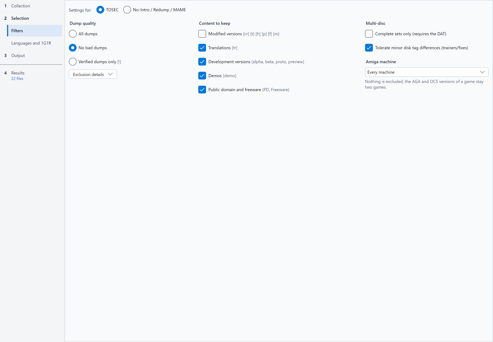

# Filters

Filters exclude the files you do not want in your sorted collection. An excluded file is never written: it stays in
the source, and the table shows why it was excluded.

## Settings for TOSEC or No-Intro / Redump / MAME

TOSEC names and No-Intro / Redump names do not carry the same information, so each convention has its own filter
settings, all of them saved (in `config.json` and in profiles). The **Filters** page of the *Selection* step shows one set at a time, chosen with
**Settings for:** **TOSEC** or **No-Intro / Redump / MAME**.

* The choice follows the effective convention (chosen or detected in the *Collection* step): a No-Intro DAT
  shows the No-Intro / Redump / MAME settings.
* MAME sets use the No-Intro / Redump settings (see [MAME DATs](naming-conventions-and-dats.md#mame-dats)): with the
  MAME convention, the [MAME machines](#mame-machines) frame, at the top of the page, shows its settings. Without the
  MAME convention, this frame comes down to its title and a sentence that says when it applies.
* The software of a [MAME software list](naming-conventions-and-dats.md#mame-software-lists) use the No-Intro / Redump
  settings too. The *MAME machines* frame comes down to its
  title and a sentence that says it only applies to the machines of a MAME DAT; the dump quality and the categories a
  software never carries are greyed (see below).
* While the convention is unknown (*Automatic* convention without a DAT), the last choice is kept.
* You can show the other convention to set it as well: a mixed collection applies to each file the settings of the
  convention of its name.

The categories both conventions share (dump quality, modified versions, translations, development versions, demos,
incomplete sets) appear once, followed by the tags of the shown convention; the options of one convention only appear
for it.

## Dump quality

A single choice sums up the integrity filters. It is greyed with the MAME convention, and a sentence says why: MAME has
no dump quality (a `baddump` ROM is the best known dump there), and these settings never apply to a MAME set. Its variants are set in the
[MAME machines](#mame-machines) frame. It is greyed for the software of a MAME list too, for the same reason; their
variants (`alt`) are all kept, and 1G1R keeps one version per game.

| Choice | Effect | TOSEC | No-Intro / Redump |
|---|---|---|---|
| **All dumps** | No integrity filter | Every exclusion off | Every exclusion off |
| **No bad dumps** *(default)* | Excludes faulty dumps, keeps alternates | Excludes `[b]`, `[o]`/`[u]` and `[v]` | Excludes `[b]` |
| **Verified dumps only** | Keeps verified dumps only | Only `[!]` | Not offered (see below) |

The **Exclusion details** button opens the list of exclusions, to set one by one:

| Option | Excludes | TOSEC | No-Intro / Redump |
|---|---|---|---|
| **Exclude bad dumps** | Corrupt dumps | `[b]` | `[b]` |
| **Exclude alternates** | Alternate dumps | `[a]` | `(Alt)` |
| **Exclude overdumps and underdumps** | Dumps of abnormal size | `[o]` `[u]` | - |
| **Exclude infected images** | Disk images infected by a virus | `[v]` | - |

No-Intro and Redump names do not mark verified dumps: every dump that is not a bad dump counts as verified there, and
**Verified dumps only** would keep the same files as **No bad dumps**. This choice is therefore only offered for TOSEC.

With **Verified dumps only**, these exclusions are implied and greyed out. A combination that matches none of the three
choices (alternates excluded as well, for instance) shows a fourth choice, **Custom**, checked in their place; it goes
away as soon as the exclusions match a level again. Choosing one of the three levels rewrites the exclusions.

## Content

The **Content to keep** group lists what you want to keep: a checked box keeps its category, an unchecked box excludes
it from the sort.

The No-Intro / Redump settings also apply to MAME sets: under the title of the group, the **Settings shared by No-Intro,
Redump and MAME** note says so, and the tooltips quote both effects. Unchecking **Modified versions** for a MAME
collection therefore also excludes the `(Hack)` ROMs of a No-Intro sort that uses the same configuration; to set them
differently, save a [profile](settings-and-profiles.md#named-profiles) for each collection. The TOSEC settings are independent.

| Option | Category (TOSEC) | Category (No-Intro / Redump) | Category (MAME) | Kept by default |
|---|---|---|---|---|
| **Modified versions** | Cracks, trainers, hacks, pirate releases, fixes, modifications `[cr] [t] [h] [p] [f] [m]` | Romhacks `(Hack)` | `(hack)` | **No** |
| **Pirate versions** *(No-Intro / Redump, MAME)* | - | Bootlegs `(Pirate)` | Bootlegs `(bootleg)` | **No** |
| **Translations** | Fan translations `[tr]` | Unofficial translation patches `(Translated)` | - | Yes |
| **Development versions** | alpha, beta, proto, preview | Beta, Proto, Sample, Pre-Release | prototype, beta, alpha, preview, location test | Yes |
| **Demos** | Demos `(demo)` | Demo, Kiosk, Taikenban, numbered or described too (`(Demo 2)`, `(Taikenban 1)`) | `(demo)` | Yes |
| **Public domain and freeware** *(TOSEC)* | PD, freeware, shareware... | - | - | Yes |
| **Unofficial releases** *(No-Intro / Redump)* | - | Unl, Homebrew, Aftermarket | - | Yes |
| **Modern re-releases** *(No-Intro / Redump)* | - | Virtual Console, Switch Online, Classic Mini, LodgeNet... | - | Yes |

With the MAME convention, the categories are read in the description of the machine, and the boxes a MAME set never
falls under (translations, unofficial releases, modern re-releases) are greyed, their tooltip saying why. Their tags and tooltips then quote the
words of MAME: `(bootleg)`, `(hack)`, `(prototype)`... By default, bootlegs and hacks are excluded, as for No-Intro /
Redump.

For the software of a MAME list, the categories are read in the description of the software: `(pirate)` is a pirate
release, `(hack)`, `cracked` and `Trained` are modified versions, `translation` a translation, `(prototype)` a
development version and `(demo)` a demo. The unofficial releases and the modern re-releases, which these descriptions
never mark, are greyed, their tooltip saying why.

Only the wording changed since the versions that showed "Exclude translations"...: `config.json` and the profiles keep
the same options (`exclude_translations`...), so a file is read back unchanged.

### Files missing from the DAT

With a DAT, the filters judge a file by its name in the DAT: they only see the files the DAT identifies. A file whose
checksum the DAT does not know is **non-conforming**, isolated in `_unmatched/`.

**Also filter files missing from the DAT**, the last box of the **Content to keep** group, checked by default, puts
these files through the filters of this page (dump quality, content, Amiga machine), by the tags of their own name when
it follows the convention of the DAT:

* a file the filters exclude is **Excluded** and stays in the source; its reason is the one of the filter, followed by
  "(file missing from the DAT)", for example "Demo version excluded (file missing from the DAT)";
* a file the filters keep stays **non-conforming**, as without the box.

This name is not the one of the DAT: only a tag the name carries excludes a file, and a missing tag leaves it in
`_unmatched/`. These files belong to no game, excluded or not: they go neither through the 1G1R nor through the
priority languages and countries, do not count in the completeness of the DAT, cannot be chosen as 1G1R winners, and an
excluded file has no box for a [partial sort](simulation-table.md#sorting-part-of-the-simulation). A file whose SHA-1
alone differs from the one of the DAT, a file damaged in its archive or an unreadable CHD always stays
non-conforming: these are anomalies to look at.

Uncheck the box for `_unmatched/` to keep everything the DAT does not know, for example to complete a DAT or to spot bad
dumps. A configuration or a profile saved by an earlier version of RomSieve keeps its result: the box is unchecked
there. Without a DAT, every file is already filtered by its name. The box is greyed with a MAME DAT or software lists,
where a file the DAT does not know is always non-conforming.

## Multi-disc

* **Complete sets only (requires the DAT)**: a game whose disks (or, for No-Intro / Redump, whose media and tracks)
  are not all present is excluded. With the MAME convention, this group gives way to the **Complete sets only (ROMs and
  CHDs present)** option of the [MAME machines](#mame-machines) frame. For the software of a MAME list, this option
  excludes a software whose archive lacks a ROM.
* **Tolerate minor disk tag differences (trainers/fixes)** *(TOSEC)*: a set is often incomplete because disk 1 carries a
  trainer `[t]` or a fix `[f]` that the data disks do not. With this option, RomSieve completes the set with the clean
  data disks of the same game.

## Amiga machine

*(TOSEC)* The **Amiga machine** list, under the Multi-disc group, says which Amiga the collection will be used on.
RomSieve reads the chipset from the system field of the TOSEC name: `(AGA)`, `(A1200)`, `(A4000)` or `(CD32)` for an
AGA-only game, `(OCS-AGA)` or `(ECS-AGA)` for a game that also runs on AGA, `(ECS)`, `(A500+)` or `(A600)` for an ECS
game. A game without a mark is presumed OCS / ECS and is never left out.

| Choice | Effect |
|---|---|
| **Every machine** (default) | Nothing is excluded; the AGA and OCS versions of a game stay two games, as before. |
| **Amiga 500, 1000, 2000 (OCS)** | The AGA, ECS and `(ECS-AGA)` games are excluded (reason *Needs an AGA Amiga: does not run on the target machine*). |
| **Amiga 500+, 600, 3000 (ECS)** | The AGA games are excluded. |
| **Amiga 1200, 4000, CD32 (AGA)** | Nothing is excluded. With [1G1R](languages-regions-1g1r.md), the AGA and OCS versions of a game are one game, and the *Amiga chipset (AGA machine)* criterion keeps the AGA version first, then an `(OCS-AGA)` version, then a version fixed for AGA (`[f AGA NOMAD]`), then the OCS version. |

With an AGA Amiga, *Theme Park (AGA)* and *Theme Park* thus keep a single version; without 1G1R, every version stays. A
version fixed for AGA is a modified version: it only counts when the modified versions are kept (or used as a fallback,
*TOSEC names* option of the *Languages and 1G1R* page).

## MAME machines

With the MAME convention, the **MAME machines** frame, in the colours of the MAME badge of the *Collection* step, is
shown at the top of the page, above the No-Intro / Redump settings that the sets also follow. It sorts the machines out
according to what the MAME DAT says of them; by default, all of them are kept. It shows the essential settings:
**Machines to keep**, then, on the right, **Emulation to keep** and **Complete sets only (ROMs and CHDs present)**. The
finer filters are under **Refine**, in a row of buttons that each open a panel over the page: **Cabinet** and
**Controls** (the [cabinet](#cabinet-and-controls)), **Categories** (the [categories](#categories)), **Ratings** and
**Size** ([Ratings and size](#ratings-and-size)). Each button says what it excludes: *Cabinet: any* without
restriction, the restriction itself when there is only one (*Cabinet: vertical screen*), otherwise their number
(*Cabinet: 3 restrictions*); it turns bold while it excludes machines, and its tooltip names all its restrictions.

**Machines to keep**:

| Option | Unchecked, excludes |
|---|---|
| **BIOS** | The BIOS sets (`neogeo`, `pgm`...). A *non-merged* set already holds the ROMs of its BIOS, but in a *merged* or *split* collection, the games take them from the BIOS set. A BIOS a kept game needs is sorted anyway. |
| **Devices (components)** | The *device* sets, components MAME does not start by themselves but that some games need. A *device* a kept game needs is sorted anyway. |
| **Mechanical machines** | Pinballs, slot machines and other mechanical machines, which MAME only partly emulates. |
| **Machines needing artwork** | The machines MAME only shows properly with an external artwork (*artwork* files installed separately). Almost all of them are mechanical machines; the others are mostly handheld electronic games and fruit machines. |
| **Machines without emulated sound** | The machines whose sound MAME does not emulate. A machine with no sound hardware at all is not concerned. With **Playable**, unchecking this box keeps the playable games with their sound. |
| **Machines with nothing to dump** | Unchecked by default. The machines with no ROM nor disk to dump: consoles that MAME runs without any file, with the software of its lists (`genesis`, `famicom`...), and machines none of whose ROMs was ever dumped. In a *merged* collection, their archive only holds the ROMs of their clones; a filtered DAT, which describes them without any ROM, has nothing to build for them either. |
| **Variants (set 2, alt)** | The variants of a machine: the sets whose description says `set 2` or more, or `alt`. The main set stays. The [dump quality](#dump-quality) settings do not apply to MAME sets. |

**Emulation to keep** keeps the machines according to the status MAME gives their driver, one box per status; any
combination is possible, for instance only the machines that do not work yet:

| Box | Checked, keeps |
|---|---|
| **Good** | The machines MAME emulates properly (`good` status). |
| **Imperfect** | The playable machines, with flaws in sound, graphics or other features (`imperfect` status). |
| **Preliminary** | The machines whose emulation is incomplete, often unplayable (`preliminary` status). |
| **Playable** | Also, whatever their status, the machines whose core (processors, game logic) is well emulated, even if sound, graphics or another feature is only partly emulated or not at all. A silent game, whose driver is preliminary for lack of sound, is kept. Greyed when the three statuses are checked, as it then changes nothing. |

The three statuses are checked by default. With no status and no playable machines, a sentence warns that only the
machines without a status are kept. Only the DAT made by `mame -listxml` gives this information (status, sound and
artwork): a machine without a status (a *device*, or a SabreTools DAT) is always kept. The overall driver status is also
a [1G1R](languages-regions-1g1r.md) criterion.

The mechanical machines are all preliminary in MAME 0.289: only **Preliminary** keeps them all, and **Playable** a few
hundred, whose core is well emulated. When **Mechanical machines** is checked but no mechanical machine of
the DAT has a checked status, a sentence under the boxes says so: *No mechanical machine of the DAT has these statuses.*
They are then all excluded; check other statuses to keep some. The sentence only appears once the whole DAT is read.

**Complete sets only (ROMs and CHDs present)**, under the emulation, only keeps the sets that have all their ROMs
and all their disks, including those they find in the set of their BIOS; the others are excluded. An incomplete set a
kept game needs is sorted anyway.

### Cabinet and controls

These settings keep the machines that suit a cabinet or a control panel, from what the DAT made by `mame -listxml` says
of their screen and controls. A value the DAT does not give (a *device*, a SabreTools DAT, a machine whose controls
MAME does not describe yet) never excludes a machine. The **Cabinet** button opens the settings of the screen, players
and buttons; the **Controls** button, the list of controls.

| Setting | Effect |
|---|---|
| **Any orientation**, **Horizontal only**, **Vertical only** (drop-down list) | Keeps the machines according to the orientation of their screen: a screen turned by a quarter turn (most shoot'em ups and games of the 1980s) is vertical. |
| **Vector screens** | Unchecked, excludes the machines with a vector screen (Asteroids, Tempest, Star Wars...). |
| **LCD screens (handhelds)** | Unchecked, excludes the electronic games with an LCD screen (Game & Watch, Tiger...). |
| **Players** | Only keeps the machines that accept at least this number of players. |
| **Buttons** | Excludes the machines with a control that has more buttons than your panel. |
| **Controls** | Opens the list of controls: uncheck those your panel lacks (joystick, analog stick, trackball or mouse, spinner, paddle or wheel, pedals, light gun, keyboard, mahjong or gambling panel); the machines that use them are excluded. The button says how many controls are kept (*Controls: 8 out of 9*), and its tooltip names the missing ones. |

The detail panel of the [simulation table](simulation-table.md) describes, under the **MAME set** line, the screen,
players, controls and buttons of the machine.

### Categories

With a [category file](naming-conventions-and-dats.md#machine-categories) chosen in the *Collection* step, the
**Categories** button opens the settings that sort the machines out according to their genre; without a file, it is
greyed out and shows *Categories: no file*, and its tooltip says where to choose one. A machine the file does not class
is never excluded.

| Setting | Effect |
|---|---|
| **Machines for adults (Mature)** | Unchecked, excludes the machines the file marks `* Mature *`. |
| **Non-arcade machines (consoles, computers...)** | Unchecked, excludes the machines the file does not class as arcade. Only a file that marks the arcade machines (`catlist.ini`) allows it: otherwise, the box is greyed out and a sentence under it says so. With `catver.ini`, uncheck the non-arcade genres instead (`Computer`, `Game Console`, `Handheld`...). |
| **Genres** | List of the genres of the file, under the two boxes: uncheck those whose machines you do not want (`Casino`, `Quiz`, `Computer`...). Its title says how many genres are kept, and its tooltip names the excluded ones. An excluded genre stays in the list even if another file does not have it. **Check all** keeps every genre; **Uncheck all** excludes them all, so that you check again only those you want to keep. The excluded genres are what is saved: a genre a new category file brings is therefore kept. |

### Ratings and size

The **Ratings** button uses the [rating file](naming-conventions-and-dats.md#machine-ratings) chosen in the
*Collection* step; without a file, it is greyed out (*Ratings: no file*) and no machine is excluded for its rating. The
**Size** button opens the size limit, which also works without a rating file, and shows the chosen size (*Size: 64 GB at
most*).

| Setting | Effect |
|---|---|
| **Minimum rating** | Only keeps the machines rated at least at this level: *70 or more* keeps the *Good*, *Very Good* and *Best Games* ranges. An unrated machine is not concerned. |
| **Unrated games** | Unchecked, excludes the machines the file does not rate. |
| **Limit to … GB** | Only keeps what fits in this size, in GB of 10⁹ bytes as on a memory card (64 GB offered). RomSieve keeps the best rated games first, then, at equal rating, the smallest, and leaves out those that no longer fit (reason *Beyond the limit*); a smaller game may still fit afterwards. Each game counts with its CHDs and the sets it needs (BIOS, *devices*, parent of a *split* clone), counted once whatever the number of games that use them. Without a rating file, the smallest come first. |

The size limit applies after the other filters and the 1G1R; a 1G1R choice made by hand in the table must fit in the
limit too. The log gives the size used and the number of sets left out.

## Tips

* Start with the defaults, simulate, then click the **Excluded** chip of the banner to review what was removed and why.
* An option that seems to have no effect may simply concern the other convention: check **Settings for:** and the badge
  of the *Collection* step.
* To keep a single release per game, filters are not enough: enable [1G1R](languages-regions-1g1r.md), whose options
  (the modified releases kept as a fallback and the preferred media format, for TOSEC, included) are all in the
  *Languages and 1G1R* page.
