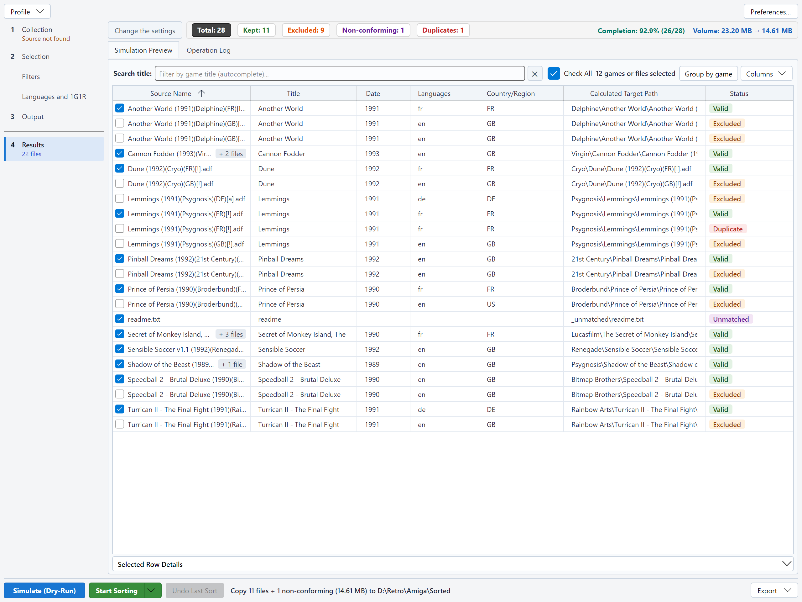

# RomSieve user guide

RomSieve audits, filters, deduplicates and reorganizes large collections of ROMs, disk images and optical media
images. It understands the three main preservation naming standards:

| Standard | Typical content |
|---|---|
| **TOSEC** (TOSEC Naming Convention, TNC) | Retro computers (Amiga, Atari ST, Amstrad CPC, C64, ZX Spectrum...) and vintage consoles |
| **No-Intro** | Cartridge consoles (NES, SNES, Mega Drive, Game Boy, GBA, N64...) |
| **Redump** | Optical media (PlayStation, Saturn, Dreamcast, Amiga CD32...) |

It also sorts **MAME** arcade sets (*non-merged* or *merged*), with a MAME DAT (see
[MAME DATs](naming-conventions-and-dats.md#mame-dats)).

It reads your files, identifies them (by their name, and by their checksum when you give it a DAT catalog),
applies your filters, keeps the best release of each game if you ask for it ("1G1R", *1 Game, 1 ROM*), and builds
a clean folder tree in a destination of your choice. Every sort can be **simulated** first, and every real sort can be
**undone**.

## The window

The column on the left follows the steps of a sort:

1. **Collection**: the naming convention, the DAT file and the source.
2. **Selection**: what to keep, on two pages, **Filters** then **Languages and 1G1R**. A click on *Selection* always opens
   **Filters**.
3. **Output**: the destination, the transfer mode, conflicts, the directory tree and the playlists.
4. **Results**: the statistics banner, the simulation table and the log, over the whole height of the window.

Under a step, a short line tells what is missing or what changed: *No source chosen*, *Source not found*,
*DAT not found*, *No destination chosen*, *Overlaps the source*; for **Results**, the number of files of the last run
("22 files"), *Running…* during a run, or "22 files, out of date" when a setting changed since the simulation. With a
DAT but no source, **Collection** shows *DAT only, no source*, a mere information: the DAT is enough to export the
filtered DAT of the catalog (**Export** menu), but simulating or sorting needs a source.

The **Simulate (Dry-Run)**, **Start Sorting**, **Undo Last Sort** and **Export** buttons, with the sentence that sums up
the next sort and the progress of a run, stay at the bottom of the window, whatever the step shown. Starting a
simulation or a sort shows **Results**; the **Change the settings** button leads back to the last settings step, and
the results stay available from the **Results** step.

## Contents

1. [Installation](installation.md): download, first launch, where RomSieve stores its files.
2. [Quick start](quick-start.md): your first simulation and your first sort, step by step.
3. [Naming conventions and DAT files](naming-conventions-and-dats.md): how files are identified.
4. [Destination and transfers](destination-and-transfers.md): folder patterns, transfer modes, conflicts, playlists.
5. [Filters](filters.md): dumps, modifications, demos, re-releases (TOSEC, No-Intro and Redump settings).
6. [Languages, regions and 1G1R](languages-regions-1g1r.md): keep one release per game, in your languages.
7. [The simulation table](simulation-table.md): statuses, search, manual 1G1R choices, successive simulations.
8. [Exports](exports.md): reports, DAT of your collection, missing ROMs and fixdat, filtered DAT of the catalog.
9. [Safety, purge and undo](safety-and-undo.md): what RomSieve never does, and how to go back.
10. [Command line](command-line.md): `romsieve-cli` for scripts, NAS and scheduled tasks.
11. [Settings and profiles](settings-and-profiles.md): preferences window (language, theme, updates), advanced options, saved options, named profiles.
12. [Troubleshooting](troubleshooting.md): common questions and problems.

## In a hurry?

1. In the **Collection** step, choose the **Source** (your unsorted files) and, optionally, a **DAT file** matching your
   collection.
2. In the **Output** step, choose the **Destination** (an empty folder).
3. Click **Simulate (Dry-Run)** and look at the table: nothing is written to disk.
4. When the result suits you, click **Start Sorting**. If you change your mind, **Undo Last Sort**.
