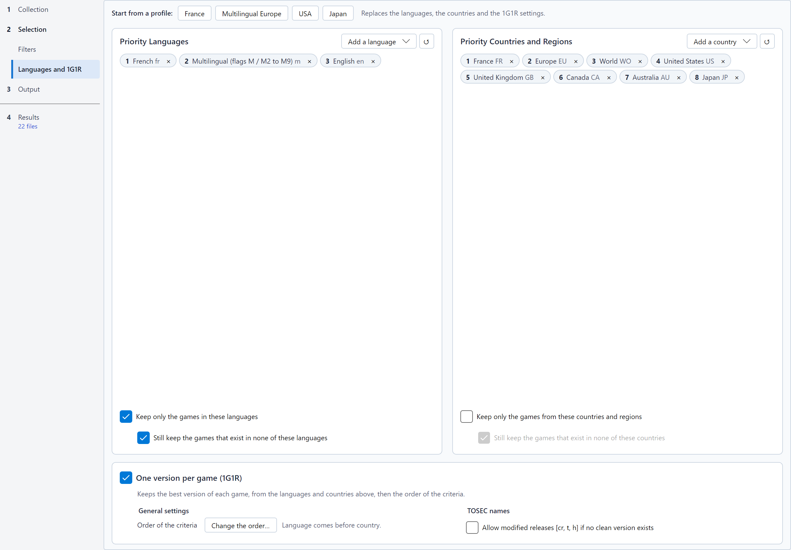

# Languages, regions and 1G1R

The **Languages and 1G1R** page of the *Selection* step decides which languages and countries you want, and whether RomSieve keeps a
single release of each game.

The page follows the order of the reasoning: at the top, **Start from a profile** fills everything in one click (see
[Quick presets](#quick-presets)); in the middle, two frames say which languages and countries you want; at the bottom,
the **One version per game (1G1R)** frame says how one release of each game is chosen.

## Priority languages and countries

Two side-by-side frames, *Priority Languages* and *Priority Countries and Regions*, show **your choices in order of
priority**, as numbered chips: chip 1 is preferred, then chip 2, and so on.

* **Add a language** / **Add a country**, at the top right of the frame, opens a search by name or code: click a result, or press Enter to add the
  first one. The added entry goes to the end of the list.
* The cross of a chip removes it from the list.
* To change the rank of a chip, drag it onto another chip, or right-click it: **Move to first**, **Move up**,
  **Move down** or **Remove**. With the keyboard, a selected chip moves with Ctrl+arrows, goes first with Ctrl+Home and
  is removed with Delete.
* The **↺** button next to it restores the default list.

* Languages use two-letter codes (`en`, `fr`, `de`, `ja`...); `m` stands for *multilingual* releases (`M3`, or several
  languages).
* Countries use two-letter codes (`FR`, `US`, `JP`...) and regions: `EU` (Europe), `WO` (World), `AS` (Asia),
  `SCAN` (Scandinavia), `LA` (Latin America)...

### Filtering

Under the chips of each frame:

* **Keep only the games in these languages**: excludes the games available in none of your languages.
* **Keep only the games from these countries and regions**: excludes the games released in none of your countries.
* **Still keep the games that exist in none of these languages** (or **countries**), indented under its filter (checked
  by default, active only with the filter): when a game exists in none of your languages (or countries), keeps its
  available version instead of excluding it. Recommended, unless you want a strictly monolingual collection.

## 1G1R: one game, one ROM

A collection often holds many releases of the same game: several regions, revisions, alternate dumps, cracked and
clean versions... With **One version per game (1G1R)**, the box in the title of the bottom frame, RomSieve groups the releases of each game and keeps only the
best one; the others are **Excluded**, with the reason (for instance *1G1R: Game (Europe).zip retained (FR preferred
over EN)*).

The releases of a game are grouped by their title (normalized: articles, accents, roman numerals...) and their system,
and with a DAT by its parent / clone relations. Enabling 1G1R also enables the language filter, on which it relies.

### Quick presets

| Preset | Languages | Countries | Video |
|---|---|---|---|
| **France** | fr > multilingual > en | FR, EU, WO, US, GB, CA, AU, JP | PAL |
| **Multilingual Europe** | multilingual > fr > en > de > es > it | EU, WO, FR, GB, DE, ES, IT, US, AU, JP | PAL |
| **USA** | en > multilingual | US, WO, CA, EU, GB, AU, JP | NTSC |
| **Japan** | ja > en | JP, AS, WO, US, EU | NTSC |

The **Start from a profile** buttons, at the top of the page, replace the languages, the countries and the 1G1R
settings; their tooltip describes them. A preset enables 1G1R and fills the lists; adjust them afterwards as you like. The France, USA and Japan presets also
prefer single-language releases.

### How the best release is chosen

The candidates are compared criterion by criterion; the first criterion that tells them apart decides. A candidate is a
whole release of a game: all the disks of the same multi-disk edition compete together, and the release's properties
are read from its first file (disk 1). The information comes mostly from the **file name**, parsed according to its
convention (TOSEC, No-Intro or Redump), and from its **extension**. With a DAT, it is the name the DAT gives the
identified file, the name it is written under: a file named otherwise in the source keeps the format the DAT gives it.
The DAT also gives the parent / clone relations.
A MAME set is described by its machine in the DAT (description, year, manufacturer, emulation status), and a software
of a MAME list by its entry in the DAT of the list (description, year, publisher, support by MAME). A criterion on
which the candidates are tied, for instance because their names say nothing about it, lets the next one decide.

Each convention has **its own order of the criteria**, made of the only criteria that can separate two of its releases:
a Redump DAT only lists verified dumps, a No-Intro name marks no Amiga chipset, a MAME board is neither PAL nor NTSC... A release follows
the order of its convention; a release whose convention is not known follows the order of TOSEC.

The reason shown for an excluded release names the deciding criterion (for instance *version v1.2 > v1.0*, or *version
v1.0 > no version* against a name without a version number, which comes after all the others).

#### The criteria

* **Language (priority rank)**: the release whose language ranks highest in your *Priority Languages* wins. The
  languages are those of the name (`(fr)`, `(En,Fr,De)`, `M3`...). When the name gives none, they are deduced from the
  country: `(France)` means `fr`, `(USA)` and `(Europe)` mean `en`, `(Japan)` means `ja`... A name with neither
  language nor country counts as English. The `m` code (multilingual) matches a multilingual release that contains at
  least two of your languages (one if your list only has one), or whose name does not detail its languages (`M3`). A
  release in none of your languages comes after all the others.
* **Complete set**: a set with all its disks present wins over an incomplete set; for MAME, a set that has all its ROMs
  and CHDs. The expected number of disks comes from the name (`(Disk 1 of 3)`) or, failing that, from the highest disk
  number found (`(Disc 1)`, `(Disk 2)`...). A set that lacks disks cannot be played: it also loses to a release on a
  single disk, a demo for instance. A release on a single disk only loses to a complete set on the same type of media.
* **Amiga chipset (AGA machine)**: no effect until the *Amiga machine* option of the Filters page is set to
  **Amiga 1200, 4000, CD32 (AGA)**. With this machine, the AGA and OCS versions of a game are one game, and the AGA
  version (`(AGA)`, `(A1200)`...) wins over a version that runs on both families (`(OCS-AGA)`, `(ECS-AGA)`), which
  wins over a version fixed for AGA (`[f AGA NOMAD]`), which wins over an OCS / ECS version (no chipset mark). The
  chipset comes from the TOSEC name.
* **Good dump (verified first)**: a verified dump (`[!]` in TOSEC) wins over a dump without a mark, which wins over a
  bad dump (`[b]`, `(Bad Dump)`), a virus-infected one (`[v]`), an overdump (`[o]`) or an underdump (`[u]`). Every
  dump of a Redump DAT is verified, and a MAME ROM marked *baddump* is the best dump known: their orders do not have
  this criterion.
* **Original release**: the original release wins over a modified one, and the full game over its demo. From the least
  to the most penalized: fixes (`[f]`), re-releases (`(Virtual Console)`, `(Switch Online)`...), translations (`[tr]`,
  `[T-En]`), alternate dumps (`[a]`), cracks (`[cr]`), trainers (`[t]`, `[t +2]`), modified releases (`[m]`), hacks
  (`[h]`, `(Hack)`), pirate releases (`[p]`, `(Pirate)`), development versions (`(alpha)`, `(beta)`, `(proto)`,
  `(preview)`...), demos (`(demo)`, `(demo-playable)`, `(Demo)`, `(Kiosk)`...) and extended ADFs; each additional flag
  costs more, and `[a2]`, `[cr3]`... come after `[a]`, `[cr]`. For MAME, a bootleg or a
  hack loses to the original set; for a software of a MAME list, a pirate release, a hack, a crack, a trained release
  or a prototype loses to the retail release.
* **MAME emulation (driver status)**: a machine whose emulation is *good* wins over an *imperfect* emulation, which
  wins over a *preliminary* one. The status comes from the DAT made by `mame -listxml`. For a software of a MAME list,
  it is its support by MAME (*supported*, then *partially*, then *unsupported*), which only the hash files of MAME give.
* **Country / region (priority rank)**: the release with a country ranked highest in your *Priority Countries &
  Regions* wins. The countries are those of the name (`(France)`, `(Europe)`, `(USA, Europe)`, `(FR)`...); `UK` and
  `GB` are equivalent. A release with no country in your list, or no country at all, comes after the others.
* **Preferred video standard**: compares the releases to the standard chosen on the line of the criterion: **Any**
  (no effect), **PAL (50Hz / Europe)** or **NTSC (60Hz / USA, Japan)**. A release of the chosen standard wins over an
  unknown one, which wins over one of the other standard. The standard comes from the name (`(PAL)`, `(NTSC)`) or,
  failing that, from the countries: `USA`, `Japan`, `Canada`, `Brazil`, `Korea`... are NTSC; `France`, `Germany`,
  `Europe`, `Australia`... are PAL. A release from countries of both standards suits both preferences.
* **Preferred media type**: compares the TOSEC releases to the media chosen on the line of the criterion (floppy
  disks, tapes, cartridges, CD images, hard drive and WHDLoad; **Any**: no effect). A release on the chosen media wins.
  The media is deduced from the extension (`.adf`, `.d64`, `.st`... for floppy disks, `.tap`, `.tzx`, `.cdt`... for
  tapes, `.crt`, `.rom`... for cartridges, `.iso`, `.cue`, `.chd`... for CDs, `.lha`, `.hdf` for hard drives),
  otherwise from a mention in the name (`(Disk 1 of 2)`, `(Tape)`, `(Cart)`).
* **Format fidelity**: on the same media, the image format most faithful to the original wins, based on the
  extension:
  * floppy disks: `.ipf`, `.stx`, `.g64`, `.scp`, `.fdi`, `.jfd` (and `(sps)` images) > `.adf`, `.d64`, `.dsk`,
    `.st`, `.msa`, `.img` > `.dms`, `.dmz`;
  * optical discs: `.chd` > `.cue`, `.gdi` > `.cdi`, `.mds`, `.ccd`, `.nrg` > `.iso`;
  * tapes: `.tzx`, `.cdt`, `.pzx`, `.uef` > `.tap`, `.cas`, `.t64`, `.k7` > `.wav`, `.voc`;
  * hard drives: `.lha`, `.hdf` > `.vhd` > `.hdz`;
  * cartridges: `.crt`, `.nes`, `.sfc`, `.gb`, `.gbc`, `.gba`, `.md`, `.gen`, `.smd` > `.rom`, `.smc`, `.a26`, `.pce`,
    `.sms`, `.gg`... > `.bin`.

  An unknown extension is placed at the middle level.
* **One or several languages**: follows the choice on the line of the criterion. With **A single language** (the
  default), a single-language release wins over a multilingual one (`M3`, `(En,Fr,De)`); with **Several languages**,
  the reverse.
* **Country speaking the chosen language**: prefers the release whose country speaks the selected language. For a
  French speaker, a French release from `(France)` wins over a French release from `(USA)`. A release from a European
  or world region (`Europe`, `World`, `Scandinavia`) in a European language of your list comes next, like a release
  whose country speaks another of your languages, or a release with no country; a release from a country speaking
  none of your languages comes last. Canada counts for English and French, Belgium for French, Dutch and German,
  Switzerland for German, French and Italian.
* **Latest version**: the release with the highest number wins (`v1.2` before `v1.1`, `v1.10` before `v1.9`,
  `v1.0a` before `v1.0`). The number comes from the version field of a TOSEC name, from `(v1.1)` in No-Intro, or
  failing that from a `v…` or `r…` found in the name. A release with no number comes after any numbered release.
* **Latest revision**: the highest revision wins: `(Rev 2)` before `(Rev 1)`, `(Rev B)` before `(Rev A)`, or
  `(PRG1)` before `(PRG0)`. A release with no revision comes after.
* **Latest date**: the most recent date in the name wins (`(1991-03-12)` before `(1990)`), in TOSEC names, where the
  date is mandatory, in No-Intro and Redump names, where it dates a development version (`(Proto) (2000-01-10)` before
  `(Proto) (1999-10-07)`), and in MAME descriptions (the date of a prototype of a software list, `prototype 19940420`).
  An incomplete date (`19xx`, `1990-xx`, `1998-12-xx`) loses its unknown parts: `1990-05` wins over `1990`, and `19xx`
  counts as no date. A dated release wins over a release without a date.
* **Most disks (incomplete set)**: between two releases whose disks are not all there, the one with the most distinct
  disks or parts found wins (`Disk 1`, `Disk 2`... or `Side A`, `Side B`).
* **Parent rather than clone**: with a DAT, the parent release of a game wins over its clones (the DAT's `cloneof`
  attribute). A set whose disks the DAT makes clones of one of them, as the No-Intro DATs of floppy disks do, counts as
  a parent. Without a DAT, every release counts as a parent and this criterion decides nothing. TOSEC DATs describe
  no clone: the order of TOSEC does not have this criterion.

and always last, the **name** itself: the shortest file name wins, since a name loaded with mentions usually describes
a variant (the disk role mentions `(Intro)`, `(Game)`, `[bootable]` and `[non-bootable]` are not counted), then the
first file name in character code order, so that the result never depends on the order of the files on disk.

#### Default orders

| Criterion | TOSEC | No-Intro | Redump | MAME | MAME lists |
|---|:-:|:-:|:-:|:-:|:-:|
| Language (priority rank) | 1 | 1 | 1 | 5 | 1 |
| Complete set | 2 | 2 | 2 | 1 | 2 |
| Amiga chipset (AGA machine) | 3 | | | | |
| Good dump (verified first) | 4 | 3 | | | |
| Original release | 5 | 4 | 3 | 2 | 3 |
| MAME emulation (driver status) | | | | 3 | 4 |
| Country / region (priority rank) | 6 | 5 | 4 | 6 | 5 |
| Preferred video standard | 7 | 6 | 5 | | 6 |
| Preferred media type | 8 | | | | |
| Format fidelity | 9 | 7 | 6 | | |
| One or several languages | 10 | 8 | 7 | | 7 |
| Country speaking the chosen language | 11 | 9 | 8 | 10 | 8 |
| Latest version | 12 | 10 | 9 | 7 | 9 |
| Latest revision | 13 | 11 | 10 | 8 | 10 |
| Latest date | 14 | 12 | 11 | 9 | 11 |
| Most disks (incomplete set) | 15 | 13 | 12 | | |
| Parent rather than clone | | 14 | 13 | 4 | 12 |

An empty cell is a criterion that cannot separate two releases of the convention: it is not in its order. The No-Intro
DATs of floppy disks, such as the one of the Acorn Archimedes, have games on several floppy disks and images of
different formats (`.adf`, `.jfd`): the order of No-Intro therefore has *Complete set*, *Format fidelity* and *Most
disks*, which have no effect on a DAT of cartridges. In the "country first" mode, the country moves to the top of the
orders of TOSEC, No-Intro, Redump and the MAME lists.

### Changing the order

The **Change the order…** button, on the *Order of the criteria* line, opens the panel of the orders. **Settings for:**
TOSEC, No-Intro, Redump, MAME or MAME lists chooses the order shown: the one of the convention of your collection, or any other,
which is kept for your other collections. Select a criterion and move it up or down, or restore the default order. Under
the list, a sentence names the criteria of the other conventions, which this one does not have.

The criteria that compare the releases to a preference have it on their line, in a drop-down list: **Preferred video
standard**, **Preferred media type** and **One or several languages**. A quick preset changes them too.

The order is the only setting of the order of the language and the country: their places also say which of the two
comes first, the language and country filters included. The sentence next to the button recalls it (*Language comes
before country.* or *Country comes before language.*). Moving the country above the language in the order of TOSEC,
No-Intro, Redump or the MAME lists does the same in the others; the order of the MAME sets keeps its own. Restoring the default
order keeps the language or the country first, as in the current order.

The criteria that have no effect on the collection you are sorting are greyed out and in italics in the list. Hover
over a criterion to see what it compares and, when it is greyed out, why it has no effect. RomSieve only greys out a
criterion when it is certain that it separates no versions:

* **Amiga chipset (AGA machine)** while the chosen *Amiga machine* is not an AGA Amiga, or when no name of the DAT
  marks a chipset (`(AGA)`, `(A1200)`, `(OCS-AGA)`...) or a fix for AGA (`[f AGA NOMAD]`), as in an Atari ST DAT;
* **Preferred video standard** and **Preferred media type** while their line says **Any**;
* **Preferred media type** and **Format fidelity** when all the files of the DAT have the same media and the same
  format, as in a TOSEC DAT (`[ADF]`, `[ST]`, `[TZX]`...) or a DAT of cartridges. The advanced option *Identify CHDs by
  their name* gives them back their effect, a CHD keeping its extension;
* **Parent rather than clone** without a DAT, or with a DAT that describes no parent / clone relation.

What depends on the DAT is only greyed out once the whole DAT is read, and never for a folder of DATs, each DAT of
which is only read when sorting.

After a simulation, each criterion shows on its right the number of games it decided: those in which it set the kept
version apart from at least one other version. A game counts once for each criterion that discarded one of its
versions; a game with a single version, or whose version was chosen by hand, is counted by none. A greyed-out 0 marks a
criterion that decided nothing in this collection. The numbers follow the versions chosen by hand and disappear as soon
as a setting changes, the order of the criteria included, since they would describe another sort: run the simulation
again.

Click a number to see those games: the Results step opens and the table only shows the games decided by that
criterion: for each one, the kept version and the versions this criterion discarded (not those another criterion
discarded). A band above the table recalls it; its **Show all** button removes the filter. This filter combines with the
search and the status chips: with the "Kept" chip, the table only shows the kept versions.

### Order of MAME sets

By default, the order of the MAME sets keeps the parent chosen by the MAME developers, unless it is incomplete, a bootleg
or a hack, or less well emulated than a clone; the language, the country, the version, the revision, the date and the
country speaking the chosen language only separate clones whose parent is absent or left out.

To prefer the versions of your region (a `USA` or `Japan` clone rather than a `World` parent), put the language or the
country above *Parent rather than clone*. Changing this order does not change which of the language or the country
comes first for the other collections. Priority countries keep their filtering effect: without a priority language, a
set from a country of your list always wins over a set from another country.

### Order of the MAME software lists

The software of a [MAME software list](naming-conventions-and-dats.md#mame-software-lists) are cartridges, disks and
tapes released by region: their order is close to that of No-Intro, the language first. A software that lacks a ROM
loses to a complete one, as a MAME set does, and a software MAME supports better wins over the others when the DAT says
so (hash files of MAME). The parent chosen by MAME only separates what nothing else does; with a SabreTools DAT, which
names no parent, *Parent rather than clone* is greyed out.

### Other preferences

Every 1G1R option is in its frame, below the box that enables it. While 1G1R is off, they stay in sight but greyed out,
and the frame says that every version that passes the filters is kept.

**TOSEC names**, on the right, only acts with the TOSEC convention, or while it is not known yet. With another
convention, it stays in sight but greyed, a sentence says why, and it keeps its value.

* **Allow modified releases [cr, t, h] if no clean version exists**: for a game that only exists in modified
  releases, keeps the best of them instead of none.

### Overriding a choice

If RomSieve does not keep the release you want, right-click the release in the simulation table and choose
**Keep this version as 1G1R winner**: see [The simulation table](simulation-table.md#choosing-a-1g1r-winner-by-hand).
