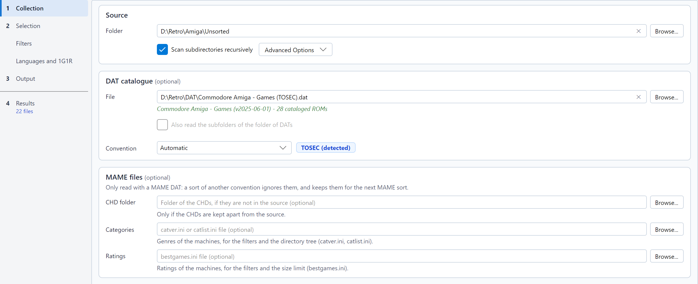

# Naming conventions and DAT files

## Choosing the convention

The source, the DAT file and the convention are set in the **Collection** step, in that order: the **Source** frame
(the only required field), then the **DAT catalogue** frame (optional), which also holds the convention, and, with the
MAME convention, the **MAME files** frame (optional). Without a DAT, a sentence under the field recalls that the games
are then only recognised from the names of their files. A cross at the end of a file or folder field empties it: that
is how you stop using a DAT, a CHD folder, or a category or rating file.



The **Convention** list, in the *DAT catalogue* frame, offers:

* **Automatic**: the convention is deduced from the DAT header, or from the file names. The badge
  next to the list shows the result, for instance *No-Intro (detected)*. It appears as soon as the DAT is chosen,
  from its header and its first games; the whole DAT is then read in the background ("reading the DAT..." under the
  field) to show its name, its version and the number of ROMs it catalogs.
* **TOSEC**, **No-Intro** or **Redump**: forces the convention.
* **MAME**: sorts arcade sets with a MAME DAT (see [MAME DATs](#mame-dats)).
* **MAME software list**: sorts the software of a console or computer list of MAME with the DAT of that list (see
  [MAME software lists](#mame-software-lists)).

The effective convention also selects the filter settings shown in the **Filters** page (TOSEC, or No-Intro / Redump,
also used for MAME and its software lists). With a [lot of DATs](#several-dats), each DAT keeps its own convention; the
effective convention is that of most of the DATs checked.

## How names are read

### TOSEC

A TOSEC name holds its information in a fixed order:

```
Title v1.1 (demo) (1991)(Publisher)(System)(Video)(Country)(Language)(Copyright)(Status)(Media)[flags].ext
```

For instance `Another World v1.1 (1991)(Delphine)(FR)(Disk 1 of 2)[cr Quartex].adf`. RomSieve reads the title,
the version, the date, the publisher, the system (A500, AGA, C64...), the video standard (PAL, NTSC), the countries,
the languages (`en`, `fr-de`, `M3` for "3 languages"), the media (*Disk 1 of 2*, *Side B*, *Tape 1*) and the flags in
brackets:

| Flag | Meaning |
|---|---|
| `[!]` | Verified dump |
| `[a]`, `[a2]` | Alternate dump |
| `[b]` | Bad dump |
| `[o]`, `[u]` | Overdump, underdump |
| `[v]` | Infected by a virus |
| `[cr]`, `[t]`, `[h]`, `[f]`, `[m]`, `[p]` | Crack, trainer, hack, fix, modification, pirate release |
| `[tr Fr]` | Translation |

A file whose name does not follow at least `Title (date)(publisher).ext` is **non-conforming**.

### No-Intro and Redump

```
Title (Region) (Languages) (Rev 1) (Beta) (Disc 2).ext
```

For instance `Super Mario World (USA).sfc` or `Final Fantasy VII (Europe) (Disc 1).cue`. RomSieve reads the regions,
the languages, the revision, the development status (Beta, Proto, Sample...), the unofficial releases (Unl, Pirate,
Hack...), the modern re-releases (Virtual Console, Switch Online, Classic Mini...) and the disc number.

The No-Intro DATs of floppy disks (Acorn Archimedes...) number the disks `(Disk 1)`, `(Disk 2)`..., sometimes with a
label: `(Disk 1, Game Disk)`, `(Disk 2 - Courses)`. RomSieve reads them as the disks of one set, kept or left out
together by 1G1R, even when the DAT describes each disk as a game and makes the disks clones of one of them. Without a
total in the name, the set counts as many disks as the highest number found.

### Optical media

A descriptor (`.cue`, `.gdi`, `.ccd`) and its tracks (`.bin`, `.img`, `.sub`...) form a **set**: they are analyzed,
renamed and transferred together, on disk as well as inside archives. When a set has to be renamed to avoid a conflict,
the descriptor is rewritten to point to the renamed tracks.

## DAT files

A DAT file lists the ROMs of a collection with their name, size and checksums (CRC32, often MD5 and SHA-1). RomSieve
reads the **Logiqx XML** (`.dat`, `.xml`) and **ClrMamePro** (`.dat`) formats published by TOSEC, No-Intro and Redump.

With a DAT:

* each file is identified by its **size and CRC32**, even if it is badly named; its name in the DAT is then used;
* a file absent from the DAT is **non-conforming** and goes to `_unmatched/`;
* the **parent / clone** relations of the DAT help group the releases of a game for 1G1R;
* the banner shows the **completion** of your collection, and you can [export the missing ROMs](exports.md).

Some details:

* The CRC32 is only computed for files whose size exists in the DAT, which saves time on large collections.
* **Copier headers** (for instance the 16-byte header of NES ROMs) are detected: when the size without the header is
  the one of the DAT, the checksum is computed without it.
* A ROM present in several games of the DAT marks all of them as found.

### Verify the SHA-1

The CRC32 is short: two different files may share it. With **Verify SHA-1** checked (in the
[advanced options](settings-and-profiles.md)), RomSieve also computes the SHA-1
of each file identified by its CRC32 when the DAT provides one (Redump DATs do), and rejects the match if it differs.
It is safer but slower, since each identified file is read again (a file inside a ZIP has to be decompressed).

### Verify the content of the archives

A file in an archive (ZIP, 7z, RAR) is identified by the CRC32 the archive records for it, without being read, and a
MAME set is copied as it is: a damaged archive whose header is right passes for complete. With **Verify archive
contents** checked (in the [advanced options](settings-and-profiles.md)), RomSieve decompresses every file of every
archive and compares its content with that CRC32, as the *full scan* of a ROM manager does. A damaged file is
non-conforming ("File damaged in its archive"), and a game with a damaged track is damaged as a whole; a damaged MAME set
is non-conforming ("Damaged archive"), its ROMs counted as missing: repair it with a ROM manager. The first analysis
is much slower, since every archive is decompressed; the result is then kept in the cache of the headers, and only a
new or changed archive is read again. A file of a 7z or RAR archive that records no CRC32 cannot be verified.

### Calculation speed

**CRC computation**, in the [preferences window](settings-and-profiles.md), sets how many files are hashed at the same time: *1 file at a time* suits a hard disk drive best;
2, 4, 8 or *Automatic* speed the analysis up on an SSD, an NVMe drive or a fast NAS. The result never depends on it.
It is a sort option: it is saved in the profiles, and loading a profile can change it. The checksums are cached: a second analysis of unchanged files is much faster.

### MAME DATs

A MAME DAT (the output of `mame -listxml`, or a *non-merged* or *merged* DAT made by SabreTools) makes the **MAME**
convention detected: the badge shows *MAME (detected)*. It can also be chosen in the list, but it requires a MAME DAT.

With this convention, the unit is the **set**: an archive (ZIP or 7z) bearing the short name of a machine (`sf2.zip`).

* An archive is identified by its name, or failing that by the ROMs it holds: a renamed archive is written under the
  short name of its machine. The ROMs are compared by their size and the CRC32 recorded in the archive, without
  decompression.
* The title, region, date, revision, version and status (bootleg, hack, prototype) come from the **description** of
  the machine in the DAT, and so do the year and the manufacturer (`{year}`, `{publisher}`).
* A CHD stored in the folder of its set (`area51/area51.chd`) is identified by the SHA-1 of its header and follows its
  set, into a folder of the same name. The disk of a clone stored in the folder of its parent (*merged* CHDs) stays
  there: MAME looks for it there too. When the CHDs are stored apart (a `CHD` folder next to the ROMs, as in a *full
  set*), enter that folder in the **CHD folder** field of the *MAME files* frame of the *Collection* step (always shown, in the colours of MAME with the MAME convention): its CHDs
  are read in addition to the source, and its other files are ignored. The destination must not overlap that folder,
  any more than the source. A sort of another convention never reads it: the folder stays in the settings for the next
  MAME sort, without a word in the log.
* The DAT does not tell the genre of a machine: enter a category file in the **Categories** field of the *Collection*
  step (see [Machine categories](#machine-categories)).
* A set that lacks ROMs or a disk is **incomplete**; with **Complete sets only**, it is excluded. The ROMs a game
  shares with its BIOS may stay in the set of the BIOS (`neogeo.zip`), as in *merged* and *split* collections: the
  game is complete when that set is in the source, and reported when it is missing. The same goes for the *devices*
  with ROMs a game uses (`qsound` for the CPS2 games): unless its set holds their ROMs (a *fully non-merged* set), the
  game needs their sets, and is incomplete without them.
* The sets a kept set needs to run (its BIOS, its *devices*, the parent of a *split* clone) are **sorted with it**,
  even when a filter or 1G1R excludes them; the table shows the **Required** badge and gives the reason (*the set … needs it to run*). A
  [partial sort](simulation-table.md#sorting-part-of-the-simulation) adds them to the chosen games in the same way.
* For 1G1R, a clone joins its parent (`cloneof` relations of the DAT; a SabreTools DAT has none, so its sets are
  grouped by title). Two games with the same title but different parents stay apart, and a BIOS or a *device* is a game
  of its own.
* The filters use the **No-Intro / Redump** settings (a bootleg counts as a pirate release) and the
  [MAME machines](filters.md#mame-machines) group: BIOS, *devices*, mechanical machines, machines needing artwork,
  emulation statuses kept, sound, and the cabinet (screen orientation and type, players, controls, buttons). 1G1R prefers the best emulation (*MAME emulation* criterion).
* An archive is transferred as it is, even in ZIP mode, and is never renamed: in a conflict with the *Rename* mode, it
  is skipped as a duplicate, since MAME only finds a set by its name.
* MAME does not look for sets in subfolders: choose **All at the root** (*Layout* line of the *Directory tree* frame, *Output* step); the pattern preview reminds you of it.

#### Romset types

RomSieve sorts the archives as they are: it never rebuilds, repairs nor converts a set.

| Romset | An archive holds | With RomSieve |
|---|---|---|
| *non-merged* | All the ROMs of its machine, BIOS included | Each parent and each clone is a set of its own: 1G1R and the filters choose between them. |
| *merged* | The parent and all its clones | Sorted as it is, with its clones: 1G1R and the filters choose the whole archive, not a clone. |
| *split* | Only the ROMs of its own machine | A parent is sorted normally. A clone does not run without the set of its parent: it is reported, and in 1G1R it always loses to its complete parent. |

In a *merged* or *split* collection, the games take from the BIOS sets the ROMs they share with their BIOS: put the
BIOS and *device* sets in the source, and RomSieve sorts those the kept games need.
To change the romset type, use a romset manager such as clrmamepro or RomVault.

*Samples* are not supported, and a file outside an archive (except a CHD) is not a MAME set.

#### Machine categories

The MAME DAT does not tell the genre of a machine. The community publishes category files, which RomSieve reads when
you enter one in the **Categories** field of the *Collection* step (`--categories` option on the command line):

* `catver.ini`: a `[Category]` section of `machine=Genre / Subgenre` lines;
* `catlist.ini` and `genre.ini` from progettosnaps: one section per category, followed by its machines. `catlist.ini`
  marks the arcade machines (`Arcade: Shooter / Flying Vertical`): it allows excluding the consoles, computers and
  other non-arcade machines of a *full set*.

A category followed by `* Mature *` marks a machine for adults. A clone the file does not list takes the category of
its parent. The categories feed the [filters](filters.md#categories), the search of the table and the `{genre}` and
`{category}` variables of the [folder pattern](destination-and-transfers.md). A missing or unreadable file is reported
in the log, and the sort goes on without categories.

#### Machine ratings

progettosnaps also publishes `bestgames.ini`, which rates a few thousand arcade games out of 100, by range of ten (from
`0 to 10 (Worst)` to `90 to 100 (Best Games)`). Enter it in the **Ratings** field of the *Collection* step
(`--ratings` option on the command line): a clone takes the rating of its parent, and a machine the file does not list
is *unrated*. The ratings feed the [rating filters and the size limit](filters.md#ratings-and-size); the detail panel
of the table shows them.

### MAME software lists

Besides its arcade machines, MAME emulates consoles and computers, whose cartridges, disks and tapes it describes in
*software lists*: one list per kind of media (`megadriv` for the Mega Drive cartridges, `a2600`, `cpc_flop`...). A
*Software List ROMs* collection holds one folder per list, and one archive per software in it
(`megadriv/sonic.zip`). RomSieve reads two kinds of DATs for a list:

* the **SabreTools DAT** of the list (Pleasuredome, ROMVault: `megadriv.xml`), whose header bears the name of the list;
* the **hash file** of the list that MAME ships in its `hash` folder (`hash/megadriv.xml`), which also says the
  parent of each clone and how well MAME supports each software;
* the **output of MAME** for the list, which says the same: `mame -getsoftlist megadriv > megadriv.xml`. In Windows
  PowerShell, a redirection rewrites the accented characters of the descriptions: run the command in the command
  prompt (`cmd`), or use the hash file.

Each of these DATs makes the **MAME software list** convention detected (the badge shows *MAME list (detected)*), from the
publisher its software name. The convention can also be chosen in the list, but it requires the DAT of the list.

To sort **one list**, choose its DAT and, as the source, the folder of the list (`Software List ROMs/megadriv`).

To sort **several lists at once**, choose a **folder of DATs**: **Browse...** next to the DAT field, then **Folder of
DATs…**, or `--dat <folder>` on the command line. The folder holds a DAT per list: the *Software List
ROMs* folder of the `DatRoot` of ROMVault, or the `hash` folder of MAME. An output of MAME that holds several lists
(`mame -getsoftlist`, `mame -listsoftware`) works the same way. The source is then the folder that holds a folder per
list (`Software List ROMs`), and **Scan subdirectories recursively** must be checked.

* Each archive belongs to the list of its folder (`megadriv/sonic.zip`) and is only looked for in the DAT of that list:
  `sonic` of `megadriv` and `sonic` of another list are two software, two games, each sorted into its folder. The source
  may also be the folder of a single list.
* A file outside the folder of a list (at the root of the source), or in a folder that no DAT names, is
  **non-conforming**; the log counts them and names a few.
* The completion and the Miss List only count the lists present in the source: a DAT of the folder whose list the
  source does not hold adds nothing missing. The Miss List names each software with its list (`gamegear/shinobi`).
* The filtered DAT of the catalog, the DAT of your collection and the fixdat are written as **a DAT per list** (as in
  the `DatRoot` of ROMVault), at the root of the folder chosen: `megadriv.xml`, `gamegear.xml`... Read from the `hash`
  folder of MAME, they are written as MAME software lists, which MAME reads
  ([Exports](exports.md#mame-software-lists)).
* A folder of software lists only holds lists: lists mixed with DATs of another convention, or two DATs of the same
  list (the SabreTools DAT and the hash file of `megadriv`, for instance), are refused, and the field says why. A folder
  of No-Intro, Redump or TOSEC DATs is a [lot](#several-dats).
* The first analysis of a whole collection is long on a network share (about 131,000 archives for MAME 0.289); the
  following ones read the headers of the unchanged archives from the cache.

* As with the MAME sets, the unit is the archive of a software, identified by its short name or failing that by its
  ROMs, compared with the DAT (incomplete when it lacks a ROM), and transferred as it is, never re-zipped nor renamed.
* The title, the regions, the languages, the revision, the date of a prototype and the releases set apart (pirate,
  hack, crack, trainer, translation, prototype, demo) come from the **description** of the software, the year and the
  publisher from the DAT (`{year}`, `{publisher}`). The title is all the text outside the parentheses and the brackets:
  *Initiation au Langage Basic (CEGOS) - Volume 3* has the title *Initiation au Langage Basic - Volume 3*, so that
  each volume, level or part is a game of its own.
* A software goes into the **folder of its list**, where MAME looks for it: `megadriv/sonic.zip` under the destination.
  With **All at the root**, the destination is the ROM folder of MAME; the folders of a pattern come above that of the
  list, and the pattern preview recalls that MAME would not find the software there.
* For 1G1R, the software follow the order of the [MAME lists](languages-regions-1g1r.md#order-of-the-mame-software-lists). With
  a hash file, a clone joins its parent, even under another title (*Castle of Illusion - Fushigi no Oshiro Daibouken*
  and *Castle of Illusion Starring Mickey Mouse*), and 1G1R prefers the software MAME supports best. A SabreTools DAT has
  no parents: the software are grouped by title, so the versions of a game released under other titles stay apart.
* The filters use the **No-Intro / Redump** settings. The dump quality has no effect (a ROM marked *baddump* is the
  best dump known), nor do the unlicensed releases and the modern re-releases, which the descriptions never mark; the
  [MAME machines](filters.md#mame-machines) group only applies to the machines of a MAME DAT.
* Some lists of computers describe a software disk by disk (*Disk 1 of 2*, *Disk 2 of 2*): each disk is then a game of
  its own, so that 1G1R keeps all of them, possibly from different releases.

**Split sets.** The Pleasuredome collections are *split*: the archive of a clone only holds the ROMs it does not share
with its parent. With the hash file, RomSieve knows it: a kept split clone takes its parent with it (the **Required**
badge), as MAME needs it. A SabreTools DAT lists only the own ROMs of a clone and names no parent: the clone looks
complete, and nothing tells that it needs its parent. In MAME 0.289, this concerns 868 of the 41,505 clones of the
lists, most of them in `nes` (416) and `msx2_flop` (114); use the hash file for these lists.

## Several DATs

A No-Intro, Redump or TOSEC pack holds hundreds, even thousands of DATs, one per system. Rather than sorting the source
once per DAT, choose the **folder** that holds them: **Browse...** next to the DAT field, then **Folder of DATs…**
(`--dat <folder>` on the command line). This folder is a
**lot**: the source is analysed once, each file is sorted with the DAT that knows it, and each DAT keeps its
convention, its filters and its 1G1R.

### DATs in an archive

The DAT may also be a **ZIP, 7z or RAR archive**, as it was downloaded: choose it with **Browse...** (**DAT file…**),
or `--dat pack.zip` on the command line. RomSieve reads it without extracting anything, and only takes its `.dat` and
`.xml` files.

* An archive that holds **a single DAT** (a Redump DAT, for instance) is that DAT: everything goes as if you had chosen
  the file itself.
* An archive that holds **several DATs** (a No-Intro daily pack, a TOSEC pack) is a **lot**, like a folder of DATs: the
  **DATs of the lot** window opens once its DATs are read, and the lot bears the name of the archive, without its
  extension. All its DATs are read, whatever their folder in the archive, and these folders can be mirrored in the
  destination like those of a folder of DATs.
* An archive that holds no DAT, or that cannot be read, is refused, and the information line says so.
* A MAME software list in MAME's own format (a `hash/<list>.xml` file) read from an archive is exported as an XML DAT,
  not in MAME's format.

### Choosing the DATs of the lot

Under the field, the information line sums the lot up: *Lot of 3111 DATs (2900 TOSEC, 150 No-Intro, 61 Redump), 3111
checked*. Only the headers of the DATs are read to show it, usually in a fraction of a second. While they are read,
a progress bar counts the DATs read (*1200 / 3111 DATs read*), and **Simulate (Dry-Run)** and **Start Sorting** are
greyed out: the sort waits until the DATs of the lot are known. The other settings can still be changed, and choosing
another DAT or clearing the field drops the read. On its right, the **Choose
DATs…** button (greyed out for a DAT file) opens the **DATs of the lot** window; it opens by itself when you choose a
new folder with **Browse...**, once its DATs are read (not at startup, nor when a profile is loaded). It always opens
on every DAT.

* The window gives the name and the convention of each DAT, with a box to check, and its subfolder when it is not at
  the root of the folder chosen; the tooltip of a line names its file.
* **Search a DAT** filters the list by name, path (file included) or convention, word by word like the
  [search of the table](simulation-table.md#searching): `C64 Games D64` shows the DATs that hold the three words,
  `-Demos` leaves out those that hold *Demos*; the cross at the end of the field clears the search.
* The list next to the search shows **Every DAT**, only the **DATs checked** (to find at once those you chose) or only
  the **DATs unchecked**, together with the search. A box changed keeps its line until the next change of this list or
  of the search, so that it can be changed back.
* **Check all** and **Uncheck all** apply to every DAT; when the search or the list hide some, they become **Check
  shown** and **Uncheck shown**, and only touch the DATs shown.
* **OK** keeps your choices; **Cancel** (or Escape) puts the boxes back as they were when the window opened.
* A DAT unchecked is not read by the sort: its files are non-conforming if no other DAT knows them. The DATs unchecked
  are saved in the settings and the profiles; on the command line, `--dat-only <name>` chooses the DATs to use.
* **Also read the subfolders of the folder of DATs**, under the information line, adds the DATs of its subfolders to
  the lot (a TOSEC pack sorted by maker, the No-Intro and Redump folders of a pack; `--dat-recursive`). The box is
  greyed out for a DAT file and for an archive, whose DATs are all read.

A folder (or an archive) is refused, and the information line says why, when two of its DATs bear the same name (case
ignored), when it holds a DAT of MAME machines (to choose alone), when it mixes MAME software lists with other DATs, or
when all its DATs are unchecked.

### Conventions of a lot

Each DAT keeps the convention of its header: a lot may mix TOSEC, No-Intro and Redump DATs, each read with its names and
filtered with its settings of the **Filters** page. The convention chosen in the **Convention** list only applies to the
DATs no header tells; the log names the DATs whose detected convention wins over it. The badge and the **Filters** page
follow the convention of most of the DATs checked; **Settings for:** shows the settings of the other family. The TOSEC
variables of the pattern stay active as soon as a TOSEC DAT is checked.

### Sorting with a lot

* Each file is sorted with the **first DAT**, in the order of the paths, that knows it by its size and CRC32 (or, for a
  CHD, by the SHA-1 of its disk). A descriptor and its tracks go together, with the DAT of their first file known.
* The other DATs that know it are named in the log and in the detail panel of the
  [simulation table](simulation-table.md): its ROMs count as present there, but it is written once, with its DAT.
* A file no DAT knows is **non-conforming**, as with a single DAT.
* The same title in two DATs makes two games: 1G1R keeps a release in each, a manual 1G1R choice only applies to its
  DAT, and a multi-disk game is only complete with the disks sorted with its DAT.
* Each DAT gets its own **folder** in the destination by default; see
  [A folder per DAT](destination-and-transfers.md#a-folder-per-dat).
* The **completion** of the banner gathers every DAT; its tooltip details each DAT with a game found. The Miss List and
  the fixdat only list the DATs with ROMs missing and at least a game found ([Exports](exports.md#lot-of-dats)).

Only the DATs that may know a file of the source are read whole, once the checksums are computed: sorting a small source
with a whole TOSEC pack (3,000 DATs, more than a million ROMs) only keeps a few tens of MB in memory. A source that
touches every DAT reads them all, twice (the lot, then each DAT): about 1.8 GB of memory for a whole pack.

## Archives

With **Inspect archives (ZIP, 7z, RAR)** (advanced option, checked by default), RomSieve lists the files inside each archive and
identifies them by the CRC32 recorded in the archive, without extracting anything. The kept files are extracted by the
sort; the archive itself stays in place, **even in Move mode**.

* A member of a 7z or RAR archive without a recorded CRC32 cannot be identified against the DAT.
* In a *solid* 7z, extracting a file requires decompressing its block from the start: extraction is slower.
* An unreadable archive is treated as an ordinary file.
* A file whose name in the archive is an absolute path or holds `..` is never written: see
  [Safety, purge and undo](safety-and-undo.md).

## CHD files

RomSieve reads the header of `.chd` files (versions 3 to 5) and their track list without decompressing them. An
unreadable or incomplete CHD is non-conforming.

* With a MAME-style DAT, which lists CHDs as *disks*, a CHD is identified by the SHA-1 of its header.
* A Redump DAT describes the tracks of a disc (`.bin`, `.cue`), not the CHD that compresses them, so a CHD can never
  match it by checksum. **Identify CHDs by their name** (advanced option) links a CHD to the DAT game that has exactly its
  name. The content is not verified: such files are shown as *identified by name, not verified* and counted apart in
  the completion.
