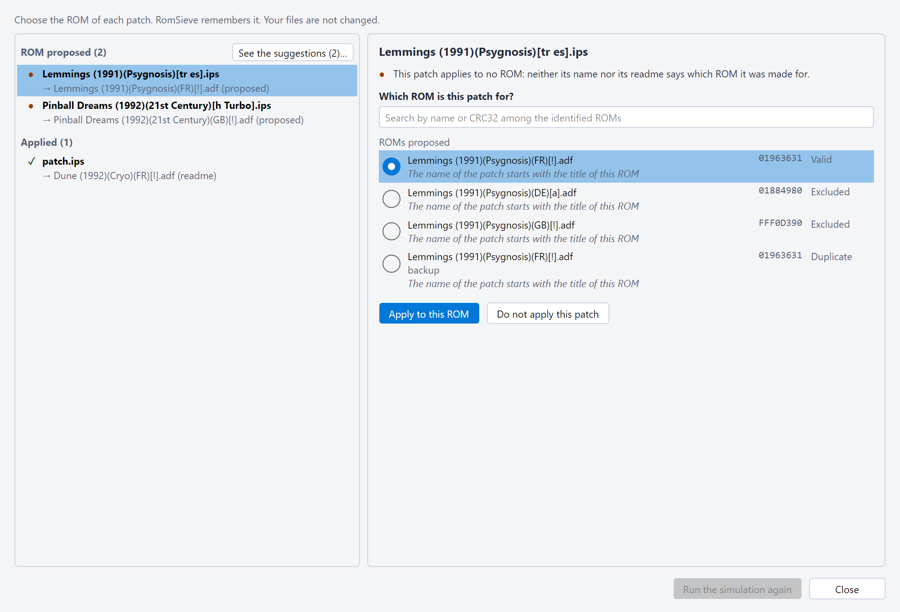

# Patches

A patch is a small file that only holds the **differences** between a ROM and a modified version of it: a
translation, a bug fix, a hack. It is shared instead of the modified ROM, since sharing the ROM would mean sharing the
game; each user applies it to their own copy.

RomSieve applies the patches of a folder to the ROMs of your collection: each patch whose original ROM is identified in
the source gives a **patched version**, written in the destination next to the original version, or in a folder of its
own (see [A folder for the patched versions](#a-folder-for-the-patched-versions)). The original ROM is **never
modified**.

A patch only applies to the exact ROM it was made for: same region, same revision, same dump. RomSieve finds it for you
by its checksum (CRC32), which needs a [DAT file](naming-conventions-and-dats.md#dat-files).

## Supported formats

| Format | Extension | Original ROM found by | Checks |
|---|---|---|---|
| **IPS** | `.ips` | your choice, otherwise the CRC32 written in the name of the patch, or in its readme (see [Matching](#matching)) | none: the format records no checksum |
| **IPS32** | `.ips` or `.ips32` | your choice, otherwise the CRC32 written in the name of the patch, or in its readme | none |
| **UPS** | `.ups` | the CRC32 and the size it records | CRC32 of the patch, of the original ROM and of the result |
| **BPS** | `.bps` | the CRC32 and the size it records | CRC32 of the patch, of the original ROM and of the result |

The format is read from the content of the file, not only from its extension. UPS and BPS are the safest: they only
apply to the right ROM and check their result. A damaged or truncated patch is refused before it is applied.

The other formats (xdelta, PPF, APS, BSDiff…) are not supported: their files are ignored. MAME arcade sets and the
software of MAME software lists are never patched.

## Folder of the patches

In the **Collection** step, the **Patches** card has the **Folder of the patches** field, with its **Browse...** button.
It is always shown, whatever the convention. Next to its title, **Manage patches…** opens the **Patches** window on the
last simulation (see [The Patches window](#the-patches-window)); it is greyed out until a simulation found patches.

* The folder is read with its **subfolders**. Only the `.ips`, `.ips32`, `.ups` and `.bps` files are read, and the
  `.txt` and `.nfo` texts that may give the original ROM of an IPS (see [Matching](#matching)).
* The patches stored in ZIP, 7z or RAR **archives** of the folder are read too.
* The folder may be inside the source: its files are not sorted as files of the collection. If it is the source
  itself, only the patches are set aside, and your ROMs are sorted as usual.
* The destination must not overlap the folder of the patches, either way: under the **Output** step, a line says so
  (*Overlaps the patches*), and both the simulation and the sort are refused. A purge never touches the folder of the
  patches.

The **Apply the patches** box, next to the title of the card, is checked by default, and checks itself when you
choose a folder with **Browse...**. Unchecked, no patch is applied, but the folder stays in the settings and the
profiles for next time: it is not read, **Write the patched versions only** and the folder of the patched versions are
greyed out, and the log says that applying the patches is turned off. The rest does not change: a folder of the
patches inside the source is still not sorted as ROMs, and the destination still may not overlap it, so that a purge
never puts your patches in quarantine.

The log of the simulation tells how many patches were found and how many gave a patched version.

## Matching

Only a ROM **identified in the DAT** can receive a patch, whatever its status: a release left out by 1G1R receives its
patch like any other. This is often the case of a translation, made for the Japanese release of a game that 1G1R leaves
out in favour of the American release.

* **Your choice** comes first: an IPS you applied to a ROM in the **Patches** window applies to that ROM, whatever its
  name and its readme say, and a patch you set aside is never applied (see [Your choices](#your-choices)).
* A **UPS** or a **BPS** designates its original ROM by the CRC32 and the size it records.
* An **IPS** records nothing: without your choice, its name must give the CRC32 of the original ROM, as 8 hexadecimal
  digits, between brackets, between parentheses or apart from the rest of the name
  (`Game (Japan) (T-En) [47E70E08].ips`, `(0x47e70e08)`).
* An IPS whose name gives no CRC32 takes it from its **readme**, if it has one. Most patches give it, in the form
  romhacking.net uses (`File/ROM CRC32: 47E70E08`) or another (`CRC32 : 0x47e70e08`). See
  [Readme of an IPS](#readme-of-an-ips).
* An IPS without a CRC32, neither in its name nor in its readme, is not applied: choose its ROM in the **Patches**
  window (see [Choosing the ROM of a patch](#choosing-the-rom-of-a-patch)).
* A ROM with a **copier header** (iNES for the NES, 512-byte header for the Super Nintendo, Lynx header) is looked for
  in both forms, with and without its header: a patch made for either finds its ROM. The patch applies to the form it
  expects (see [NES, Lynx and Super Nintendo](#nes-lynx-and-super-nintendo) for the header of the result).
* When several files of the source have the same CRC32, the patch applies to the one the sort writes, otherwise to the
  first in the order of the paths.
* Several patches for the same ROM each give their own patched version.

### Readme of an IPS

A readme is a `.txt` or `.nfo` text file of at most 1 MB, stored next to the patch: in the same folder of the folder of
the patches, or in the same archive, at the same place. A readme on the disk never comes with a patch stored in an
archive, nor the reverse.

* A readme with the name of the patch (`Game (T-Fr).txt` for `Game (T-Fr).ips`, case ignored) is its own.
* Otherwise, the readmes of a folder or an archive that holds **a single patch** are its own.
* In a folder of several patches, a readme with the name of none comes with none: it does not tell which patch it is
  about.

For the CRC32, RomSieve only reads the lines where the word **CRC** appears, and on them the CRC32 that follow it. A
readme often also gives the CRC32 of the patched result: it designates no ROM of the source, and it is ignored. Your
choice, then the name of the patch, always prevail over its readme, and a UPS or a BPS, which records its original ROM
itself, never reads its own.

A readme sometimes gives the CRC32 of a ROM **with and without its copier header**, on two lines (for example
`File CRC32` and `ROM CRC32`). An IPS does not tell which of the two forms it expects: RomSieve does not apply it. The
readme usually tells which form the patch was made for: then choose that form in the **Patches** window (see
[Choosing the ROM of a patch](#choosing-the-rom-of-a-patch)).

The detail panel of a patched version names the readme that gave the CRC32.

A readme often also names the ROM the patch was made for, by its No-Intro name followed by its extension
(`Make sure to use the "Super Mario Bros. 2 (USA).nes" ROM`, `Mega Man 2 (USA).nes - NOINTRO`, or after
`Database match:`). When no CRC32 designates a ROM of the source, RomSieve **proposes** the ROM so named in the
**Patches** window ("readme.txt gives the name of this ROM"), never applying it on its own: a readme may name another
revision, or a ROM that must be translated first. The name is compared with those of the DAT, case ignored, as a file
name and as the name of the game (a readme writes `.nes` where a DAT without header writes `.unh`). A GoodTools name
(`(U) [!]`) or an approximate one designates no ROM. When the ROM named is in the DAT but not in the source, the reason
of the patch names it.

## The patched version

* **Name**: that of the original ROM, followed by a label of the patch in square brackets, with the extension of the
  original ROM (see [Name of the patched version](#name-of-the-patched-version)).
* **Folder**: the one the original ROM would have in the destination, even when 1G1R leaves it out, or the one the
  **Patched versions** field of the **Output** step gives (see
  [A folder for the patched versions](#a-folder-for-the-patched-versions)).
* **Game**: the patched version belongs to the game of its original ROM. It stays outside 1G1R, multi-disk sets and
  filters: it is never left out instead of its origin, and never leaves it out.
* **Conflicts**: a collision with a file already in the destination follows the chosen conflict mode (see
  [Conflicts](destination-and-transfers.md#conflicts)). If two patches give the same name (the same patch as an IPS and
  as a BPS, for example), the second patched version takes the suffix `_01` whatever the mode: both are written.

### NES, Lynx and Super Nintendo

A patch made for the whole file of a ROM with a copier header gives a result that has one: it is written as the patch
produces it. A patch made for the data without the header gives data alone:

* for the **NES** (iNES header, 16 bytes) and the **Lynx** (Lynx header, 64 bytes), RomSieve writes the header of the
  original ROM in front of them, since most emulators of these systems need it: the patched version starts like its
  original ROM;
* for the **Super Nintendo**, the patched version stays without its 512-byte copier header, which emulators do without.

When such a patch changes the size of the data (a patch that enlarges the ROM), the header is written as it is, and
may no longer give their right size: the log says so for each patched version concerned. A patch made for the whole
file, which can update the header itself, does not have this problem.

The header must still be the one of the original ROM when the patch is applied: a header changed since the simulation
puts the patched version in **Error**, without writing anything.

### Name of the patched version

The name always starts from that of the original ROM, as the DAT gives it: the region and the revision come from the
DAT, never from the author of the patch, and each patched version sorts next to its original ROM. The label in square
brackets comes from the name of the patch:

| Patch | Original ROM | Patched version |
|---|---|---|
| `Game (Japan) (T-En).bps` | `Game (Japan).sfc` | `Game (Japan) [T-En].sfc` |
| `Game (T-En v1.2).bps` | `Game (Japan).sfc` | `Game (Japan) [T-En v1.2].sfc` |
| `Game (T-En) [47E70E08].ips` | `Game (Japan).sfc` | `Game (Japan) [T-En].sfc` |
| `SMB3_eng_v1.2.ups` | `Super Mario Bros. 3 (Japan).nes` | `Super Mario Bros. 3 (Japan) [SMB3_eng_v1.2].nes` |
| `Alpha (1990)(Ocean)[h Hack].bps` | `Alpha (1990)(Ocean).adf` | `Alpha (1990)(Ocean)[h Hack].adf` |

* What repeats the original ROM is removed: its whole name or its title, when the name of the patch starts with them,
  and its CRC32, with its brackets or parentheses. The parentheses and brackets left are removed.
* Square brackets mark a modified dump, as in TOSEC (`[h]`, `[tr]`): in No-Intro and Redump, parentheses describe an
  official release. For a TOSEC ROM, the label follows the name without a space, as a TOSEC flag.
* A **generic** patch name (`patch`, `patched`, `hack`, `fix`, `translation`, `rom`, `game`, `english`, `eng`, `update`,
  or a version alone such as `v1.1`) gives way to the name of the archive that holds the patch, or of its folder in that
  archive, then to the name of its folder in the patch folder, if that folder holds no other patch (a folder of several
  patches sorts them, by system or by kind, and tells nothing of each one). `CT Translation/patch.ips` gives
  `Chrono Trigger (Japan) [CT Translation].sfc`. Without a better label, the generic name is kept.
* A patch that gives no label (named as its original ROM, as emulators that apply a patch when they start a game ask)
  takes the label `patched`: `Game (Japan) [patched].sfc`. The patched version never has the name of its original ROM.

### Write the patched versions only

Check **Write the patched versions only**, in the **Output** step, under the **Patched versions** field (*Directory
tree* frame), so that a game that has a patched version is only written
in that form. With 1G1R, the ROM kept for that game is not written, even when the patch was made for another release of
the game: a patch made for `Game (World) (Collection).md`, which 1G1R leaves out for `Game (World).md`, gives the only
patched version, and `Game (World).md` is not written. Without 1G1R, each ROM kept is a choice of its own, and only the
original ROM of the patch is replaced. The table shows a ROM replaced **Excluded**, with the reason *Replaced by a
patched version*; a ROM that 1G1R already left out keeps its reason. With the option unchecked, the ROM kept and the
patched version are both written. The option is greyed out without a folder of the patches, or with **Apply the patches** unchecked.

## A folder for the patched versions

By default, a patched version goes into the folder of its original ROM. The **Patched versions** field of the
**Output** step, in the *Directory tree* frame, under the **Pattern**, puts it elsewhere, for two uses:

* **keeping a clean set**: a DAT manager that checks the folder of a DAT finds no unknown file in it, since the patched
  versions are kept out of that folder;
* **showing the patched versions apart** in a frontend, in a folder of their own or in a subfolder of each game.

The field is a pattern of folders, like the **Pattern** (see [Variables](destination-and-transfers.md#variables)), but it
starts from the **root of the destination**, even with **All at the root**: the folders of a lot of DATs are not added
to it on their own. Its variables take the values of the original ROM (`{title}`, `{dat}`, `{publisher}`…), even when
1G1R leaves it out, and two variables exist for it alone:

| Variable | Content |
|---|---|
| `{origin_folder}` | The whole folder the original ROM goes into: the folder of its DAT in a lot (under the folders of its path when they are mirrored), then the folders of the pattern; none with **All at the root** |
| `{dat_folder}` | The folder of the DAT of the original ROM in a lot, under the folders of its path when they are mirrored; none for a single DAT, or without **A folder per DAT** |

Each makes up a folder on its own, between two `/`: `{origin_folder}/Patches` is allowed, `{origin_folder}-patches` is
not. Empty, the field (*Next to the original ROM*) gives the same folder as `{origin_folder}`.

Examples with `Chrono Trigger (Japan).sfc`, the pattern `{title}` and a `(T-En)` patch:

| Patched versions | Single DAT | Lot, a folder per DAT | Lot, folders of the DATs mirrored (`No-Intro/`) |
|---|---|---|---|
| *(empty)* | `Chrono Trigger/` | `Nintendo - SNES/Chrono Trigger/` | `No-Intro/Nintendo - SNES/Chrono Trigger/` |
| `Patches/{title}` | `Patches/Chrono Trigger/` | `Patches/Chrono Trigger/` (every DAT together) | `Patches/Chrono Trigger/` |
| `Patches/{dat}/{title}` | `Patches/Nintendo - SNES/Chrono Trigger/` | `Patches/Nintendo - SNES/Chrono Trigger/` | `Patches/Nintendo - SNES/Chrono Trigger/` |
| `{dat_folder}/Patches` | `Patches/` | `Nintendo - SNES/Patches/` | `No-Intro/Nintendo - SNES/Patches/` |
| `{origin_folder}/Patches` | `Chrono Trigger/Patches/` | `Nintendo - SNES/Chrono Trigger/Patches/` | `No-Intro/Nintendo - SNES/Chrono Trigger/Patches/` |

The file keeps its name there, `Chrono Trigger (Japan) [T-En].sfc` (a `.zip` archive in ZIP mode). The `_unmatched`
folder of the non-conforming files stays at the root: a patched version never goes there, since its original ROM is
identified.

* **Insert Variable** inserts a variable at the caret of the field: those of the pattern, then **Folder of the original
  ROM** (`{origin_folder}`) and **Folder of the DAT** (`{dat_folder}`, greyed out outside a lot with **A folder per
  DAT**).
* **Presets**: **Next to the original ROM** (empty field), **Subfolder of the original ROM** (`{origin_folder}/Patches`)
  and **Folder at the root** (`Patches/{dat}/{title}`), which leaves the folder of each DAT without unknown files.
* The field and its menus are **greyed out without a folder of the patches**, or with **Apply the patches** unchecked,
  since nothing patched would be written; the field keeps its value, saved in the settings and the profiles.
* When the patches are applied, the [live preview](destination-and-transfers.md#live-preview) shows, in place of its
  third example, where the patched version of the first one would go: *Patched version: …*.

Nothing is written outside the destination. A folder that would leave it, or write into the folders RomSieve keeps for
itself, is **refused**: a path that starts with `/` or `\`, a drive (`C:`), a `..` folder, a character forbidden in a
name (`< > : " | ? *`), `_purged` or `.romsieve` as first folder, `{origin_folder}` or `{dat_folder}` that is not a
folder on its own. The preview says why, a line says so under the **Output** step (*Patched folder refused*), and both
the simulation and the sort are refused before anything is written. An unknown variable, a brace without its pair or an
`_unmatched` folder are only a warning of the preview, as for the pattern.

Changing the folder of the patched versions makes the last simulation out of date; the next one marks the patched
versions alone *Changed*. **Undo Last Sort** deletes them, and the folders it empties.

## Transfer modes

| Mode | Patched version |
|---|---|
| **Copy** | A file, written next to the original ROM or in its [folder](#a-folder-for-the-patched-versions) |
| **Move** | A file, written **before** the original ROM leaves the source. With *Write the patched versions only*, the ROM it replaces stays in the source. |
| **Hard link**, **Symlink** | A **copy**: a link cannot hold modified data. The log says so. |
| **ZIP** | An archive of its own, in the TorrentZip format, like that of any other game, in the same folder |

An original ROM stored in an archive is extracted next to the target while the patch is applied, then deleted. The
archive is never modified.

The writing follows the same safety rules as any other (see [Safety, purge and undo](safety-and-undo.md)): the file only
appears under its name once complete, and a stopped or failed sort leaves no truncated file. The CRC32 of the original
ROM is checked while the patch is applied: a ROM modified since it was identified is refused, even for an IPS. For a UPS
or a BPS, the CRC32 of the result is checked too: a wrong result puts the patched version in **Error**, leaving nothing
in the destination. With **Verify copied files**, the patched version is read again once written.

## Patches not applied

A patch that gives no patched version has its line in the log, with its reason:

| Reason | What to do |
|---|---|
| The original ROM, *name*, is missing from the source (or: a readme designates the original ROM, *name*, …) | The DAT knows this ROM, but the source does not have it: add it to the source. In a lot, the DAT of the ROM follows its name |
| A readme names the original ROM, *name*, which is missing from the source | The readme gives no known CRC32, but names a ROM of the DAT: add it to the source, or check the revision the readme expects |
| No ROM of the DAT has this CRC32: the patch was made for another dump or for a hack | Look for the ROM the readme of the patch asks for; for an IPS, choose a ROM for it in the **Patches** window |
| No ROM of the DAT has this CRC32: … or for another form of the ROM than the one the DAT describes (with another copier header, or without) | For the NES, the Lynx or the Super Nintendo, the patch may have been made for the ROM with a header (or another header) when the DAT describes it without, or the reverse: a DAT of the other form will name it. For an IPS, choose its ROM and its **Form** in the **Patches** window |
| Neither the name of the IPS patch nor a text that comes with it gives the CRC32 of the original ROM | Choose its ROM in the **Patches** window (see [Choosing the ROM of a patch](#choosing-the-rom-of-a-patch)) |
| Unreadable patch | The file is truncated, damaged, or of another format |
| The name of the patch gives the CRC32 of several ROMs of the source | Choose the right ROM in the **Patches** window |
| A readme gives the CRC32 of several ROMs of the source | Choose the right ROM in the **Patches** window |
| A readme gives the CRC32 of a ROM with and without its copier header | Choose in the **Patches** window the form it was made for |
| The ROM you chose for this patch is not identified in the source | It left the source, or the DAT no longer identifies it: choose another one, or go back to the automatic choice |
| The original ROM is part of a game in several files | A `.cue` and its tracks, or a game on several disks: these games are not patched |
| The ROM does not have the size the patch expects | It is not the ROM the patch was made for |

A patch you set aside is not among them: the log says so apart (*Patch set aside at your request*). To silence a
patch nothing fixes, set it aside (see [Not applying a patch](#not-applying-a-patch)).

Without a DAT, the patches are not read: the log says so.

## The Patches window

The **Patches** window shows every patch of the last simulation, and it is where you tell RomSieve what to do with
them. It opens after a simulation:

* from **Manage patches…**, in the **Patches** card of the **Collection** step;
* from "*n* patches not applied" in the banner of the results, or from **View the patches** when no patch was left out;
* from the context menu of a patched version of the table, which selects its patch.

On the left, the patches are grouped by state:

* **To match** (●): the IPS that apply to no ROM, and that you can choose one for;
* **Applied** (✓): each followed by its ROM ("→ *ROM*"), with "(readme)" or "(your choice)" when its readme or you
  designate it;
* **Automatic choice** (↺): the patches whose choice you just forgot; the next simulation will tell what they do;
* **Set aside** (–): the patches you set aside;
* **Cannot be fixed** (✗): a UPS or a BPS whose ROM is missing, a patch that cannot be read… The detail gives the
  reason.

On the right, the detail of the patch selected says in plain words where it stands (for a patch applied: what
designates its ROM, and the name of its patched version), then gives its actions.

The footer counts the patches modified. **Run the simulation again** runs the simulation again, which follows your
choices: the window stays open and shows its results, on the same patch. If you close the window with choices the
simulation has not seen yet, it runs again: the table always shows what your choices give.

## Choosing the ROM of a patch

A UPS or a BPS designates its own ROM and checks it: no other one is chosen for it. For an IPS, the detail asks
**Which ROM is this patch for?**:

* **ROMs proposed**: the identified ROMs whose name or title starts the name of the patch, or that of its archive, or
  that of its folder when the folder holds it alone (`CT Translation/patch.ips`). Generic names (`patch`, `fix`, `v1.1`…)
  do not count. The whole name comes before the title alone, then the ROM the sort writes. For a patch whose name or
  readme designates several ROMs, those ROMs; for a patch applied, the ROM it is applied to. Under each ROM, its folder
  in the source tells two files of the same name apart, and a line says why it is proposed ("The name of its archive
  starts with the title of this ROM", "readme.txt designates this ROM", "readme.txt gives the name of this ROM"…). The
  ROMs the readme names come before those of the name of the patch. On the right, its CRC32 (in the DAT) and its
  status in the simulation (**Valid**, **Excluded**, **Duplicate**, as in the table), with its reason in a tooltip: a
  ROM 1G1R or a filter leaves out is proposed too, since a translation is often made for it. The first one is chosen,
  but never applied without your click.
* A **translation** is not made for a ROM already in its language: when the name of the patch has a translation tag
  (`[tr fr]` in TOSEC, `(T-En)`, `[T+Eng]`), the ROMs already in that language (from their languages, otherwise their
  country) come after the others, and say so. A patch `Game (T-En).ips` thus proposes `Game (Japan)` before
  `Game (USA)`.
* The **search**, above, looks by name or CRC32 (at least 6 hexadecimal digits, with or without `0x`) among all the
  ROMs identified by the simulation, when no ROM proposed is the right one: a translated (`Super Mario Frères.ips` for
  `Super Mario Bros.`) or shortened title proposes none. All the words, in any order. Each result (**Other ROMs**) shows
  its CRC32 and status on the right, with its full path in a tooltip. A ROM found (a click, or Enter for the first one)
  joins the ROMs proposed and becomes the choice. Ctrl+F goes to the search.
* **Form** only shows for a ROM with a copier header (NES, Super Nintendo, Lynx): the CRC32 with or without the header.
  An IPS does not tell which one it was made for: its readme usually does. NES patches are almost always made for the
  whole file, header included. A ROM of a set without headers has only one form: an IPS made for the whole file would
  apply to it 16 bytes off, with nothing to tell. Keep a ROM with its header for these patches.

**Apply to this ROM** saves your choice: the next simulation applies the patch to that ROM, whatever its name and its
readme say. The file of the patch is not changed, and a patch stored in an archive is chosen like any other. While the
current ROM of a patch applied is chosen, the button is greyed out. The Enter key never saves anything.

If a patched version does not work, because the patch was made for another ROM, choose the right one for it the same
way: your choice wins over the CRC32 of its name and over its readme.

**Accept all the suggestions (*n*)**, on the title of the **To match** group, shows the ROM chosen for each patch:
nothing is checked beforehand. Check those to apply (or **Check all**), then **Apply (*n*)**; **Back** returns to the
detail without saving anything.

## Not applying a patch

**Do not apply this patch** sets the patch selected aside, whatever its format: the next simulation does not apply it,
nor counts it among the patches not applied. It is also the way to silence a patch that applies to nothing and that
you want to keep in the folder. The context menu of a patched version of the table offers the same action, which runs
the simulation again at once.

**Back to the automatic choice** forgets your choice for a patch (a ROM chosen, or a patch set aside): the next
simulation applies it again from what it records, its name or its readme.

The patched version a sort already wrote in a destination stays in place: **Undo Last Sort** deletes it, if that sort
is the last one.

## Your choices

* RomSieve keeps your choices in the `patch_links.json` file, next to its settings (see
  [Where RomSieve stores its files](installation.md#where-romsieve-stores-its-files)). They apply to every profile.
* A patch is known there by its content, not by its name: your choice follows it if it is renamed, moved, or stored in
  an archive. Two copies of the same patch have the same choice.
* No choice changes a file. **Undo** undoes your last change to the patch selected, as long as the window is open;
  later, **Back to the automatic choice** does the same. The choices are not recorded in the journal of the sorts, and
  **Undo Last Sort** does not undo them.
* A `patch_links.json` file that cannot be read is never lost: RomSieve keeps a copy of it next to it
  (`patch_links.unreadable-<date>-<time>.json`), says so in the log, and starts again without choices.
* **For other tools**, **Write the ROM in the file name (for other tools)** renames an IPS applied to a ROM its name
  does not give yet: the CRC32 of the ROM is added before the extension (`Game (T-Fr).ips` becomes
  `Game (T-Fr) [47e70e08].ips`), or replaces the one the name gave. RomSieve does not need it, but the tools that apply
  an IPS from its name will apply it too. A patch stored in an archive is never renamed, and nothing is overwritten: a
  name already taken leaves the patch as it was, and the detail says so. **Undo** gives it back its old name. The CRC32
  added does not appear in the name of the patched version (see
  [Name of the patched version](#name-of-the-patched-version)).
* **Remove the ROM from the file name** does the reverse, for any IPS on the disk whose name designates a ROM, written by
  RomSieve or by anyone: `Game (T-Fr) [47e70e08].ips` becomes `Game (T-Fr).ips` again. This is how a name written before
  a new simulation is taken back, when **Undo** no longer can. RomSieve applies the patch as before: a patch only its
  name applied first gets your choice for the same ROM. For it to apply no more, set it aside (see
  [Not applying a patch](#not-applying-a-patch)).

## In the results

* The table marks each patched version with a **Patched** badge. In the grouped view, it follows the kept release of its
  game. The detail panel names the patch, its format and the original ROM; that of an original ROM names its patched
  versions. A patched version cannot be chosen as the 1G1R winner.
* The banner counts the patched versions in the **Patched** chip, which shows them alone, and the patches not applied in
  "*n* patches not applied", whose tooltip lists them with their reasons and which a click opens in the **Patches**
  window (see [The Patches window](#the-patches-window)). Without patches left out, **View the patches** opens the
  window.
* The context menu of a patched version opens the window on its patch (**Change the ROM of this patch…** for an IPS,
  **See this patch…** for a UPS or a BPS), and offers **Do not apply this patch**, which sets the patch aside and runs
  the simulation again (see [Not applying a patch](#not-applying-a-patch)).
* In a [partial sort](simulation-table.md#sorting-part-of-the-simulation), a patched version follows the checkbox of
  its game.
* The [exports](exports.md) describe it: the report names its patch, and the DAT of your collection writes it with its
  own checksums.

## Undo

Each patched version is recorded in the journal of the sort: **Undo Last Sort** deletes it, unless it was modified since
the sort. Your choices for the patches are not recorded in the journal: **Undo Last Sort** does not undo them (see
[Your choices](#your-choices)).

## On the command line

`--patches <folder>` gives the folder of the patches and applies them, even when **Apply the patches** is unchecked
in the settings; `--no-patches` applies none, without changing the settings; `--patch-only` only writes the patched
versions (see [Command line](command-line.md)). The folder of the patched versions comes from the settings file or the
profile; a folder refused stops `run` as well as `patches`, with code 3. The summary counts the patched versions and
the patches not applied.

`romsieve-cli patches` simulates the sort and lists all its patches: those it does not apply, with the ROMs proposed,
those it applies and what designates their ROM, and those you set aside. The choices of the window are made there too,
saved with `--yes`: `--link <patch> --rom <ROM>` applies an IPS to a ROM (its name, or the CRC32 of the form the patch
was made for, required for a ROM with a copier header), `--ignore <patch>` sets a patch aside, `--auto <patch>` forgets
your choice. `--name-from-notes --yes` writes the CRC32 in the name of the IPS applied thanks to their readme, for other
tools.
