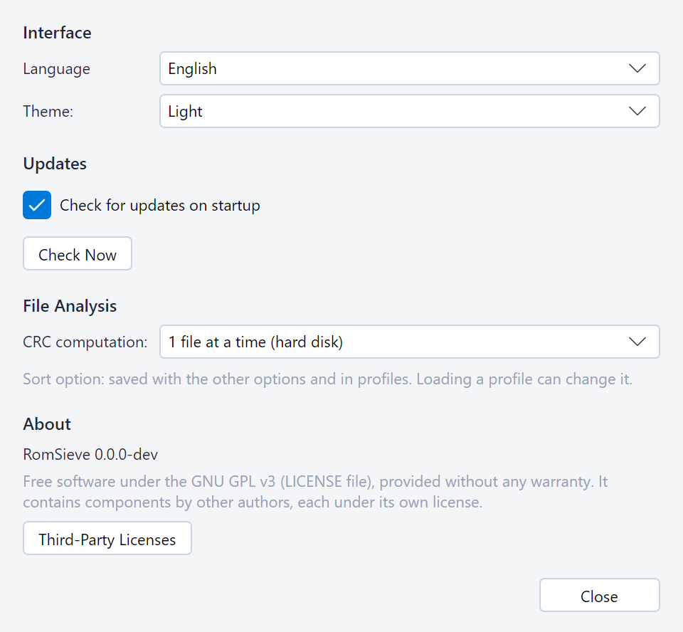
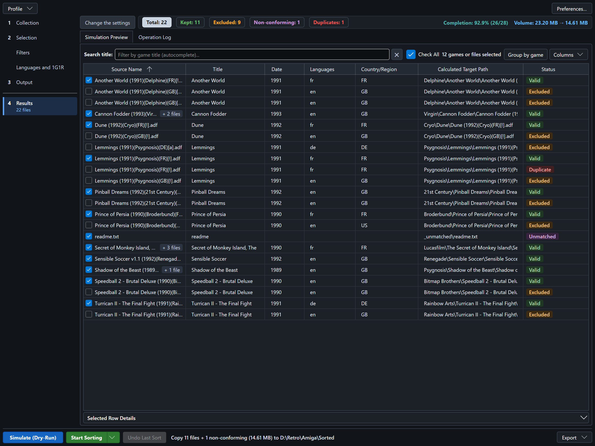

# Settings and profiles

## Preferences

The bar at the top of the window holds the **Profile** menu, with **Save as profile…** and **Load a profile…** (see
[named profiles](#named-profiles)), and the **Preferences…** button, which opens the preferences window. Its changes
apply at once; **Close** closes it.

* **Interface**:
  * **Language**: English, Français or Español. At the first launch, RomSieve takes the language of the system
    (English for any other language). The whole interface switches at once, including the lines already written in
    the log and the statuses of the table.
  * **Theme**: *Light*, *Dark*, or *System* (follows the setting of the operating system).
* **Updates**: **Check for updates on startup** and **Check Now** (see [updates](#updates)).
* **File Analysis**: **CRC computation** (see [performance settings](#performance-settings)). Unlike the other
  preferences, it is a sort option: it is saved in the profiles, and loading a profile can change it.
* **About**: the version of RomSieve and its license (free software under the GNU GPL v3, provided without any
  warranty). **Third-Party Licenses** opens `THIRD-PARTY-NOTICES.txt`, shipped next to RomSieve: the copyright
  notices and license texts of the components it contains (see [installation](installation.md)). If no application
  opens it, RomSieve gives its path, to open it with a text editor.

## Advanced options

In the *Collection* step, the **Advanced Options** button, right of *Scan subdirectories recursively*, opens a panel
over the page with the identification settings that most collections never need: **Inspect archives (ZIP, 7z, RAR)**,
**Verify SHA-1**, **Verify archive contents** and **Identify CHDs by their name**. **Verify copied files** is a box of the *Output* step, below
*Conflicts*. Click outside the panel to close it.

The button shows how many of these options differ from their default value, for instance
**Advanced Options (2 changed)**, and its tooltip names them: an option that acts does not go unnoticed.

## Saved settings

Your folders, filters, 1G1R choices, pattern, language, theme and window layout are saved in `config.json` when you
close RomSieve and before each real sort, and restored at the next launch
(see [where RomSieve stores its files](installation.md#where-romsieve-stores-its-files)). RomSieve always opens on
the **Collection** step, whatever the step shown when it was closed.

To go back to the default settings, close RomSieve and delete `config.json`.

An unreadable `config.json` (edited by hand into invalid JSON, for instance) does not stop RomSieve: it opens with the
default settings and says so with a warning in the log. As these settings will replace the file when it closes,
RomSieve first keeps a copy next to it, `config.unreadable-<date>-<time>.json`. To get your settings back, close
RomSieve, fix the copy and rename it `config.json`. If even the copy fails (file locked by another program), RomSieve
does not replace the file for the whole session.

## Named profiles

A profile stores the **sort options** of the settings steps (folders, DAT, mode, filters, 1G1R, pattern...)
under a name, to switch between several collections or configurations in one click. It does not store the language,
the theme or the window layout, but it does store the **CRC computation** of the preferences window, which is a sort
option: loading a profile can change it.

* **Save as profile…**: saves the current options. The dialog opens in the `profiles` folder next to `config.json`;
  give the profile a name (for instance `Amiga 1G1R.json`). RomSieve then shows the command that uses it from the
  [command line](command-line.md): `romsieve-cli run --profile "Amiga 1G1R"`.
* **Load a profile…**: replaces the options of the steps with those of a profile. An option absent from the file takes
  its default value. Loading a profile with another source folder forgets the manual 1G1R choices.

Profiles are ordinary JSON files, in the same format as `config.json`: you can copy them to another computer, keep them
under version control, or edit them by hand. Only the profiles of the `profiles` folder can be used with
`--profile`; a profile saved elsewhere can still be loaded from the interface.

`config.json` and the profiles hold the version of their format, `config_version`. A file without it (written by hand)
is read in the current format: an option it lacks keeps its default value. A file written by a newer version of
RomSieve is read with a warning, in the log of the interface or in the output of the command line:
the options this version does not know are ignored, and the `config.json` it saves no longer contains them.

A profile name may contain letters, digits, spaces, dashes and parentheses, but no `/ \ : * ? " < > |` and no
reserved Windows names (`CON`, `NUL`...).

## Updates

RomSieve can tell you when a new version is published on GitHub:

* **Check Now**, in the preferences window, checks at once, and tells you whether you already have the latest version.
* **Check for updates on startup** (enabled by default) checks when RomSieve starts, in the background, if the last
  check is more than 6 hours old. Nothing is shown unless a new version is available, nor if GitHub cannot be reached:
  a check that fails is tried again at the next startup.

When a new version is available, a banner appears at the top of the window. RomSieve remembers that version: the
banner comes back at each startup, without a new check, until the version is installed or ignored.

* **View release** opens the page of the release in your browser, with its notes and its downloads.
* **Ignore** hides the banner and no longer announces this version at startup; the next one will be announced.
  **Check Now** still shows it.
* The cross hides the banner until the next startup.

RomSieve never downloads or installs anything by itself. A check only asks the GitHub API for the latest published
release; the request carries the version of RomSieve and no information about your collection. Pre-releases are not
announced. Uncheck **Check for updates on startup** to keep RomSieve from going online unless you ask it to.

## Performance settings

Two options affect speed only, never the result:

* **CRC computation**, in the preferences window: number of files hashed at the same time (1 for a hard disk drive,
  more for an SSD or a NAS).
* **Inspect archives (ZIP, 7z, RAR)**, in the advanced options of the *Collection* step: disable it if your
  archives are not ROM containers, to save time.

Three other options trade speed for safety: **Verify SHA-1** and **Verify archive contents** (advanced options of the
*Collection* step), and **Verify copied files** (*Output* step) (see
[Naming conventions and DAT files](naming-conventions-and-dats.md) and
[Destination and transfers](destination-and-transfers.md)).
