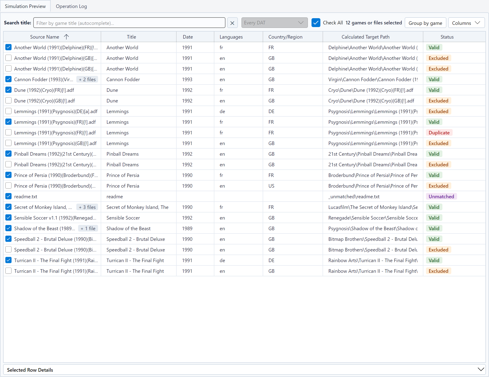
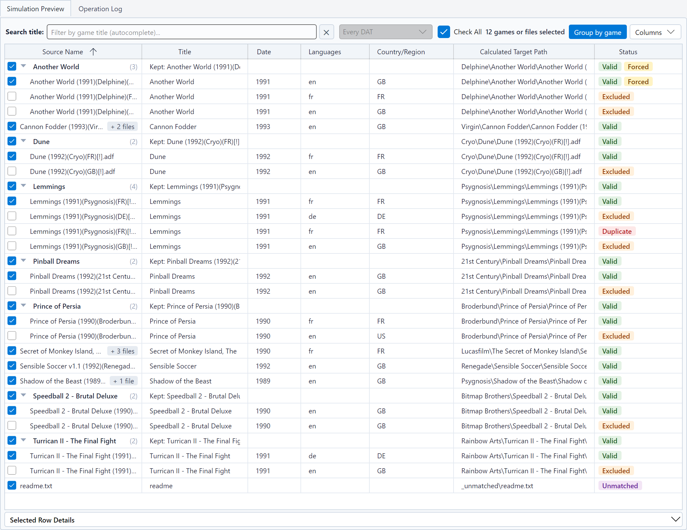

# The simulation table

After a simulation or a sort, the **Results** step is shown: its **Simulation Preview** tab shows one row per analyzed file. It is the place to check
a result before writing anything.

## Columns

| Column | Content |
|---|---|
| **Source Name** | File name, or archive member, after the check box that [chooses its game](#choosing-games) for a partial sort; a badge counts the [related files](#related-files) |
| **CRC32** | Checksum, when it was computed (hidden by default) |
| **Title** | Title read from the name or from the DAT |
| **Media** | Position of the file in a game of several parts (floppies, tapes, CDs, sides), *1 of 2*, or failing that the media label read from the name, *Side A* (hidden by default) |
| **Related** | Number of [related files](#related-files) transferred with the file (hidden by default) |
| **Publisher** | TOSEC publisher (hidden by default) |
| **Date** | TOSEC date |
| **Languages**, **Country/Region** | Detected languages and regions |
| **Calculated Target Path** | Where the file is (or would be) written, relative to the destination |
| **Status** | Badge Valid, Excluded, Unmatched, Duplicate or Error |
| **DAT** | DAT of the [lot](naming-conventions-and-dats.md#several-dats) the file is sorted with, empty with a single DAT (hidden by default) |

Click a column header to sort the table; sorting by status also orders the rows by their reason. Hover a row to see a
tooltip with the size, the checksum, the reason for the status, the companion tracks of an optical set, or the details
of a CHD.

The **Columns** button, at the right of the search box, shows or hides every column but **Source Name** and
**Status**; **Default Columns** restores the initial choice. The **Calculated Target Path** takes the room left free.
Your choice is kept from one session to the next.

## Related files

Some rows carry other files with them: the tracks of a `.cue` or `.gdi` descriptor, the CHDs of a MAME set, the other
files of a DAT game. A badge after the source name counts them by kind: *+ 2 tracks*, *+ 1 CHD*, *+ 3 files*. The
**Related** column, shown from the **Columns** menu, gives their number; sorting by it brings together the rows
without any, then those with the most. The **Selected Row Details** panel lists them.

## Grouping by game

The **Group by game** button, at the left of **Columns**, gathers the files of each game under a header row. The
header gives the title of the game and its number of files, *(3)*, or *(1/3)* when a chip or the search hides some,
the kept release (**Kept: …**), its target and its status. Below the header come the kept release (all its disks, in
order), then the other releases. The table thus matches [1G1R](languages-regions-1g1r.md): you see at a glance which
release won over which others.

* A game of a single file stays a plain row, without a header.
* The files without an identified game (non-conforming names) are gathered at the end, under **No identified game**.
* Sorting by a column orders the games by their kept release (or their first file), and the other releases of each
  game; the kept release always stays first in its game.
* The chevron of a header folds or unfolds the game. With the keyboard, on a selected header: left arrow to fold, right
  arrow to unfold, Space to switch. Right-clicking a header offers **Fold this game** (or **Unfold this game**),
  **Fold all games** and **Unfold all games**.
* During a run, the rows come in the order of processing; the games are grouped at the end.
* With a lot of DATs, the games are ordered by DAT, then in the order of the sort: the same title in two DATs is two
  games.

Folded games stay folded from one simulation of the same source to the next. The view you choose is kept from one
session to the next.

## Selected row details

Below the table, the **Selected Row Details** panel (click its title to unfold it) shows for the selected row its
source name, the full path of the source file and of the target, its status with the whole reason (filter, 1G1R
decision, identification by name) and its checksum: the CRC32 of a file, the SHA-1 of a CHD (the one that identifies it
in the DAT, with its version, media and tracks under **CHD**), nothing when it was not computed (a file absent from the
DAT) or does not exist (a MAME archive, which is a whole set). For a MAME set, the **MAME set** line tells which machine
it stands for and whether it is complete, then what it lacks (ROMs, CHDs, BIOS or devices missing from the source), the
set a *split* clone depends on, the other sets it needs, the clones a *merged* set holds and the files the DAT does not
know: *brubber: complete*, *mslug: complete (needs neogeo)*. A second line describes the cabinet of the machine (screen,
players, controls, buttons) when the DAT gives it. The **Used by** line counts the machines that take ROMs from the set,
according to the DAT (its clones, the games of a BIOS, the machines that use a *device*), those in the source and those
kept, which it names: *389 machine(s), 389 of them in the source; 120 kept: 1944, 19xx, armwar and 117 others*. Under
**Related files**, it lists the [files transferred with
it](#related-files), each with its size, its target (with its new name when a collision renamed it) and, for a CHD, its
version, media and tracks. With a lot of DATs, the **DAT** line names the DAT of the file and, when other DATs know it,
those, where its ROMs count as present. While some games are [unchecked](#choosing-games), a **Selection**
line also tells whether the row will be sorted: *Checked*, *Unchecked*, or *Sorted with the set …, which needs it* for a
MAME set taken along by the checked games; the tooltip of the row repeats it. The status always describes the whole
simulation, the **Selection** line the partial sort. The texts can be selected and copied. The panel is folded by default;
it stays open or closed from one session to the next.

## Status chips

The banner above the table counts the files: **Total**, **Kept**, **Excluded**, **Non-conforming**, **Duplicates**.
Click a chip to show only those rows; click several to combine them; **Total** shows everything again.

While some games are [unchecked](#choosing-games), a **Selection** chip counts the checked games (non-conforming files
included). It does not change the other chips: an unchecked game stays **Kept**, it is the release the sort would keep,
you are just not sorting it this time. Click **Selection** to show only the rows the selection sorts (with the
required MAME sets); it combines with the status chips and the search. A row unchecked while this filter is on stays
shown, so that you can check it again, until the next change of filter.

With a DAT, the banner also shows the **Completion** of your collection (ROMs of the DAT found / total). With a lot of
DATs, it gathers all its DATs, and its tooltip details each DAT with a game found, then counts the others.

## Volume

After a run, **Volume** gives two sizes: on the left, all the scanned files; on the right, after the arrow, what the
sort writes to the destination, that is the kept files and the non-conforming files (isolated in `_unmatched`). It
tells you whether the sorted collection fits on a USB drive or an SD card. Its tooltip gives the exact size in bytes.

* Sizes are in binary units: 1 GB = 1,024 MB = 1,073,741,824 bytes. A drive sold as "64 GB" (64 billion bytes)
  holds about 59.6 of them.
* In **ZIP** mode, the sizes are those before compression: the volume is followed by **max.**, the archives take less.
* Hard and symbolic links take almost no space: the volume is that of the linked files.
* What the destination already contains (**Add to a non-empty destination**) is not counted.
* While some games are [unchecked](#choosing-games), the right size is that of the sort of the checked ones, followed
  by **(selection)**, and the FAT32 warning only counts their files.

## FAT32 warning

Many USB drives and SD cards are formatted as FAT32, which does not accept files of 4 GB or more. When the sort writes
such files (a DVD image, a large CD track), the banner shows **⚠ FAT32: N files > 4 GB**, and the log gives a single
warning with their number and up to three names, the largest first. The tooltip names the largest ones too. Format the
medium as exFAT or NTFS if your hardware reads them.

In **ZIP** mode, an archive is measured before compression: it may still fit. With hard or symbolic links, no warning
is shown, since links cannot be created on FAT32 anyway.

## Room in the destination

Before writing the first file, the simulation as the sort compare what they write on the disk of the destination with
the room left there. When room is lacking, the log says so, with both volumes, and the confirmation of the sort repeats
it: a sort that lacks room stops as soon as the destination is full (see [Troubleshooting](troubleshooting.md)). Links
and files moved within a disk take no room; in **ZIP** mode, files are counted before compression, and files already
in the destination are counted too: the volume counted is the most the sort may write. The room of a network share is
not always known: nothing is reported then.

## Non-empty destination

When kept files are already in the destination before the sort (a previous sort, another tool) and the conflicts are
set to **Skip**, they are not written again: they count among the **Duplicates**, and the banner also shows
**N already in the destination (not written again)**. Their row says *Already in the destination (not written again)*,
the log adds a single warning, and the command line adds a line to its summary. A MAME set is never renamed: with
**Auto-rename (suffix _01)**, it is skipped too.

To write them, choose an empty destination, purge it (its content goes to quarantine, and undoing the sort puts it
back; see [Destination and transfers](destination-and-transfers.md)), or set the conflicts to **Overwrite**. Two files
of the same run that lead to the same target are still plain duplicates.

## Searching

Type part of a title in **Search title**: the table is filtered as you type, with suggestions. The ✕ button clears
the search. The search also looks at the source name, the name of the DAT of a lot and, for a MAME set, at its
category (`shooter`, `flying vertical`). The detail panel gives the category of a set at the start of its second line.

With a lot of DATs, the **Every DAT** list, to the right of the search, only shows the files sorted with the DAT
chosen; it is greyed out with a single DAT.

## Choosing a 1G1R winner by hand

When [1G1R](languages-regions-1g1r.md) does not keep the release you prefer, right-click a row:

| Menu item | Effect |
|---|---|
| **Isolate all versions of "…"** | Shows only the releases of this game, to compare them |
| **Keep this version as 1G1R winner** ⭐ | Keeps this release; the others of the game become Excluded |
| **Restore automatic 1G1R choice for this game** | Cancels your choice for this game |
| **Reset all manual 1G1R overrides** | Cancels all your choices |
| **Clear title search filter** | Shows all the rows again |

The table and the counters are updated at once, without analyzing the files again. A release chosen by hand shows the
**Forced** badge next to its status, and so does the header of its game in the grouped view: right-clicking that header
offers **Restore automatic 1G1R choice for this game**. Your choices are kept for the next
simulations and used by the real sort; they are forgotten when you choose another source folder.

With MAME, a set kept only because a kept set needs it to run (its BIOS, a *device*), whereas a filter or 1G1R excluded
it, shows the **Required** badge next to its status, and so does the header of its game in the grouped view; its reason
names the kept sets that need it (the first three, then their number: *the sets 2020bb, 3countb, aof and 149 others
need it to run*).

## Successive simulations

When you simulate the **same source** again (after changing a filter, for instance), RomSieve updates the existing rows
instead of reloading the table: your selection, sort order and scroll position are kept. New rows, and rows whose
status, target or reason changed, are marked, and the **Changed** chip shows only them. Hover a marked row to see its
previous status and target, or its previous reason when only the reason changed (another release won, another rule
applies).

A real sort, another source, or an interrupted simulation start again from an empty table.

## Simulate, sort, export

The actions are at the bottom of the window, whatever the step shown:

| Button | Effect |
|---|---|
| **Simulate (Dry-Run)** | Starts a simulation. While a simulation or a sort runs, it becomes **Stop**. |
| **Start Sorting** | Starts the real sort, after confirmation. It is put forward after a simulation of the current settings. While some games are unchecked, it becomes **Sort Selection** and sorts only the checked ones. The arrow next to it opens the menu of the [partial sorts](#sorting-part-of-the-simulation). |
| **Undo Last Sort** | Reverses the last real sort: see [Safety, purge and undo](safety-and-undo.md). |
| **Export** | Menu of the exports: see [Exports](exports.md). |

After a simulation, a sentence sums up what the sort will do: the mode, the number of kept files (and of non-conforming
files, isolated in `_unmatched`), the volume written and the destination, for example "Copy 11 files + 1 non-conforming (14.61 MB) to
D:\Retro\Amiga\Sorted". Changing a setting hides it until the next simulation; a real sort remains possible without a
simulation, with the same confirmations.

The progress bar, the number of files processed and the remaining time are shown above these buttons, and only while a
run is in progress. Next to them, a line names the current step: *Looking for files: 16277 found* while the source is
listed (minutes for a large collection on a network share), *Loading the DAT*, *Analyzing* or *Identifying* followed by
the file name, *Selecting the versions...*, then *Computing the target paths...* for a simulation, or *Copying*,
*Moving*, *Hard link*, *Symbolic link* or *Compressing* followed by the file name for a real sort.

The **Change the settings** button, left of the banner, leads back to the last settings step shown. The table is neither
reloaded nor emptied when you change steps: selection, sort order, scroll position and folded games are kept. If a
setting changes after a simulation, the **Results** step says so ("22 files, out of date") until the next simulation.

## Sorting part of the simulation

To copy only a few games (to an SD card, for a test), filter the table, then open the menu of the arrow next to
**Start Sorting** and choose **Sort the Checked Games Shown**. Only the checked games among the rows shown are
transferred, after a search or with status chips (the scroll position of the table does not matter), and each one as a
whole: all its disks (disks borrowed from another release included), the tracks of its descriptor, its `.m3u` playlist
and the MAME sets it needs. Without a filter, these are all the checked games. A row that the sort does not write (an
excluded release, a duplicate) does not choose its game, and a required MAME set shown alone is never sorted without
the game that needs it. A non-conforming file goes to `_unmatched` only if its own row is shown and checked (and never when **Isolate
non-conforming files in _unmatched** is unchecked).

The entry is available after a simulation of the current settings, as soon as a checked game is shown. Under its name,
it says what it will write, with the number of games and files, the volume and the destination, and, if it leaves
games out, that this is a part of the simulation. When it is not available, it says why. Files too large for FAT32
among them are counted in the same sentence, which also gives the room left in the destination when it is not enough.

### Choosing games

Each row starts with a check box, which says whether its game is sorted. After a simulation, every game the sort would
write is checked: **Start Sorting** sorts the whole simulation. Unchecking a file leaves out its whole game (all its
rows are unchecked), and, in the view grouped by game, unchecking a header leaves out all its files. A non-conforming
file, which goes to `_unmatched` apart from its game, has a box of its own, even when its name gives its game: unchecking
it leaves the kept release of its game checked, and the reverse. To change several rows at once, select them with Ctrl or Shift + click, then press Space, or right-click them and choose **Check the
Selected Rows** or **Uncheck the Selected Rows**. **Check All**, above the table, acts on the games of the rows shown
(after a search or with status chips): it is checked when they all are, partly checked when only some of them are, and a
click unchecks them all (when it is checked or partly checked) or checks them all. Without a search or a status chip,
unchecking it empties the selection. Next to it, the number of games selected counts every checked game, shown or not,
and says how many of them are hidden ("12 games selected, 9 of them hidden"): the hidden games stay checked and are
sorted too. It counts games, not files: a game of several files (the sides of a tape, the disks of a set) counts once,
so it can be lower than the number of kept files in the banner. A game the sort would not write (all its releases
excluded) cannot be checked, and neither can an excluded release of a game: its box stays empty, since only the kept
release is sorted.

As soon as a game is unchecked, **Start Sorting** becomes **Sort Selection**: it sorts only the checked games, and the
sentence next to it, the **Selection** chip and the volume of the banner describe them. With nothing checked, there is nothing to sort. To sort
the whole simulation anyway, check every game again, or choose **Sort the Whole Simulation** in the menu of the arrow.
The unchecked games are kept when you change the search, the status chips or the grouping, and when you simulate the
same source again, whose new games arrive checked; every game is checked again after you choose another source, and
after a real sort. The rows of a real sort show its results and cannot be checked.

The whole collection is analyzed again, as for a full sort: the release kept for a game is the one the simulation
shows, never one chosen because of what is shown. If a game changed since the simulation (another kept release, a
missing disk) or is no longer in the source, it is reported in the log and nothing is written for it; the rest of the
selection is sorted. The files left out are not touched; they are counted as *Not selected* in the summary of the log.
A MAME game takes with it the sets it needs to run (its BIOS, its *devices*), even unchecked. Their box stays checked
and greyed out while a checked game needs them (its tooltip names the checked games that need them), the counter adds them (*1 game selected +
1 required set*, the tooltip names them), and so does the sentence next to the button (*Copy 1 game and the required
set neogeo (2 files)…*).

A partial sort never purges the destination: it always adds to it, whatever the option chosen, and says so in its
confirmation. It is recorded in the journal like any sort, and **Undo Last Sort** reverses it. The rows shown are never
saved, neither in the settings nor in a profile, and neither are the checked games.

## The operation log

The **Operation Log** tab lists every step of the run, with a level:

| Level | Meaning |
|---|---|
| `INFO` | Progress information |
| `OK` | Successful operation: the file is written |
| `PLANNED` | What a simulation would write (it writes nothing) |
| `SKIP` | File excluded or skipped |
| `UNMATCHED` | Non-conforming file, isolated in `_unmatched` |
| `WARN` | Problem that did not stop the run |
| `ERROR` | Failed operation |

The log is not emptied between two runs: the lines of a simulation stay above those of the sort that follows it. They
are told apart by their level, `PLANNED` for the simulation, `OK` for the files actually written; a game left out of a
partial sort has no line of its own.

The log keeps the last 2,000 lines; the **Clear Messages** button of the tab (or its context menu) empties it,
without touching anything on disk. It follows the language of the interface, even for the
lines already written.
