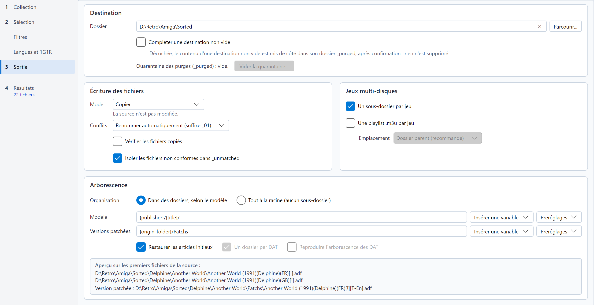

# Destination et transferts

Tout ce qui est décrit sur cette page se règle dans l'étape **Sortie**, en quatre cadres : **Destination** (le dossier,
et que faire s'il n'est pas vide), **Écriture des fichiers** (mode, conflits, vérification, archives d'un seul jeu),
**Jeux multi-disques** (sous-dossier, playlist) et **Arborescence** (organisation et [frontend](#pour-un-frontend),
modèle, dossier des versions patchées, articles, dossiers des DAT d'un lot, aperçu). La croix au bout du champ de la
destination le vide.

## Modèle d'arborescence

Le **Modèle** décrit les dossiers créés pour chaque jeu, avec des variables entre accolades. Par exemple, avec
`{publisher}/{year}/{title}/`, le fichier `Another World (1991)(Delphine)(FR)[!].adf` va dans
`Delphine/1991/Another World/`.

Saisissez le modèle dans le champ, ou utilisez les deux menus placés dessous :

* **Insérer une variable** insère une variable à la position du curseur (à la fin, comme nouveau dossier, si vous
  n'avez pas cliqué dans le champ). Les variables de toutes les conventions viennent d'abord ; suivent celles des noms
  TOSEC (éditeur, année, chipset...), celles des catégories MAME (genre, catégorie), puis celle du DAT. Toutes restent
  dans le menu : celles qui n'ont pas de valeur avec la convention actuelle sont grisées, et leur infobulle dit quand
  elles s'appliquent (les variables TOSEC quand la convention est TOSEC ou pas encore connue, ou qu'un DAT TOSEC d'un
  lot est coché, celles des catégories en MAME, celle du DAT dès qu'un DAT est choisi).
* **Préréglages** remplace le modèle par un modèle tout prêt :

| Préréglage | Modèle | Pour |
|---|---|---|
| **Éditeur / année / titre (TOSEC)** | `{publisher}/{year}/{title}/` | Les collections TOSEC |
| **Pays / titre (No-Intro, Redump)** | `{country}/{title}/` | Les consoles rangées par région |
| **Lettre / titre** | `{letter}/{title}/` | Des dossiers alphabétiques |
| **Chipset / lettre / titre (Amiga)** | `{chipset}/{letter}/{title}/` | Un dossier par Amiga (AGA, OCS-AGA, OCS-ECS) |

Choisir un préréglage repasse sur **Dans des dossiers, selon le modèle** si **Tout à la racine** était choisi (voir plus bas).

Sous le modèle, le champ **Versions patchées**, avec ses propres menus, range les versions patchées d'un
[dossier des patchs](patches.md) : vide, à côté de leur ROM d'origine ; sinon, dans les dossiers qu'il décrit, depuis
la racine de la destination, même avec **Tout à la racine** (voir [Un dossier Patchs](patches.md#un-dossier-patchs)). Il
est grisé sans dossier des patchs.

### Aperçu en direct

En bas du cadre *Arborescence*, l'aperçu montre où le tri écrirait trois fichiers avec les options actuelles : destination, dossiers et
nom du fichier (une archive `.zip` en mode ZIP). Il se met à jour pendant la saisie, et quand changent la source, la
convention, le DAT, la destination, le mode ou les options ci-dessous.

* Les fichiers sont les premiers de la source dont le nom suit la convention. Seuls leurs noms sont lus : aucun CRC
  n'est calculé et aucune archive n'est ouverte. Une archive est donc montrée sous son propre nom.
* Sans source, ou si aucun de ses premiers fichiers ne suit la convention, l'aperçu montre des exemples intégrés de la
  convention, sous le titre **Exemples**.
* Avec un DAT, le tri nomme un fichier identifié par le DAT d'après l'entrée du DAT : l'aperçu, qui ne lit aucun CRC,
  garde le nom de la source.
* Avec un [lot de DAT](naming-conventions-and-dats.md#plusieurs-dat), les exemples vont dans le dossier du premier DAT
  coché de leur convention, comme ses fichiers.
* Avec un [frontend](#pour-un-frontend) et un DAT, les exemples vont dans le dossier de la plateforme de ce DAT.
* Avec un [dossier des patchs](patches.md), une ligne montre, à la place du troisième exemple, où irait une version
  patchée du premier (*Version patchée : …*), d'après le champ **Versions patchées**.

L'aperçu signale un modèle qui ne ferait pas ce qu'il dit : une variable inconnue (le tri la supprime), une accolade
sans paire (elle resterait dans le nom du dossier), ou un modèle qui écrit dans `_unmatched`, le dossier des fichiers
non conformes. Il signale de même un dossier des versions patchées refusé, et dit pourquoi.

Un modèle dont le premier dossier est `_purged` ou `.romsieve` est **refusé** : ces noms sont réservés à la
[quarantaine des purges et au marqueur](safety-and-undo.md) de la destination, et vider la quarantaine supprimerait ce
que le tri y aurait écrit. L'aperçu le signale, une ligne le dit sous l'étape **Sortie** (*Modèle refusé*), et la
simulation comme le tri sont refusés (code 3 en ligne de commande). Avec **Tout à la racine**, le modèle n'est pas
utilisé et n'est pas refusé.

### Variables

| Variable | Contenu | Exemple |
|---|---|---|
| `{title}` | Titre, sans les balises techniques | `Another World` |
| `{letter}` | Première lettre du titre (`#` pour les chiffres et symboles) | `A` |
| `{country}` | Pays ou région, tel qu'écrit dans le nom | `FR`, `Europe` |
| `{language}` | Langue, telle qu'écrite dans le nom ; à défaut, celle de son pays (un nom TOSEC comme `(FR)` l'omet) | `fr`, `M3` |
| `{version}` | Version ou révision | `v1.1` |
| `{publisher}` | Éditeur (TOSEC) | `Delphine` |
| `{year}` | Année de sortie (TOSEC) | `1991` |
| `{system}` | Système ou modèle d'ordinateur (TOSEC) | `A500` |
| `{chipset}` | Chipset qu'une version Amiga demande (TOSEC) : `AGA` (AGA seulement), `OCS-AGA` (les deux, ou corrigée pour AGA), `OCS-ECS` (tout le reste, un nom sans marque compris) | `AGA` |
| `{video}` | Standard vidéo (TOSEC) | `PAL` |
| `{dump_status}` | Statut du dump (TOSEC) | `Verified`, `Clean`, `Cracked`, `BadDump` |
| `{genre}` | Genre de la machine, d'après le [fichier de catégories](naming-conventions-and-dats.md#genre-des-machines) (MAME) | `Shooter` |
| `{category}` | Genre et sous-genre de la machine (MAME) | `Shooter - Flying Vertical` |
| `{dat}` | Nom d'en-tête du DAT du fichier : le DAT choisi, ou le DAT du lot avec lequel il est rangé | `Nintendo - Game Boy` |
| `{origin_folder}` | Versions patchées seulement : le dossier entier de la ROM d'origine (dossier de son DAT dans un lot, puis dossiers du modèle) | `Nintendo - Game Boy/Tetris` |
| `{dat_folder}` | Versions patchées seulement : le dossier du DAT de la ROM d'origine dans un lot, aucun pour un DAT seul ; avec un [frontend](#pour-un-frontend), le dossier de sa plateforme | `Nintendo - Game Boy`, `gb` |

Une valeur inconnue donne `Unknown` (vide pour `{version}`). Les noms sont débarrassés des caractères interdits par
Windows ou Linux, et les chemins très longs sont pris en charge sous Windows. Le premier dossier sous la destination
n'est jamais `_purged` ni `.romsieve` : une valeur qui les donnerait (un jeu titré `_purged` sous `{title}`, un DAT d'un
lot nommé ainsi) prend un `_` final (`_purged_`).

### Sortie à la racine

La ligne **Organisation**, en tête du cadre *Arborescence*, propose deux choix : **Dans des dossiers, selon le modèle**
(par défaut) ou **Tout à la racine (aucun sous-dossier)**, qui place tous les fichiers à la racine de la destination.
C'est une option à part entière : le modèle reste dans son champ, grisé avec **Insérer une variable**, et resservira
quand vous reviendrez aux dossiers ou choisirez un préréglage. Une phrase sous les deux choix le rappelle, et dit que
le dossier des versions patchées, lui, s'applique encore.
**Restaurer les articles initiaux** reste actif, car il s'applique aussi au sous-dossier d'un jeu multi-disques. Un jeu multi-disques garde son sous-dossier si **Un sous-dossier par jeu**
(cadre *Jeux multi-disques*) est coché.

Un logiciel d'une [liste de logiciels MAME](naming-conventions-and-dats.md#listes-de-logiciels-mame) va toujours dans
le dossier de sa liste, où MAME le cherche : avec **Tout à la racine**, `megadriv/sonic.zip` sous la destination ; avec
un modèle, ses dossiers viennent au-dessus de celui de la liste.

### Un dossier par DAT

Avec un [lot de DAT](naming-conventions-and-dats.md#plusieurs-dat), deux cases à côté de **Restaurer les articles
initiaux** placent les fichiers de chaque DAT à part :

* **Un dossier par DAT** (cochée par défaut) : les fichiers de chaque DAT vont dans un dossier à son nom, au-dessus des
  dossiers du modèle. Avec `{title}`, `Tetris (World).gb` va dans `Nintendo - Game Boy/Tetris/`. Décochée, tous les
  DAT partagent les mêmes dossiers : la variable `{dat}` permet alors de placer le DAT ailleurs dans le modèle, et deux
  fichiers de DAT différents qui visent la même cible suivent la règle des [conflits](#conflits).
* **Reproduire l'arborescence des DAT** : le dossier de chaque DAT va sous les dossiers de son chemin dans le dossier
  ou l'archive de DAT, comme dans le pack (`TOSEC/Commodore/Amiga/Commodore Amiga - Games - [ADF]/...`). Seulement
  avec un dossier par DAT, et pour les DAT rangés dans des sous-dossiers (`--dir-dat-mirror` en ligne de commande).

Les deux cases sont grisées avec un fichier DAT ou une archive d'un seul DAT : un DAT seul n'a jamais de dossier à lui,
et sa sortie ne change pas. Elles le sont aussi avec un [frontend](#pour-un-frontend), qui met chaque DAT dans le dossier
de sa plateforme.
Le dossier `_unmatched` des fichiers non conformes reste à la racine de la destination.

### Options associées

* **Restaurer les articles initiaux**, sous le modèle et le dossier des versions patchées : `Legend of Zelda, The`
  devient `The Legend of Zelda` dans les noms de dossiers.

Le cadre **Jeux multi-disques**, à côté de *Écriture des fichiers* :

* **Un sous-dossier par jeu** : les disques d'un jeu multi-disques vont dans un sous-dossier à son nom.
* **Une playlist .m3u par jeu** : écrit une playlist qui liste les disques d'un jeu multi-disques, pour que les
  émulateurs et frontends (RetroArch, Batocera, Recalbox...) puissent les échanger. Chaque face d'un disque est une
  image à part (`Disk 1 of 2 Side A`, `Disk 1 of 2 Side B`) : la playlist les liste toutes, dans l'ordre des disques
  puis des faces, et son nom n'en garde aucune (`Jeu (1988)(Éditeur).m3u`). **Emplacement**, en retrait juste en
  dessous, choisit où elle va :
  * *Dossier parent (recommandé)* : la playlist est à côté du dossier du jeu (recommandé pour les frontends) ;
  * *Dossier parent avec sous-dossier masqué (.\*)* : le dossier du jeu commence par un point, pour que les frontends
    n'affichent que la playlist ;
  * *Dans le sous-dossier du jeu* : la playlist est avec les disques ;
  * *Dans un dossier à son nom (ES-DE)* : le sous-dossier du jeu porte le nom de sa playlist (`Jeu (USA).m3u/`), qui y
    va avec les disques : ES-DE lit ce dossier comme un seul jeu.
* **Un dossier par jeu sur disque** : chaque jeu sur image de disque (`.cue` et ses pistes, `.gdi`, `.ccd`, `.chd`,
  `.iso`...) va dans un dossier à son titre, même s'il n'a qu'un disque, comme le demandent les cores CD de MiSTer. Les
  cartouches, les disquettes et les sets MAME ne changent pas.

## Pour un frontend

La liste **Frontend**, au bout de la ligne **Organisation**, range la destination pour qu'un frontend la lise telle
quelle : chaque DAT dans le dossier que ce frontend donne à sa plateforme, au nom qu'il attend, au-dessus de
l'organisation choisie. La destination est alors le dossier `roms/` du frontend (`games/` pour MiSTer). Un lot de DAT
No-Intro et Redump trié en un passage donne ainsi directement ce dossier.

| Frontend | Game Boy | Mega Drive | Mega-CD | PlayStation | Amiga (OCS / AGA) |
|---|---|---|---|---|---|
| **Batocera** | `gb` | `megadrive` | `megacd` | `psx` | `amiga500` / `amiga1200` |
| **RetroPie** | `gb` | `megadrive` | `segacd` | `psx` | `amiga` |
| **ES-DE** | `gb` | `megadrive` | `segacd` | `psx` | `amiga` / `amiga1200` |
| **Recalbox** | `gb` | `megadrive` | `segacd` | `psx` | `amiga600` / `amiga1200` |
| **MiSTer** | `GAMEBOY` | `MegaDrive` | `MegaCD` | `PSX` | `Amiga500` |

* RomSieve connaît une soixantaine de plateformes, relevées dans les fichiers de chaque frontend (et, pour MiSTer, dans
  les dossiers que créent ses scripts de mise à jour). Il reconnaît un DAT No-Intro ou Redump par son nom d'en-tête,
  variantes comprises (`Nintendo - Game Boy (Private)`, `(Headered)`, `(Parent-Clone)`...), et un DAT TOSEC par son
  système (`Commodore Amiga - Games - [ADF]` est un DAT Amiga).
* Une version Amiga qui demande un Amiga AGA (`(AGA)`, `(A1200)`) va dans le dossier des Amiga AGA du frontend, les
  autres dans celui des Amiga OCS / ECS.
* Un DAT de machines MAME va dans `mame` (`arcade` pour RetroPie), un DAT d'arcade FinalBurn Neo dans `fbneo` (`fba`
  pour RetroPie).
* Un dossier qui existe déjà à la racine de la destination et ne diffère que par les majuscules (`GameBoy` pour
  `GAMEBOY`) est repris tel quel.
* L'aperçu en direct montre le dossier de la plateforme de ses exemples, comme le tri.

### Repli sur le nom du DAT

Un DAT que RomSieve ne connaît pas, ou dont la plateforme n'a pas de dossier chez ce frontend (la Nintendo DS sous
MiSTer), garde son nom comme dossier, comme avec **Un dossier par DAT** ; le journal le dit, une fois par DAT. Sans DAT,
aucune plateforme n'est connue : les fichiers vont où l'organisation les met, et le journal le dit. Le dossier
`_unmatched` reste à la racine de la destination, et un logiciel d'une liste MAME reste dans le dossier de sa liste.

### Réglages recommandés

Choisir un frontend propose les réglages de sortie qu'il lit le mieux, dans une question qui n'énumère que ce qui
changerait :

| Frontend | Organisation | Un sous-dossier par jeu | Une playlist .m3u par jeu | Emplacement | Un dossier par jeu sur disque |
|---|---|---|---|---|---|
| **Batocera**, **Recalbox** | Tout à la racine | non | oui | | non |
| **RetroPie** | Tout à la racine | oui | oui | Dossier parent avec sous-dossier masqué (.\*) | non |
| **ES-DE** | Tout à la racine | oui | oui | Dans un dossier à son nom (ES-DE) | non |
| **MiSTer** | inchangée | oui | non | | oui |

* Batocera et Recalbox cachent les disques qu'une playlist désigne quand ils sont dans son dossier : les disques
  restent à côté de leur playlist, et le jeu n'apparaît qu'une fois.
* L'EmulationStation de RetroPie ignore les dossiers dont le nom commence par un point : les disques vont dans
  `.Jeu/`, la playlist à côté.
* ES-DE lit un dossier nommé comme une playlist (`Jeu (USA).m3u/`) comme un seul jeu : les disques et la playlist y
  vont.
* MiSTer ne lit pas de playlist : il change de disque parmi les fichiers d'un dossier, nomme la carte mémoire d'un jeu
  PlayStation d'après son dossier, et ses cores CD veulent chaque jeu sur disque dans un dossier à lui. Sous le dossier
  du système, l'organisation reste la vôtre.

Refuser garde le frontend choisi et vos réglages. Le modèle, les filtres, les langues, le 1G1R et le mode de transfert
ne sont jamais touchés. Rien n'est demandé au chargement des réglages ou d'un profil.

### Frontend et lot de DAT

Avec un [lot de DAT](naming-conventions-and-dats.md#plusieurs-dat), chaque DAT va dans le dossier de sa plateforme, à la
place de son propre dossier : **Un dossier par DAT** et **Reproduire l'arborescence des DAT** sont grisés. Plusieurs DAT
d'une même plateforme (`Nintendo - Game Boy` et `Nintendo - Game Boy (Private)`, ou un DAT No-Intro et un DAT TOSEC d'un
même système) partagent son dossier : deux fichiers qui visent la même cible suivent la règle des
[conflits](#conflits). Le 1G1R reste calculé DAT par DAT : un jeu présent dans deux de ces DAT peut être écrit deux fois.
Le journal nomme, une fois par dossier, les DAT qu'il réunit. Dans la fenêtre **DAT du lot**, chaque ligne montre à
droite le dossier de son DAT (`→ gb`) ; un DAT qui garde son nom est en couleur d'avertissement, et son infobulle dit
pourquoi.

### Frontend et archives

Un frontend ne lit pas des archives partout : Batocera et RetroPie ne lisent pas de `.zip` pour la PlayStation, MiSTer
ne lit jamais une image de CD dans une archive, ni aucun `.7z`. En mode **ZIP**, ou avec **Conserver les archives
contenant un seul jeu**, la simulation prévient une fois par DAT quand le frontend ne lit pas les archives écrites dans
le dossier de sa plateforme. Rien n'est refusé : votre émulateur est peut-être réglé autrement.

### Ce que le frontend ne fait pas

* Il ne choisit pas la version des sets MAME, que chaque frontend attend précise, et ne range pas les BIOS.
* Il n'écrit ni métadonnées (`gamelist.xml`), ni playlists RetroArch (`.lpl`).
* L'arcade de MiSTer (fichiers `.mra`, dossier `games/mame`) suit sa propre organisation, installée par ses scripts : un
  tri MAME n'y a pas de dossier, et garde le nom de son DAT.

## Modes de transfert

**Mode** est une liste : chaque entrée donne le nom du mode et une phrase qui dit ce qu'il fait (son infobulle donne le
détail), et la phrase du mode choisi reste affichée sous la liste.

| Mode | Effet | Source | Remarques |
|---|---|---|---|
| **Copier** | Les fichiers sont copiés | Inchangée | Le choix le plus sûr. |
| **Déplacer** | Les fichiers sont déplacés | Vidée des fichiers retenus | Instantané sur un même disque ; d'un disque à l'autre, copie, écriture sur le disque, puis suppression. Une archive inspectée n'est jamais déplacée : ses fichiers sont extraits (sauf avec *Conserver les archives contenant un seul jeu*). |
| **Hard link** | Un second nom pour les mêmes données | Inchangée | Aucun espace supplémentaire. Sur un même disque uniquement ; pas en FAT32 / exFAT. Un émulateur qui écrit dans le fichier (une disquette ADF sous WinUAE, par exemple) modifie aussi celui de la source : ce sont les mêmes données. |
| **Symlink** | Un raccourci vers la source | Doit rester en place | Aucun espace supplémentaire. Sous Windows, créer des liens symboliques peut exiger le mode développeur ou les droits d'administrateur. Un émulateur qui écrit dans le fichier modifie celui de la source. |
| **ZIP** | Une archive ZIP par fichier | Inchangée | Un descripteur et ses pistes partagent la même archive. |

À propos du mode **ZIP** : les archives sont au format *TorrentZip*. Ce format fixe tout ce qui pourrait changer d'un
outil à l'autre (ordre des fichiers, date, compression, en-têtes) : une archive ne dépend que de son contenu, et deux
tris des mêmes fichiers donnent des archives identiques à l'octet près. Un gestionnaire de ROMs les tient donc pour déjà rangées, sans les recompresser, et une collection
partagée reste identique d'un utilisateur à l'autre. La compression prend plus de temps qu'une copie. Avec **Vérifier
les fichiers copiés**, chaque archive est relue et sa signature TorrentZip contrôlée. Un set MAME, qui est déjà une archive, et ses CHD sont copiés tels quels (voir
[DAT MAME](naming-conventions-and-dats.md#dat-mame)), de même qu'un logiciel d'une liste MAME.

Les fichiers **Exclus** par un filtre et les **Doublons** ne sont jamais écrits : ils restent dans la source, même en
mode Déplacer.

Une version patchée (voir [Patchs](patches.md#modes-de-transfert)) est écrite comme une copie dans tous les modes, liens
compris, puisqu'un lien ne peut pas porter un contenu modifié, à côté de sa ROM d'origine ou dans son
[dossier](patches.md#un-dossier-patchs) ; en mode Déplacer, elle est écrite avant que sa ROM d'origine ne quitte la
source, et en mode ZIP, elle a son archive. Les fichiers **Non conformes** sont transférés dans `_unmatched/` à la racine de la destination.

### Isoler les fichiers non conformes dans _unmatched

**Isoler les fichiers non conformes dans _unmatched**, sous *Conserver les archives contenant un seul jeu*, est cochée
par défaut.
Décochez-la pour laisser les fichiers non conformes dans la source : les résultats les montrent toujours **Non
conformes**, avec *laissé dans la source* dans leur raison et sans cible, mais le tri ne les écrit pas, même en mode
Déplacer. Ils ne comptent ni dans le volume écrit ni dans l'alerte FAT32, leur case dans les résultats ne peut pas être
cochée, et le journal les compte en une ligne. L'option est enregistrée dans la configuration et dans les profils : la
ligne de commande la suit donc aussi.

### Vérifier les fichiers copiés

Avec **Vérifier les fichiers copiés**, sous *Conflits*, chaque fichier copié, extrait d'une archive ou déplacé vers un autre disque est
relu, et son CRC32 est comparé à celui des données lues à la source (en mode ZIP, chaque fichier de l'archive, et la
signature TorrentZip de l'archive). En cas d'écart (disque, câble ou réseau
défaillant), la copie est supprimée, la source est conservée et le fichier est marqué en erreur. Les liens ne sont pas
vérifiés. Le tri est plus lent, puisque chaque fichier est lu deux fois.

### Conserver les archives contenant un seul jeu

**Conserver les archives contenant un seul jeu**, à côté de *Vérifier les fichiers copiés*, est décochée par défaut.
Cochée, une archive de la source (ZIP, 7z, RAR) est écrite telle quelle, au lieu que son contenu soit extrait, quand
elle contient un seul jeu (un fichier, ou un descripteur et ses pistes) et que le tri retient tous ses fichiers. Une
archive qui contient un fichier de plus, comme un lisez-moi ou un `.nfo`, voit son contenu extrait, comme sans l'option.

L'archive est copiée, déplacée (instantanément sur un même disque ; d'un disque à l'autre, copiée, puis supprimée) ou
liée, selon le mode : une image de disque de plusieurs gigaoctets n'est ni décompressée ni recompressée. L'option est
grisée en mode ZIP, qui écrit toujours une nouvelle archive TorrentZip.

* L'archive prend le nom de son jeu, tel que le DAT nomme son fichier (sans DAT, tel que l'archive le nomme), avec sa
  propre extension : `tetris.7z`, qui contient `tetris.gb` identifié comme `Tetris (World).gb`, devient
  `Tetris (World).7z`. Les fichiers qu'elle contient gardent leur nom, même quand le DAT leur en donne un autre :
  l'archive contient toujours `tetris.gb`.
* Avec **Vérifier les fichiers copiés**, une archive copiée, ou déplacée vers un autre disque, est relue, et son CRC32
  est comparé à celui de l'archive de la source.
* L'espace requis sur la destination et l'alerte FAT32 comptent la taille de l'archive, pas celle de son contenu.
* La playlist `.m3u` d'un jeu multi-disques liste les archives de ses disques. Certains émulateurs ouvrent un `.cue`
  dans un `.zip`, mais la plupart n'en ouvrent aucun dans un `.7z` ou un `.rar`.
* La version patchée d'une ROM contenue dans une archive conservée est un fichier à part, écrit là où vont les versions
  patchées : le patch lit la ROM dans l'archive, qui reste intacte ([Patchs](patches.md)).

## Conflits

**Conflits** décide de ce qui se passe quand un fichier du même nom existe déjà à la cible :

* **Renommer automatiquement (suffixe _01)** : le nouveau fichier devient `nom_01.ext`, `nom_02.ext`...
* **Ignorer (Skip)** : le fichier existant est conservé et le nouveau n'est pas écrit.
* **Écraser (Overwrite)** : le fichier existant est remplacé, une fois le nouveau entièrement écrit : si le transfert
  échoue (disque plein, partage réseau perdu, fichier verrouillé), le fichier existant est conservé. Le fichier
  remplacé est perdu : **Annuler le dernier tri** ne peut pas le remettre en place, ce que rappelle la confirmation du
  tri.

Un descripteur et ses pistes sont toujours traités ensemble : ils reçoivent tous le même suffixe, et le descripteur est
réécrit pour désigner les pistes renommées.

Une playlist `.m3u` suit la même règle : une playlist déjà présente est conservée (**Ignorer**), complétée d'une
nouvelle `nom_01.m3u` (**Renommer**) ou remplacée (**Écraser**). Une playlist dans un dossier à son nom (ES-DE) n'est
jamais renommée, son dossier ne pouvant pas suivre : avec **Renommer automatiquement**, celle qui y est déjà est
conservée.

Un set MAME et ses CHD ne sont jamais renommés, pas plus qu'un logiciel d'une liste MAME, car MAME ne les trouve que
par leur nom : avec **Renommer automatiquement**, ils sont ignorés comme des doublons.

## Destination non vide

* Avec **Compléter une destination non vide** coché, le tri ajoute ses fichiers au
  contenu existant ; la règle de conflits s'applique.
* Sinon, RomSieve propose de **purger** la destination d'abord. Rien n'est supprimé : le contenu précédent est déplacé
  dans `_purged/<date>/` à l'intérieur de la destination, et l'[annulation](safety-and-undo.md) le remet en place.
* Un [tri partiel](simulation-table.md#trier-une-partie-de-la-simulation) ne purge jamais : il complète toujours la destination.
