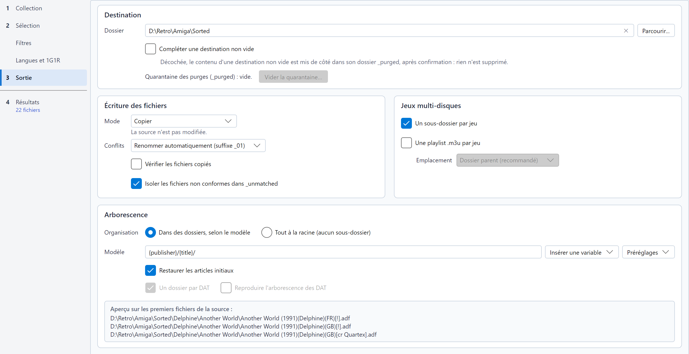

# Destination et transferts

Tout ce qui est décrit sur cette page se règle dans l'étape **Sortie**, en quatre cadres : **Destination** (le dossier,
et que faire s'il n'est pas vide), **Écriture des fichiers** (mode, conflits, vérification), **Jeux multi-disques**
(sous-dossier, playlist) et **Arborescence** (modèle, articles, aperçu). La croix au bout du champ de la destination le
vide.

## Modèle d'arborescence

Le **Modèle** décrit les dossiers créés pour chaque jeu, avec des variables entre accolades. Par exemple, avec
`{publisher}/{year}/{title}/`, le fichier `Another World (1991)(Delphine)(FR)[!].adf` va dans
`Delphine/1991/Another World/`.

Saisissez le modèle dans le champ, ou utilisez les deux menus placés dessous :

* **Insérer une variable** insère une variable à la position du curseur (à la fin, comme nouveau dossier, si vous
  n'avez pas cliqué dans le champ). Les variables de toutes les conventions viennent d'abord ; celles des noms TOSEC
  (éditeur, année...) suivent, et ne sont proposées que si la convention est TOSEC ou pas encore connue.
* **Préréglages** remplace le modèle par un modèle tout prêt :

| Préréglage | Modèle | Pour |
|---|---|---|
| **Éditeur / année / titre (TOSEC)** | `{publisher}/{year}/{title}/` | Les collections TOSEC |
| **Pays / titre (No-Intro, Redump)** | `{country}/{title}/` | Les consoles rangées par région |
| **Lettre / titre** | `{letter}/{title}/` | Des dossiers alphabétiques |
| **Chipset / lettre / titre (Amiga)** | `{chipset}/{letter}/{title}/` | Un dossier par Amiga (AGA, OCS-AGA, OCS-ECS) |

Choisir un préréglage repasse sur **Dans des dossiers, selon le modèle** si **Tout à la racine** était choisi (voir plus bas).

### Aperçu en direct

En bas du cadre *Arborescence*, l'aperçu montre où le tri écrirait trois fichiers avec les options actuelles : destination, dossiers et
nom du fichier (une archive `.zip` en mode ZIP). Il se met à jour pendant la saisie, et quand changent la source, la
convention, le DAT, la destination, le mode ou les options ci-dessous.

* Les fichiers sont les premiers de la source dont le nom suit la convention. Seuls leurs noms sont lus : aucun CRC
  n'est calculé et aucune archive n'est ouverte. Une archive est donc montrée sous son propre nom.
* Sans source, ou si aucun de ses premiers fichiers ne suit la convention, l'aperçu montre des exemples intégrés de la
  convention, sous le titre **Exemples**.
* Avec un DAT, le tri nomme un fichier identifié par le DAT d'après l'entrée du DAT : l'aperçu, qui ne lit aucun CRC,
  garde le nom de la source.

L'aperçu signale un modèle qui ne ferait pas ce qu'il dit : une variable inconnue (le tri la supprime), une accolade
sans paire (elle resterait dans le nom du dossier), ou un modèle qui écrit dans `_unmatched`, le dossier des fichiers
non conformes.

### Variables

| Variable | Contenu | Exemple |
|---|---|---|
| `{title}` | Titre, sans les balises techniques | `Another World` |
| `{letter}` | Première lettre du titre (`#` pour les chiffres et symboles) | `A` |
| `{country}` | Pays ou région, tel qu'écrit dans le nom | `FR`, `Europe` |
| `{language}` | Langue, telle qu'écrite dans le nom ; à défaut, celle de son pays (un nom TOSEC comme `(FR)` l'omet) | `fr`, `M3` |
| `{version}` | Version ou révision | `v1.1` |
| `{publisher}` | Éditeur (TOSEC) | `Delphine` |
| `{year}` | Année de sortie (TOSEC) | `1991` |
| `{system}` | Système ou modèle d'ordinateur (TOSEC) | `A500` |
| `{chipset}` | Chipset qu'une version Amiga demande (TOSEC) : `AGA` (AGA seulement), `OCS-AGA` (les deux, ou corrigée pour AGA), `OCS-ECS` (tout le reste, un nom sans marque compris) | `AGA` |
| `{video}` | Standard vidéo (TOSEC) | `PAL` |
| `{dump_status}` | Statut du dump (TOSEC) | `Verified`, `Clean`, `Cracked`, `BadDump` |
| `{genre}` | Genre de la machine, d'après le [fichier de catégories](naming-conventions-and-dats.md#genre-des-machines) (MAME) | `Shooter` |
| `{category}` | Genre et sous-genre de la machine (MAME) | `Shooter - Flying Vertical` |

Une valeur inconnue donne `Unknown` (vide pour `{version}`). Les noms sont débarrassés des caractères interdits par
Windows ou Linux, et les chemins très longs sont pris en charge sous Windows.

### Sortie à la racine

La ligne **Organisation**, en tête du cadre *Arborescence*, propose deux choix : **Dans des dossiers, selon le modèle**
(par défaut) ou **Tout à la racine (aucun sous-dossier)**, qui place tous les fichiers à la racine de la destination.
C'est une option à part entière : le modèle reste dans son champ, grisé avec **Insérer une variable**, et resservira
quand vous reviendrez aux dossiers ou choisirez un préréglage. Une phrase sous les deux choix le rappelle.
**Restaurer les articles initiaux** reste actif, car il s'applique aussi au sous-dossier d'un jeu multi-disques. Un jeu multi-disques garde son sous-dossier si **Un sous-dossier par jeu**
(cadre *Jeux multi-disques*) est coché.

Un logiciel d'une [liste de logiciels MAME](naming-conventions-and-dats.md#listes-de-logiciels-mame) va toujours dans
le dossier de sa liste, où MAME le cherche : avec **Tout à la racine**, `megadriv/sonic.zip` sous la destination ; avec
un modèle, ses dossiers viennent au-dessus de celui de la liste.

### Options associées

* **Restaurer les articles initiaux**, sous le modèle : `Legend of Zelda, The` devient `The Legend of Zelda` dans les
  noms de dossiers.

Le cadre **Jeux multi-disques**, à côté de *Écriture des fichiers* :

* **Un sous-dossier par jeu** : les disques d'un jeu multi-disques vont dans un sous-dossier à son nom.
* **Une playlist .m3u par jeu** : écrit une playlist qui liste les disques d'un jeu multi-disques, pour que les
  émulateurs et frontends (RetroArch, Batocera, Recalbox...) puissent les échanger. **Emplacement**, en retrait juste en
  dessous, choisit où elle va :
  * *Dossier parent (recommandé)* : la playlist est à côté du dossier du jeu (recommandé pour les frontends) ;
  * *Dossier parent avec sous-dossier masqué (.\*)* : le dossier du jeu commence par un point, pour que les frontends
    n'affichent que la playlist ;
  * *Dans le sous-dossier du jeu* : la playlist est avec les disques.

## Modes de transfert

**Mode** est une liste : chaque entrée donne le nom du mode et une phrase qui dit ce qu'il fait (son infobulle donne le
détail), et la phrase du mode choisi reste affichée sous la liste.

| Mode | Effet | Source | Remarques |
|---|---|---|---|
| **Copier** | Les fichiers sont copiés | Inchangée | Le choix le plus sûr. |
| **Déplacer** | Les fichiers sont déplacés | Vidée des fichiers retenus | Instantané sur un même disque ; d'un disque à l'autre, copie, écriture sur le disque, puis suppression. Une archive inspectée n'est jamais déplacée : ses fichiers sont extraits. |
| **Hard link** | Un second nom pour les mêmes données | Inchangée | Aucun espace supplémentaire. Sur un même disque uniquement ; pas en FAT32 / exFAT. Un émulateur qui écrit dans le fichier (une disquette ADF sous WinUAE, par exemple) modifie aussi celui de la source : ce sont les mêmes données. |
| **Symlink** | Un raccourci vers la source | Doit rester en place | Aucun espace supplémentaire. Sous Windows, créer des liens symboliques peut exiger le mode développeur ou les droits d'administrateur. Un émulateur qui écrit dans le fichier modifie celui de la source. |
| **ZIP** | Une archive ZIP par fichier | Inchangée | Un descripteur et ses pistes partagent la même archive. |

À propos du mode **ZIP** : les archives sont au format *TorrentZip*, celui que reconnaissent RomVault et igir. Ce format
fixe tout ce qui pourrait changer d'un outil à l'autre (ordre des fichiers, date, compression, en-têtes) : une archive ne
dépend que de son contenu, et deux tris des mêmes fichiers donnent des archives identiques à l'octet près, comme celles
de ces outils. Un gestionnaire de ROMs les tient donc pour déjà rangées, sans les recompresser, et une collection
partagée reste identique d'un utilisateur à l'autre. La compression prend plus de temps qu'une copie. Avec **Vérifier
les fichiers copiés**, chaque archive est relue et sa signature TorrentZip contrôlée. Un set MAME, qui est déjà une archive, et ses CHD sont copiés tels quels (voir
[DAT MAME](naming-conventions-and-dats.md#dat-mame)), de même qu'un logiciel d'une liste MAME.

Les fichiers **Exclus** par un filtre et les **Doublons** ne sont jamais écrits : ils restent dans la source, même en
mode Déplacer. Les fichiers **Non conformes** sont transférés dans `_unmatched/` à la racine de la destination.

### Isoler les fichiers non conformes dans _unmatched

**Isoler les fichiers non conformes dans _unmatched**, sous *Vérifier les fichiers copiés*, est cochée par défaut.
Décochez-la pour laisser les fichiers non conformes dans la source : les résultats les montrent toujours **Non
conformes**, avec *laissé dans la source* dans leur raison et sans cible, mais le tri ne les écrit pas, même en mode
Déplacer. Ils ne comptent ni dans le volume écrit ni dans l'alerte FAT32, leur case dans les résultats ne peut pas être
cochée, et le journal les compte en une ligne. L'option est enregistrée dans la configuration et dans les profils : la
ligne de commande la suit donc aussi.

### Vérifier les fichiers copiés

Avec **Vérifier les fichiers copiés**, sous *Conflits*, chaque fichier copié, extrait d'une archive ou déplacé vers un autre disque est
relu, et son CRC32 est comparé à celui des données lues à la source (en mode ZIP, chaque fichier de l'archive, et la
signature TorrentZip de l'archive). En cas d'écart (disque, câble ou réseau
défaillant), la copie est supprimée, la source est conservée et le fichier est marqué en erreur. Les liens ne sont pas
vérifiés. Le tri est plus lent, puisque chaque fichier est lu deux fois.

## Conflits

**Conflits** décide de ce qui se passe quand un fichier du même nom existe déjà à la cible :

* **Renommer automatiquement (suffixe _01)** : le nouveau fichier devient `nom_01.ext`, `nom_02.ext`...
* **Ignorer (Skip)** : le fichier existant est conservé et le nouveau n'est pas écrit.
* **Écraser (Overwrite)** : le fichier existant est remplacé, une fois le nouveau entièrement écrit : si le transfert
  échoue (disque plein, partage réseau perdu, fichier verrouillé), le fichier existant est conservé. Le fichier
  remplacé est perdu : **Annuler le dernier tri** ne peut pas le remettre en place, ce que rappelle la confirmation du
  tri.

Un descripteur et ses pistes sont toujours traités ensemble : ils reçoivent tous le même suffixe, et le descripteur est
réécrit pour désigner les pistes renommées.

Une playlist `.m3u` suit la même règle : une playlist déjà présente est conservée (**Ignorer**), complétée d'une
nouvelle `nom_01.m3u` (**Renommer**) ou remplacée (**Écraser**).

Un set MAME et ses CHD ne sont jamais renommés, pas plus qu'un logiciel d'une liste MAME, car MAME ne les trouve que
par leur nom : avec **Renommer automatiquement**, ils sont ignorés comme des doublons.

## Destination non vide

* Avec **Compléter une destination non vide** coché, le tri ajoute ses fichiers au
  contenu existant ; la règle de conflits s'applique.
* Sinon, RomSieve propose de **purger** la destination d'abord. Rien n'est supprimé : le contenu précédent est déplacé
  dans `_purged/<date>/` à l'intérieur de la destination, et l'[annulation](safety-and-undo.md) le remet en place.
* Un [tri partiel](simulation-table.md#trier-une-partie-de-la-simulation) ne purge jamais : il complète toujours la destination.
