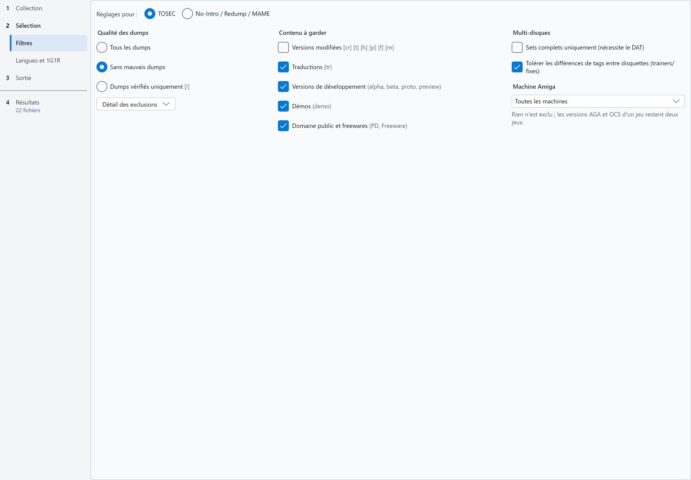

# Filtres

Les filtres excluent les fichiers que vous ne voulez pas dans votre collection triée. Un fichier exclu n'est jamais
écrit : il reste dans la source, et le tableau indique pourquoi il a été exclu.

## Reglages pour TOSEC ou No-Intro / Redump / MAME

Les noms TOSEC et les noms No-Intro / Redump ne portent pas les mêmes informations : chaque convention a donc ses propres
réglages de filtres, tous enregistrés (dans `config.json` et dans les profils). La page **Filtres** de l'étape *Sélection* en montre un jeu à
la fois, choisi par **Réglages pour :** **TOSEC** ou **No-Intro / Redump / MAME**.

* Le choix suit la convention effective (choisie ou détectée dans l'étape *Collection*) : un DAT
  No-Intro affiche les réglages No-Intro / Redump / MAME.
* Les sets MAME utilisent les réglages No-Intro / Redump (voir [DAT MAME](naming-conventions-and-dats.md#dat-mame)) :
  avec la convention MAME, le cadre [Machines MAME](#machines-mame), en tête de la page, montre ses réglages. Sans la
  convention MAME, ce cadre se réduit à son titre et à une phrase qui dit quand il s'applique.
* Les logiciels d'une [liste de logiciels MAME](naming-conventions-and-dats.md#listes-de-logiciels-mame) utilisent
  aussi les réglages No-Intro / Redump. Le cadre *Machines MAME* se réduit à son titre et à une phrase qui dit qu'il ne vaut que pour les machines d'un DAT MAME ; la qualité
  des dumps et les catégories dont un logiciel ne relève jamais sont grisées (voir plus bas).
* Tant que la convention n'est pas connue (convention *Automatique* sans DAT), le dernier choix est conservé.
* Vous pouvez afficher l'autre convention pour la régler aussi : une collection mixte applique à chaque fichier les
  réglages de la convention de son nom.

Les catégories communes aux deux conventions (qualité des dumps, versions modifiées, traductions, versions de
développement, démos, sets incomplets) n'apparaissent qu'une fois, suivies des tags de la convention affichée ; les
options propres à une convention n'apparaissent que pour elle.

## Qualite des dumps

Un seul choix résume les filtres d'intégrité. Il est grisé avec la convention MAME, et une phrase dit pourquoi : MAME ne
connaît pas la qualité des dumps (une ROM `baddump` y est le meilleur dump connu), et ces réglages ne s'appliquent jamais
à un set MAME. Ses variantes se règlent dans le cadre [Machines MAME](#machines-mame). Il est grisé aussi pour les
logiciels d'une liste MAME, pour la même raison ; leurs variantes (`alt`) sont toutes gardées, et le 1G1R garde une
version par jeu.

| Choix | Effet | TOSEC | No-Intro / Redump |
|---|---|---|---|
| **Tous les dumps** | Aucun filtre d'intégrité | Toutes les exclusions désactivées | Toutes les exclusions désactivées |
| **Sans mauvais dumps** *(par défaut)* | Exclut les dumps défectueux, garde les variantes | Exclut `[b]`, `[o]`/`[u]` et `[v]` | Exclut `[b]` |
| **Dumps vérifiés uniquement** | Ne garde que les dumps vérifiés | Seulement `[!]` | Non proposé (voir ci-dessous) |

Le bouton **Détail des exclusions** ouvre la liste des exclusions, à régler une à une :

| Option | Exclut | TOSEC | No-Intro / Redump |
|---|---|---|---|
| **Exclure les mauvais dumps** | Les dumps corrompus | `[b]` | `[b]` |
| **Exclure les variantes** | Les dumps alternatifs | `[a]` | `(Alt)` |
| **Exclure les overdumps et underdumps** | Les dumps de taille anormale | `[o]` `[u]` | - |
| **Exclure les images infectées** | Les images disques infectées par un virus | `[v]` | - |

Les noms No-Intro et Redump ne marquent pas les dumps vérifiés : tout dump qui n'est pas un mauvais dump y compte comme
vérifié, et **Dumps vérifiés uniquement** garderait les mêmes fichiers que **Sans mauvais dumps**. Ce choix n'est donc
proposé que pour TOSEC.

Avec **Dumps vérifiés uniquement**, ces exclusions sont implicites et grisées. Une combinaison qui ne correspond à aucun
des trois choix (par exemple les variantes exclues en plus) fait apparaître un quatrième choix, **Personnalisé**, coché à
leur place ; il disparaît dès que les exclusions retrouvent un niveau. Choisir l'un des trois niveaux réécrit les
exclusions.

## Contenu

Le groupe **Contenu à garder** liste ce que vous voulez garder : une case cochée garde sa catégorie, une case décochée
l'exclut du tri.

Les réglages No-Intro / Redump s'appliquent aussi aux sets MAME : sous le titre du groupe, la mention **Réglages communs
à No-Intro, Redump et MAME** le rappelle, et les infobulles citent les deux effets. Décocher **Versions modifiées** pour
une collection MAME exclut donc aussi les `(Hack)` d'un tri No-Intro qui utilise la même configuration ; pour les régler
différemment, enregistrez un [profil](settings-and-profiles.md#profils-nommes) par collection. Les réglages TOSEC sont indépendants.

| Option | Catégorie (TOSEC) | Catégorie (No-Intro / Redump) | Catégorie (MAME) | Gardée par défaut |
|---|---|---|---|---|
| **Versions modifiées** | Cracks, trainers, hacks, versions pirates, correctifs, modifications `[cr] [t] [h] [p] [f] [m]` | Romhacks `(Hack)` | `(hack)` | **Non** |
| **Versions pirates** *(No-Intro / Redump, MAME)* | - | Contrefaçons `(Pirate)` | Contrefaçons `(bootleg)` | **Non** |
| **Traductions** | Traductions de fans `[tr]` | Patchs de traduction non officiels `(Translated)` | - | Oui |
| **Versions de développement** | alpha, beta, proto, preview | Beta, Proto, Sample, Pre-Release | prototype, beta, alpha, preview, location test | Oui |
| **Démos** | Démos `(demo)` | Demo, Kiosk, Taikenban, numérotées ou décrites aussi (`(Demo 2)`, `(Taikenban 1)`) | `(demo)` | Oui |
| **Domaine public et freewares** *(TOSEC)* | PD, freeware, shareware... | - | - | Oui |
| **Parutions non officielles** *(No-Intro / Redump)* | - | Unl, Homebrew, Aftermarket | - | Oui |
| **Rééditions modernes** *(No-Intro / Redump)* | - | Virtual Console, Switch Online, Classic Mini, LodgeNet... | - | Oui |

Avec la convention MAME, les catégories sont lues dans la description de la machine, et les cases dont un set MAME
ne relève jamais (traductions, parutions non officielles, rééditions modernes) sont grisées, leur infobulle disant
pourquoi. Les étiquettes et les
infobulles citent alors les mots de MAME : `(bootleg)`, `(hack)`, `(prototype)`... Par défaut, les contrefaçons
(*bootlegs*) et les *hacks* sont exclus, comme pour No-Intro / Redump.

Pour les logiciels d'une liste MAME, les catégories sont lues dans la description du logiciel : `(pirate)` est une
version pirate, `(hack)`, `cracked` et `Trained` des versions modifiées, `translation` une traduction, `(prototype)`
une version de développement et `(demo)` une démo. Les parutions non officielles et les rééditions modernes, que ces
descriptions ne marquent jamais, sont grisées, leur infobulle disant pourquoi.

Seule la présentation a changé depuis les versions qui affichaient « Exclure les traductions »... : `config.json` et
les profils gardent les mêmes options (`exclude_translations`...), si bien qu'un fichier est relu à l'identique.

### Fichiers absents du DAT

Avec un DAT, les filtres jugent un fichier d'après son nom dans le DAT : ils ne voient que les fichiers que le DAT
identifie. Un fichier dont le DAT ne connaît pas la somme de contrôle est **non conforme**, isolé dans `_unmatched/`.

**Filtrer aussi les fichiers absents du DAT**, dernière case du groupe **Contenu à garder**, cochée par défaut, fait
passer ces fichiers par les filtres de cette page (qualité des dumps, contenu, machine Amiga), d'après les tags de leur
propre nom quand il suit la convention du DAT :

* un fichier que les filtres excluent est **Exclu** et reste dans la source ; sa raison est celle du filtre, suivie de
  « (fichier absent du DAT) », par exemple « Version Démo exclue (fichier absent du DAT) » ;
* un fichier que les filtres gardent reste **non conforme**, comme sans la case.

Ce nom n'est pas celui du DAT : seul un tag présent exclut un fichier, et un tag manquant le laisse dans `_unmatched/`.
Ces fichiers ne sont d'aucun jeu, exclus ou non : ils ne passent ni par le 1G1R ni par les langues et pays prioritaires,
ne comptent pas dans la complétude du DAT, ne peuvent pas être retenus comme gagnants 1G1R, et un fichier exclu n'a pas
de case pour le [tri partiel](simulation-table.md#trier-une-partie-de-la-simulation). Un fichier dont seul le SHA-1 diffère de celui du DAT,
un fichier abîmé dans son archive ou un CHD illisible reste toujours non conforme : ce sont des anomalies à voir.

Décochez la case pour que `_unmatched/` garde tout ce que le DAT ne connaît pas, par exemple pour compléter un DAT ou
repérer de mauvais dumps. Une configuration ou un profil enregistré par une version précédente de RomSieve garde son
résultat : la case y est décochée. Sans DAT, tous les fichiers sont déjà filtrés d'après leur nom. La case est grisée
avec un DAT MAME ou des listes de logiciels, où un fichier que le DAT ne connaît pas est toujours non conforme.

## Multi-disques

* **Sets complets uniquement (nécessite le DAT)** : un jeu auquel il manque un disque, ou un fichier que le DAT liste
  pour l'un de ses disques (une piste, le `.cue`), est exclu, qu'il ait un disque ou plusieurs. La raison dit ce qui
  manque : « Set multi-disquettes incomplet (1/2 disques trouvés) » pour un disque absent, « Disque incomplet : 1/9
  fichiers du DAT trouvés » pour un disque auquel il manque des pistes, « Jeu incomplet » pour un jeu sans descripteur.
  Le nombre de disques d'un set vient du DAT : un set auquel il manque son dernier disque est incomplet. Un fichier ne
  complète que le disque dont il porte le nom, même quand une piste identique figure sur un autre disque ; les ROMs que
  le DAT dit jamais dumpées (`nodump`) ne comptent pas, et un CHD rattaché à son jeu par **Identifier les CHD par leur
  nom** vaut tout son disque. Avec la convention MAME, ce groupe laisse place à l'option **Sets complets uniquement (ROM
  et CHD présents)** du cadre [Machines MAME](#machines-mame). Pour les logiciels d'une liste MAME, cette option exclut
  un logiciel dont l'archive n'a pas toutes ses ROMs.
* **Compléter un set avec les disques d'un autre dump** : un set incomplet emprunte le disque qui lui manque à un autre
  dump de la même édition. *(TOSEC)* Un set est souvent incomplet parce que le disque 1 porte un trainer `[t]` ou un
  correctif `[f]` que les disques de données n'ont pas : RomSieve le complète avec les disques de données propres du
  même jeu. *(No-Intro / Redump)* Un disque dumpé en plusieurs pressages, distingués par leurs codes de mastering
  (`Phantasm (Japan) (Disc 6) (4M)` et `(Disc 6) (5M)`), complète le set dont les autres disques n'en ont pas. Seul
  le set qui a le plus de disques emprunte, toujours le même dump (celui qui partage le plus de tags avec le set, puis
  celui qui en a le moins, puis le premier nom), et jamais un disque d'une autre édition (`(Premium Box)`). L'option
  est sans effet sur les sets MAME et les listes de logiciels.

*(No-Intro / Redump)* Un disque porte souvent son étiquette après son numéro : `Command & Conquer (USA) (Disc 1) (GDI Disc)`
et `(Disc 2) (NOD Disc)`, `(Disc 1) (Allies)` et `(Disc 2) (Soviet)`. Ces disques forment un seul set, dont la playlist
est nommée sans l'étiquette du premier disque (`Command & Conquer (USA).m3u`). Un tag que portent tous les disques
d'une édition, comme `(Disc 1) (Premium Box)` et `(Disc 2) (Premium Box)`, sépare toujours cette édition, de même
qu'un tag qui distingue un disque d'un autre dump du même disque (`(Disc 1) (EDC)` à côté de `(Disc 1)`). RomSieve
compare les disques du DAT, quand il y en a un : le résultat ne dépend pas des disques présents dans la source.

## Machine Amiga

*(TOSEC)* La liste **Machine Amiga**, sous le groupe Multi-disques, dit sur quel Amiga la collection sera utilisée.
RomSieve lit le chipset dans le champ système du nom TOSEC : `(AGA)`, `(A1200)`, `(A4000)` ou `(CD32)` pour un jeu
AGA seulement, `(OCS-AGA)` ou `(ECS-AGA)` pour un jeu qui tourne aussi sur AGA, `(ECS)`, `(A500+)` ou `(A600)` pour
un jeu ECS. Un jeu sans marque est présumé OCS / ECS et n'est jamais écarté.

| Choix | Effet |
|---|---|
| **Toutes les machines** (par défaut) | Rien n'est exclu ; les versions AGA et OCS d'un jeu restent deux jeux, comme avant. |
| **Amiga 500, 1000, 2000 (OCS)** | Les jeux AGA, ECS et `(ECS-AGA)` sont exclus (raison *Demande un Amiga AGA : ne tourne pas sur la machine cible*). |
| **Amiga 500+, 600, 3000 (ECS)** | Les jeux AGA sont exclus. |
| **Amiga 1200, 4000, CD32 (AGA)** | Rien n'est exclu. Avec le [1G1R](languages-regions-1g1r.md), les versions AGA et OCS d'un même jeu n'en font qu'un, et le critère *Chipset Amiga (machine AGA)* retient d'abord la version AGA, puis une version `(OCS-AGA)`, puis une version corrigée pour AGA (`[f AGA NOMAD]`), puis la version OCS. |

Avec un Amiga AGA, *Theme Park (AGA)* et *Theme Park* ne gardent ainsi qu'une version ; sans 1G1R, toutes les versions
restent. Une version corrigée pour AGA est une version modifiée : elle n'entre en compte que si les versions modifiées
sont gardées (ou servent de repli, option *Noms TOSEC* de la page *Langues et 1G1R*).

## Machines MAME

Avec la convention MAME, le cadre **Machines MAME**, aux couleurs du badge MAME de l'étape *Collection*, s'affiche en
tête de la page, au-dessus des réglages No-Intro / Redump que les sets suivent aussi. Il trie les machines d'après ce
qu'en dit le DAT MAME ; par défaut, toutes sont gardées. Il montre les réglages essentiels : **Machines à garder**, puis,
à droite, **Émulation à garder** et **Sets complets uniquement (ROM et CHD présents)**. Les filtres plus fins sont sous
**Affiner**, dans une rangée de boutons qui ouvrent chacun un panneau par-dessus la page : **Borne** et **Commandes**
(la [borne](#borne-et-commandes)), **Catégories** (les [filtres de genre](#filtres-de-genre)), **Notes** et **Volume**
([Notes et volume](#notes-et-volume)). Chaque bouton dit ce qu'il exclut : *Borne : toutes* sans restriction, la
restriction elle-même s'il n'y en a qu'une (*Borne : écran vertical*), sinon leur nombre (*Borne : 3 restrictions*) ;
il passe en gras tant qu'il exclut des machines, et son infobulle nomme toutes ses restrictions.

**Machines à garder** :

| Option | Décochée, exclut |
|---|---|
| **BIOS** | Les sets de BIOS (`neogeo`, `pgm`...). Un set *non-merged* contient déjà les ROM de son BIOS, mais dans une collection *merged* ou *split*, les jeux les prennent dans le set du BIOS. Un BIOS dont un jeu gardé a besoin est trié malgré tout. |
| **Devices (composants)** | Les sets de *devices*, des composants que MAME ne lance pas seuls mais dont certains jeux ont besoin. Un *device* dont un jeu gardé a besoin est trié malgré tout. |
| **Machines mécaniques** | Les flippers, machines à sous et autres machines mécaniques, que MAME n'émule qu'en partie. |
| **Machines à habillage externe** | Les machines que MAME n'affiche correctement qu'avec un habillage (fichiers d'*artwork* à installer à part). Ce sont presque toutes des machines mécaniques ; les autres sont surtout des jeux électroniques portables et des machines à sous. |
| **Machines sans son émulé** | Les machines dont MAME n'émule pas le son. Une machine qui n'a pas de son du tout n'est pas concernée. Avec **Jouables**, décocher cette case garde les jeux jouables avec leur son. |
| **Machines sans ROM à dumper** | Décochée par défaut. Les machines qui n'ont aucune ROM ni aucun disque à dumper : consoles que MAME lance sans fichier, avec les logiciels de ses listes (`genesis`, `famicom`...), et machines dont aucune ROM n'a été dumpée. Dans une collection *merged*, leur archive ne contient que les ROM de leurs clones ; un DAT filtré, qui les décrit sans aucune ROM, n'a rien à reconstruire pour elles non plus. |
| **Variantes (set 2, alt)** | Les variantes d'une machine : les sets dont la description dit `set 2` ou plus, ou `alt`. Le set principal reste. Les réglages de [qualité des dumps](#qualite-des-dumps) ne s'appliquent pas aux sets MAME. |

**Émulation à garder** garde les machines selon le statut que MAME donne à leur driver, une case par statut ; toute
combinaison est possible, par exemple les seules machines qui ne fonctionnent pas encore :

| Case | Cochée, garde |
|---|---|
| **Bonne** | Les machines que MAME émule correctement (statut `good`). |
| **Imparfaite** | Les machines jouables, avec des défauts de son, de graphismes ou d'autres éléments (statut `imperfect`). |
| **Préliminaire** | Les machines dont l'émulation est incomplète, souvent injouables (statut `preliminary`). |
| **Jouables** | En plus, quel que soit leur statut, les machines dont le cœur (processeurs, logique du jeu) est bien émulé, même si le son, les graphismes ou un autre élément ne le sont qu'en partie ou pas du tout. Un jeu muet, dont le driver est préliminaire faute de son, est gardé. Grisée quand les trois statuts sont cochés, car elle ne change alors rien. |

Les trois statuts sont cochés par défaut. Sans aucun statut ni les jouables, une phrase prévient que seules les machines
sans statut sont gardées. Seul le DAT produit par `mame -listxml` donne ces informations (statut, son et habillage) : une
machine sans statut (un *device*, ou un DAT SabreTools) est toujours gardée. Le statut global du driver sert aussi de
critère au [1G1R](languages-regions-1g1r.md).

Les machines mécaniques sont toutes préliminaires dans MAME 0.289 : seules **Préliminaire** les garde toutes, et
**Jouables** quelques centaines, dont le cœur est bien émulé. Quand **Machines mécaniques** est cochée mais
qu'aucune machine mécanique du DAT n'a un statut coché, une phrase sous les cases le dit : *Aucune machine mécanique du
DAT n'a ces statuts.* Elles sont alors toutes exclues ; cochez d'autres statuts pour en garder. La phrase n'apparaît
qu'une fois le DAT entièrement lu.

**Sets complets uniquement (ROM et CHD présents)**, sous l'émulation, ne garde que les sets qui ont toutes leurs
ROM et tous leurs disques, y compris ceux qu'ils trouvent dans le set de leur BIOS ; les autres sont exclus. Un set
incomplet dont un jeu gardé a besoin est trié malgré tout.

### Borne et commandes

Ces réglages gardent les machines qui conviennent à une borne ou à un panneau de commandes, d'après ce que le DAT produit
par `mame -listxml` dit de leur écran et de leurs commandes. Une valeur que le DAT ne donne pas (un *device*, un DAT
SabreTools, une machine dont MAME ne décrit pas encore les commandes) n'exclut jamais une machine. Le bouton **Borne**
ouvre les réglages de l'écran, des joueurs et des boutons ; le bouton **Commandes**, la liste des commandes.

| Réglage | Effet |
|---|---|
| **Toutes orientations**, **Horizontales uniquement**, **Verticales uniquement** (liste déroulante) | Garde les machines selon l'orientation de leur écran : un écran tourné d'un quart de tour (la plupart des *shoot'em up* et des jeux des années 1980) est vertical. |
| **Écrans vectoriels** | Décochée, exclut les machines à écran vectoriel (Asteroids, Tempest, Star Wars...). |
| **Écrans LCD (jeux électroniques)** | Décochée, exclut les jeux électroniques à écran LCD (Game & Watch, Tiger...). |
| **Joueurs** | Ne garde que les machines qui acceptent au moins ce nombre de joueurs. |
| **Boutons** | Exclut les machines dont une commande a plus de boutons que votre panneau. |
| **Commandes** | Ouvre la liste des commandes : décochez celles que votre panneau n'a pas (joystick, manche analogique, trackball ou souris, spinner, paddle ou volant, pédales, pistolet, clavier, panneau mahjong ou casino) ; les machines qui les utilisent sont exclues. Le bouton dit combien de commandes sont gardées (*Commandes : 8 sur 9*), et son infobulle nomme celles qui manquent. |

Le panneau de détail de la [table de simulation](simulation-table.md) décrit, sous la ligne **Set MAME**, l'écran, les
joueurs, les commandes et les boutons de la machine.

### Filtres de genre

Avec un [fichier de catégories](naming-conventions-and-dats.md#genre-des-machines) choisi à l'étape *Collection*,
le bouton **Catégories** ouvre les réglages qui trient les machines selon leur genre ; sans fichier, il est grisé et
affiche *Catégories : aucun fichier*, et son infobulle dit où le choisir. Une machine que le fichier ne classe pas n'est
jamais exclue.

| Réglage | Effet |
|---|---|
| **Machines pour adultes (Mature)** | Décochée, exclut les machines que le fichier marque `* Mature *`. |
| **Machines hors arcade (consoles, ordinateurs...)** | Décochée, exclut les machines que le fichier ne classe pas en arcade. Seul un fichier qui marque l'arcade (`catlist.ini`) le permet : sinon, la case est grisée et une phrase le dit en dessous. Avec `catver.ini`, décochez plutôt les genres hors arcade (`Computer`, `Game Console`, `Handheld`...). |
| **Genres** | Liste des genres du fichier, sous les deux cases : décochez ceux dont vous ne voulez pas les machines (`Casino`, `Quiz`, `Computer`...). Son titre dit combien de genres sont gardés, et son infobulle nomme les genres exclus. Un genre exclu reste dans la liste même si un autre fichier ne l'a pas. **Tout cocher** garde tous les genres ; **Tout décocher** les exclut tous, pour ne recocher que ceux que vous voulez garder. Ce sont les genres exclus qui sont enregistrés : un genre qu'apporte un nouveau fichier de catégories est donc gardé. |

### Notes et volume

Le bouton **Notes** utilise le [fichier de notes](naming-conventions-and-dats.md#notes-des-machines) choisi à l'étape
*Collection* ; sans fichier, il est grisé (*Notes : aucun fichier*) et aucune machine n'est exclue pour sa note. Le
bouton **Volume** ouvre la limite de volume, qui marche aussi sans fichier de notes, et affiche le volume choisi
(*Volume : 64 Go au plus*).

| Réglage | Effet |
|---|---|
| **Note minimale** | Ne garde que les machines notées au moins à ce niveau : *70 et plus* garde les tranches *Good*, *Very Good* et *Best Games*. Une machine non notée n'est pas concernée. |
| **Jeux sans note** | Décochée, exclut les machines que le fichier ne note pas. |
| **Limiter à … Go** | Ne garde que ce qui tient dans ce volume, en Go de 10⁹ octets comme sur une carte mémoire (64 Go proposés). RomSieve garde d'abord les jeux les mieux notés, puis, à note égale, les plus petits, et écarte ceux qui ne tiennent plus (raison *Hors du volume*) ; un jeu plus petit peut encore entrer après. Chaque jeu compte avec ses CHD et les sets dont il a besoin (BIOS, *devices*, parent d'un clone *split*), comptés une seule fois quel que soit le nombre de jeux qui les utilisent. Sans fichier de notes, les plus petits passent d'abord. |

Le volume limité s'applique après les autres filtres et le 1G1R ; un choix 1G1R fait à la main dans le tableau doit
lui aussi tenir dans le volume. Le journal donne le volume utilisé et le nombre de sets écartés.

## Conseils

* Partez des réglages par défaut, simulez, puis cliquez sur la pastille **Exclus** du bandeau pour vérifier ce qui a été
  écarté et pourquoi.
* Une option qui semble sans effet concerne peut-être l'autre convention : vérifiez **Réglages pour :** et le badge de
  l'étape *Collection*.
* Pour ne garder qu'une version par jeu, les filtres ne suffisent pas : activez le [1G1R](languages-regions-1g1r.md),
  dont toutes les options (dont les versions modifiées de repli et le format de média préféré, pour TOSEC) sont dans
  la page *Langues et 1G1R*.
