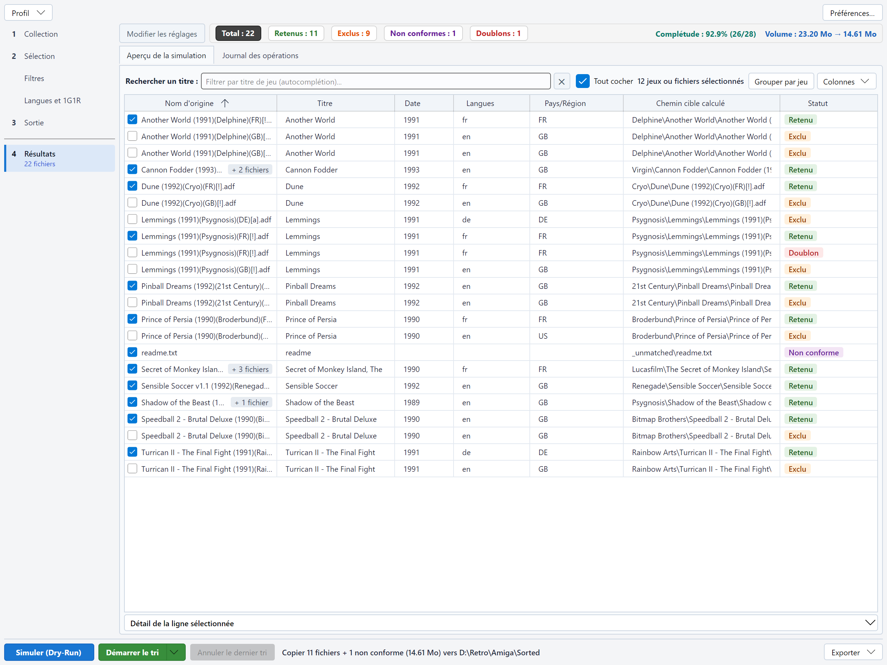

# Guide utilisateur de RomSieve

RomSieve audite, filtre, déduplique et réorganise de volumineuses collections de ROMs, d'images disques et d'images
de supports optiques. Il comprend les trois grands standards de nommage de la préservation :

| Standard | Contenu typique |
|---|---|
| **TOSEC** (TOSEC Naming Convention, TNC) | Micro-ordinateurs rétro (Amiga, Atari ST, Amstrad CPC, C64, ZX Spectrum...) et consoles anciennes |
| **No-Intro** | Consoles à cartouches (NES, Super Nintendo, Mega Drive, Game Boy, GBA, N64...) |
| **Redump** | Supports optiques (PlayStation, Saturn, Dreamcast, Amiga CD32...) |

Il trie aussi les sets d'arcade **MAME** (*non-merged* ou *merged*), avec un DAT MAME (voir
[DAT MAME](naming-conventions-and-dats.md#dat-mame)).

Il lit vos fichiers, les identifie (par leur nom, et par leur somme de contrôle si vous lui fournissez un catalogue
DAT), applique vos filtres, ne garde que la meilleure version de chaque jeu si vous le demandez (« 1G1R », *1 Game,
1 ROM* : un jeu, une ROM), et construit une arborescence propre dans le dossier de votre choix. Chaque tri peut d'abord
être **simulé**, et chaque tri réel peut être **annulé**.

## La fenêtre

La colonne de gauche suit les étapes d'un tri :

1. **Collection** : la convention de nommage, le fichier DAT et la source.
2. **Sélection** : ce qu'il faut garder, en deux pages, **Filtres** puis **Langues et 1G1R**. Un clic sur *Sélection*
   ouvre toujours **Filtres**.
3. **Sortie** : la destination, le mode de transfert, les conflits, l'arborescence et les playlists.
4. **Résultats** : le bandeau des statistiques, le tableau de la simulation et le journal, sur toute la hauteur de la
   fenêtre.

Sous une étape, une courte ligne signale ce qui manque ou ce qui a changé : *Source à choisir*, *Source introuvable*,
*DAT introuvable*, *Destination à choisir*, *Chevauche la source* ; pour **Résultats**, le nombre de fichiers de la
dernière exécution (« 22 fichiers »), *En cours…* pendant une exécution, ou « 22 fichiers, périmés » quand un réglage a
changé depuis la simulation. Avec un DAT mais sans source, **Collection** affiche *DAT seul, sans source*, une simple
information : le DAT suffit pour exporter le DAT filtré du catalogue (menu **Exporter**), mais simuler ou trier demande
une source.

Les boutons **Simuler (Dry-Run)**, **Démarrer le tri**, **Annuler le dernier tri** et **Exporter**, avec la phrase qui
résume le prochain tri et la progression d'une exécution, restent en bas de la fenêtre, quelle que soit l'étape
affichée. Lancer une simulation ou un tri affiche **Résultats** ; le bouton **Modifier les réglages** ramène à la
dernière étape de réglage, et les résultats restent consultables par l'étape **Résultats**.

## Sommaire

1. [Installation](installation.md) : téléchargement, premier lancement, fichiers de RomSieve.
2. [Démarrage rapide](quick-start.md) : votre première simulation et votre premier tri, pas à pas.
3. [Conventions de nommage et fichiers DAT](naming-conventions-and-dats.md) : comment les fichiers sont identifiés.
4. [Destination et transferts](destination-and-transfers.md) : arborescence, modes de transfert, conflits, playlists.
5. [Filtres](filters.md) : dumps, modifications, démos, rééditions (réglages TOSEC, No-Intro et Redump).
6. [Langues, régions et 1G1R](languages-regions-1g1r.md) : une seule version par jeu, dans vos langues.
7. [Le tableau de simulation](simulation-table.md) : statuts, recherche, choix 1G1R manuels, simulations successives.
8. [Exports](exports.md) : rapports, DAT de votre collection, ROMs manquantes et fixdat, DAT filtré du catalogue.
9. [Sécurité, purge et annulation](safety-and-undo.md) : ce que RomSieve ne fait jamais, et comment revenir en arrière.
10. [Ligne de commande](command-line.md) : `romsieve-cli` pour les scripts, le NAS et les tâches planifiées.
11. [Réglages et profils](settings-and-profiles.md) : fenêtre des préférences (langue, thème, mises à jour), options avancées, réglages enregistrés, profils nommés.
12. [Dépannage](troubleshooting.md) : questions et problèmes courants.

## Pressé ?

1. Dans l'étape **Collection**, choisissez la **Source** (vos fichiers non triés) et, éventuellement, un **fichier DAT**
   correspondant à votre collection.
2. Dans l'étape **Sortie**, choisissez la **Destination** (un dossier vide).
3. Cliquez sur **Simuler (Dry-Run)** et examinez le tableau : rien n'est écrit sur le disque.
4. Quand le résultat vous convient, cliquez sur **Démarrer le tri**. En cas de regret : **Annuler le dernier tri**.
