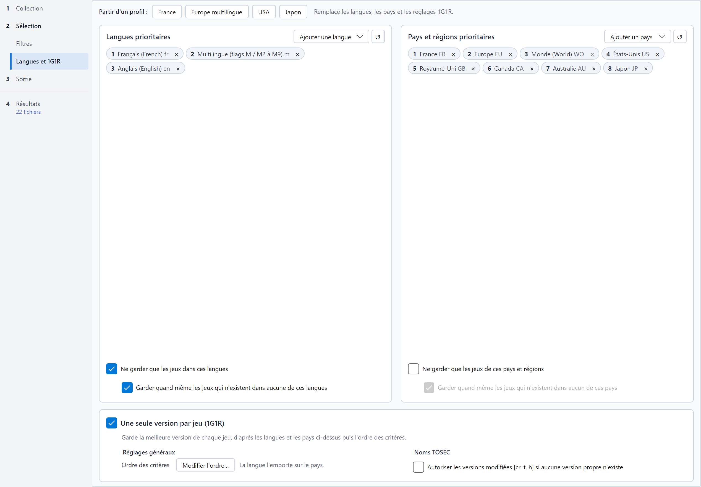

# Langues, régions et 1G1R

La page **Langues et 1G1R** de l'étape *Sélection* fixe les langues et les pays que vous voulez, et si RomSieve ne garde qu'une
seule version de chaque jeu.

La page suit l'ordre du raisonnement : en haut, **Partir d'un profil** remplit tout d'un clic (voir
[Profils rapides](#profils-rapides)) ; au milieu, deux cadres disent quelles langues et quels pays vous voulez ; en bas,
le cadre **Une seule version par jeu (1G1R)** dit comment choisir une version de chaque jeu.

## Langues et pays prioritaires

Deux cadres côte à côte, *Langues prioritaires* et *Pays et régions prioritaires*, montrent **vos choix par ordre de
priorité**, sous forme de puces numérotées : la puce 1 est préférée, puis la 2, et ainsi de suite.

* **Ajouter une langue** / **Ajouter un pays**, en haut à droite du cadre, ouvre une recherche par nom ou par code : cliquez sur un résultat, ou
  appuyez sur Entrée pour ajouter le premier. L'entrée ajoutée se place en fin de liste.
* La croix d'une puce la retire de la liste.
* Pour changer le rang d'une puce, faites-la glisser sur une autre puce, ou faites un clic droit dessus : **En premier**,
  **Monter**, **Descendre** ou **Retirer**. Au clavier, une puce sélectionnée se déplace avec Ctrl+flèches, passe en
  tête avec Ctrl+Début et se retire avec Suppr.
* Le bouton **↺**, à côté, rétablit la liste par défaut.

* Les langues utilisent des codes à deux lettres (`en`, `fr`, `de`, `ja`...) ; `m` désigne les versions
  *multilingues* (`M3`, ou plusieurs langues).
* Les pays utilisent des codes à deux lettres (`FR`, `US`, `JP`...) et des régions : `EU` (Europe), `WO` (Monde),
  `AS` (Asie), `SCAN` (Scandinavie), `LA` (Amérique latine)...

### Filtrage

Sous les puces de chaque cadre :

* **Ne garder que les jeux dans ces langues** : exclut les jeux disponibles dans aucune de vos langues.
* **Ne garder que les jeux de ces pays et régions** : exclut les jeux parus dans aucun de vos pays.
* **Garder quand même les jeux qui n'existent dans aucune de ces langues** (ou **aucun de ces pays**), en retrait sous
  son filtre (cochée par défaut, active seulement avec le filtre) : quand un jeu n'existe dans aucune de vos langues
  (ou aucun de vos pays), garde sa version disponible au lieu de l'exclure. Recommandé, sauf si vous voulez une
  collection strictement unilingue.

## 1G1R : un jeu, une ROM

Une collection contient souvent de nombreuses versions d'un même jeu : plusieurs régions, révisions, dumps
alternatifs, versions crackées et propres... Avec **Une seule version par jeu (1G1R)**, la case du titre du cadre du bas, RomSieve regroupe les versions de
chaque jeu et ne garde que la meilleure ; les autres sont **Exclues**, avec la raison (par exemple *1G1R : Jeu (Europe).zip
retenu (langue FR préférée à EN)*).

Les versions d'un jeu sont regroupées par leur titre (normalisé : articles, accents, chiffres romains...) et leur
système, et avec un DAT par ses relations parent / clone. Activer le 1G1R active aussi le filtrage par langues, sur
lequel il s'appuie.

### Profils rapides

| Profil | Langues | Pays | Vidéo |
|---|---|---|---|
| **France** | fr > multilingue > en | FR, EU, WO, US, GB, CA, AU, JP | PAL |
| **Europe multilingue** | multilingue > fr > en > de > es > it | EU, WO, FR, GB, DE, ES, IT, US, AU, JP | PAL |
| **USA** | en > multilingue | US, WO, CA, EU, GB, AU, JP | NTSC |
| **Japon** | ja > en | JP, AS, WO, US, EU | NTSC |

Les boutons **Partir d'un profil**, en haut de la page, remplacent les langues, les pays et les réglages 1G1R ; leur
infobulle les décrit. Un profil active le 1G1R et remplit les listes ; ajustez-les ensuite à votre convenance. Les profils France, USA
et Japon préfèrent aussi les versions unilingues.

### Choix de la meilleure version

Les candidates sont comparées critère par critère ; le premier critère qui les distingue décide. Une candidate est une
version complète d'un jeu : tous les disques d'une même édition multi-disques concourent ensemble, et ses
caractéristiques sont lues sur son premier fichier (le disque 1). Les informations viennent surtout du **nom du
fichier**, analysé selon sa convention (TOSEC, No-Intro ou Redump), et de son **extension** ; le DAT n'intervient que
pour les relations parent / clone. Un set MAME est décrit par sa machine dans le DAT (description, année, fabricant,
statut d'émulation), et un logiciel d'une liste MAME par son entrée dans le DAT de la liste (description, année,
éditeur, prise en charge par MAME). Un critère sur lequel les candidates sont à égalité, par exemple faute d'information
dans leurs noms, laisse décider le suivant.

Chaque convention a **son propre ordre des critères**, fait des seuls critères qui peuvent départager deux de ses
versions : un nom No-Intro ne porte pas de date, une cartouche n'a qu'un fichier, une borne MAME n'est ni PAL ni NTSC...
Une version suit l'ordre de sa convention ; une version dont la convention n'est pas connue suit l'ordre de TOSEC.

La raison affichée pour une version exclue nomme le critère décisif (par exemple *version v1.2 > v1.0*, ou *version v1.0 > sans version* face à un nom sans numéro de version, qui passe après tous les autres).

#### Les critères

* **Langue (rang de priorité)** : la version dont la langue est la mieux placée dans vos *Langues prioritaires*
  l'emporte. Les langues sont celles du nom (`(fr)`, `(En,Fr,De)`, `M3`...). Quand le nom n'en donne aucune, elles sont
  déduites du pays : `(France)` vaut `fr`, `(USA)` et `(Europe)` valent `en`, `(Japan)` vaut `ja`... Un nom sans langue
  ni pays compte comme anglais. Le code `m` (multilingue) correspond à une version multilingue qui contient au moins
  deux de vos langues (une seule si votre liste n'en compte qu'une), ou dont le nom ne détaille pas les langues
  (`M3`). Une version dans aucune de vos langues passe après toutes les autres.
* **Set complet** : un set dont tous les disques sont présents l'emporte sur un set incomplet du même support ; pour
  MAME, un set qui a toutes ses ROM et tous ses CHD. Le nombre de disques attendu vient du nom (`(Disk 1 of 3)`) ou, à
  défaut, du plus grand numéro de disque trouvé (`(Disc 1)`, `(Disc 2)`...). Ce critère ne départage que des versions
  sur le même type de support : s'il n'existe aucun set complet sur disquettes, il ne pénalise pas les versions sur
  disquettes.
* **Chipset Amiga (machine AGA)** : sans effet tant que l'option *Machine Amiga* de la page Filtres ne vaut pas
  **Amiga 1200, 4000, CD32 (AGA)**. Avec cette machine, les versions AGA et OCS d'un même jeu n'en font qu'un, et la
  version AGA (`(AGA)`, `(A1200)`...) l'emporte sur une version qui tourne sur les deux familles (`(OCS-AGA)`,
  `(ECS-AGA)`), qui l'emporte sur une version corrigée pour AGA (`[f AGA NOMAD]`), qui l'emporte sur une version
  OCS / ECS (sans marque de chipset). Le chipset vient du nom TOSEC.
* **Bon dump (vérifié d'abord)** : un dump vérifié (`[!]` en TOSEC) l'emporte sur un dump sans marque, qui l'emporte
  sur un mauvais dump (`[b]`, `(Bad Dump)`), infecté par un virus (`[v]`), surdimensionné (`[o]`) ou tronqué (`[u]`).
  Tous les dumps d'un DAT Redump sont vérifiés, et une ROM MAME marquée *baddump* est le meilleur dump connu : leurs
  ordres n'ont pas ce critère.
* **Version originale** : la version originale l'emporte sur une version modifiée. Du moins pénalisé au plus
  pénalisé : les correctifs (`[f]`), les rééditions (`(Virtual Console)`, `(Switch Online)`...), les traductions
  (`[tr]`, `[T-Fr]`), les dumps alternatifs (`[a]`), les cracks (`[cr]`), les trainers (`[t]`, `[t +2]`), les versions
  modifiées (`[m]`), les hacks (`[h]`, `(Hack)`), les versions pirates (`[p]`, `(Pirate)`), les versions de
  développement (`(alpha)`, `(beta)`, `(proto)`, `(preview)`...) et les ADF étendus ; chaque marqueur supplémentaire
  pénalise encore, et `[a2]`, `[cr3]`... passent après `[a]`, `[cr]`. Pour MAME, un bootleg ou un hack perd face au
  set original ; pour un logiciel d'une liste MAME, une version pirate, un hack, un crack, une version avec trainer ou
  un prototype perd face à la version commerciale.
* **Émulation MAME (statut du driver)** : une machine dont l'émulation est *bonne* l'emporte sur une émulation
  *imparfaite*, qui l'emporte sur une émulation *préliminaire*. Le statut vient du DAT produit par `mame -listxml`.
  Pour un logiciel d'une liste MAME, c'est sa prise en charge par MAME (*pris en charge*, puis *partiellement*, puis
  *non pris en charge*), que seuls les fichiers hash de MAME donnent.
* **Pays / région (rang de priorité)** : la version dont un pays figure le plus haut dans vos *Pays & Régions
  prioritaires* l'emporte. Les pays sont ceux du nom (`(France)`, `(Europe)`, `(USA, Europe)`, `(FR)`...) ; `UK` et
  `GB` sont équivalents. Une version sans pays dans votre liste, ou sans pays du tout, passe après les autres.
* **Standard vidéo préféré** : compare les versions au standard choisi sur la ligne du critère : **Indifférent**
  (sans effet), **PAL (50Hz / Europe)** ou **NTSC (60Hz / USA, Japon)**. Une version du standard choisi l'emporte sur
  une version inconnue, qui l'emporte sur une version de l'autre standard. Le standard vient du nom (`(PAL)`, `(NTSC)`)
  ou, à défaut, des pays : `USA`, `Japan`, `Canada`, `Brazil`, `Korea`... sont NTSC ; `France`, `Germany`, `Europe`,
  `Australia`... sont PAL. Une version de pays des deux standards convient aux deux préférences.
* **Type de média préféré** : compare les versions TOSEC au support choisi sur la ligne du critère (disquettes,
  cassettes, cartouches, images CD, disque dur et WHDLoad ; **Indifférent** : sans effet). Une version sur le support
  choisi l'emporte. Le support se déduit de l'extension (`.adf`, `.d64`, `.st`... pour les disquettes, `.tap`, `.tzx`,
  `.cdt`... pour les cassettes, `.crt`, `.rom`... pour les cartouches, `.iso`, `.cue`, `.chd`... pour les CD, `.lha`,
  `.hdf` pour le disque dur), sinon d'une mention du nom (`(Disk 1 of 2)`, `(Tape)`, `(Cart)`).
* **Fidélité du format** : à support égal, le format d'image le plus fidèle à l'original l'emporte, d'après
  l'extension :
  * disquettes : `.ipf`, `.stx`, `.g64`, `.scp`, `.fdi` (et les images `(sps)`) > `.adf`, `.d64`, `.dsk`, `.st`,
    `.msa`, `.img` > `.dms`, `.dmz` ;
  * disques optiques : `.chd` > `.cue`, `.gdi` > `.cdi`, `.mds`, `.ccd`, `.nrg` > `.iso` ;
  * cassettes : `.tzx`, `.cdt`, `.pzx`, `.uef` > `.tap`, `.cas`, `.t64`, `.k7` > `.wav`, `.voc` ;
  * disque dur : `.lha`, `.hdf` > `.vhd` > `.hdz` ;
  * cartouches : `.crt`, `.nes`, `.sfc`, `.gb`, `.gbc`, `.gba`, `.md`, `.gen`, `.smd` > `.rom`, `.smc`, `.a26`,
    `.pce`, `.sms`, `.gg`... > `.bin`.

  Une extension inconnue se place au niveau intermédiaire.
* **Une ou plusieurs langues** : suit le choix de la ligne du critère. Avec **Une seule langue** (par défaut), une
  version dans une seule langue l'emporte sur une version multilingue (`M3`, `(En,Fr,De)`) ; avec **Plusieurs
  langues**, c'est l'inverse.
* **Pays parlant la langue choisie** : préfère la version dont le pays parle la langue retenue. Pour un francophone,
  une version française de `(France)` l'emporte sur une version française de `(USA)`. Une version d'une région
  européenne ou mondiale (`Europe`, `World`, `Scandinavia`) dans une langue européenne de votre liste vient ensuite,
  comme une version dont le pays parle une autre de vos langues, ou une version sans pays ; une version d'un pays dont
  vous ne parlez aucune langue vient en dernier. Le Canada compte pour l'anglais et le français, la Belgique pour le
  français, le néerlandais et l'allemand, la Suisse pour l'allemand, le français et l'italien.
* **Version la plus récente** : la version au numéro le plus élevé l'emporte (`v1.2` avant `v1.1`, `v1.10` avant
  `v1.9`, `v1.0a` avant `v1.0`). Le numéro vient du champ version du nom TOSEC, de `(v1.1)` en No-Intro, ou à défaut
  d'un `v…` ou `r…` trouvé dans le nom. Une version sans numéro passe après toute version numérotée.
* **Révision la plus récente** : la révision la plus élevée l'emporte : `(Rev 2)` avant `(Rev 1)`, `(Rev B)` avant
  `(Rev A)`, ou `(PRG1)` avant `(PRG0)`. Une version sans révision passe après.
* **Date la plus récente** : la date du nom la plus récente l'emporte (`(1991-03-12)` avant `(1990)`), dans les noms
  TOSEC, dont la date est obligatoire, et dans les descriptions MAME (la date d'un prototype d'une liste de logiciels,
  `prototype 19940420`). Une date incomplète (`19xx`, `1990-xx`) perd ses
  parties inconnues : `1990-05` l'emporte sur `1990`, et `19xx` compte comme une absence de date.
* **Le plus de disques (set incomplet)** : entre deux versions dont il manque des disques, celle dont on a trouvé le
  plus de disques ou de parties distincts l'emporte (`Disk 1`, `Disk 2`... ou `Side A`, `Side B`).
* **Parent plutôt que clone** : avec un DAT, la version parente d'un jeu l'emporte sur ses clones (attribut `cloneof`
  du DAT). Sans DAT, toutes les versions comptent comme parentes et ce critère ne départage rien. Les DAT TOSEC ne
  décrivent aucun clone : l'ordre de TOSEC n'a pas ce critère.

et toujours en dernier, le **nom** lui-même : le nom de fichier le plus court l'emporte, car un nom chargé de mentions
décrit en général une variante (les mentions de rôle de disque `(Intro)`, `(Game)`, `[bootable]` et `[non-bootable]`
ne sont pas comptées), puis le premier nom dans l'ordre des codes de caractères, pour que le résultat ne dépende jamais
de l'ordre des fichiers sur le disque.

#### Ordres par défaut

| Critère | TOSEC | No-Intro | Redump | MAME | Listes MAME |
|---|:-:|:-:|:-:|:-:|:-:|
| Langue (rang de priorité) | 1 | 1 | 1 | 5 | 1 |
| Set complet | 2 | | 2 | 1 | 2 |
| Chipset Amiga (machine AGA) | 3 | | | | |
| Bon dump (vérifié d'abord) | 4 | 2 | | | |
| Version originale | 5 | 3 | 3 | 2 | 3 |
| Émulation MAME (statut du driver) | | | | 3 | 4 |
| Pays / région (rang de priorité) | 6 | 4 | 4 | 6 | 5 |
| Standard vidéo préféré | 7 | 5 | 5 | | 6 |
| Type de média préféré | 8 | | | | |
| Fidélité du format | 9 | | 6 | | |
| Une ou plusieurs langues | 10 | 6 | 7 | | 7 |
| Pays parlant la langue choisie | 11 | 7 | 8 | 10 | 8 |
| Version la plus récente | 12 | 8 | 9 | 7 | 9 |
| Révision la plus récente | 13 | 9 | 10 | 8 | 10 |
| Date la plus récente | 14 | | | 9 | 11 |
| Le plus de disques (set incomplet) | 15 | | 11 | | |
| Parent plutôt que clone | | 10 | 12 | 4 | 12 |

Une case vide est un critère qui ne peut départager deux versions de la convention : il ne figure pas dans son ordre.
En mode « pays d'abord », le pays passe en tête des ordres de TOSEC, No-Intro, Redump et des listes MAME.

### Modifier la cascade

Le bouton **Modifier l'ordre…**, sur la ligne *Ordre des critères*, ouvre le panneau des ordres. **Réglages pour :**
TOSEC, No-Intro, Redump, MAME ou Listes MAME choisit l'ordre affiché : celui de la convention de votre collection, ou un autre, qui
est conservé pour vos autres collections. Sélectionnez un critère et montez-le ou descendez-le, ou rétablissez l'ordre
par défaut. Sous la liste, une phrase nomme les critères des autres conventions, que celle-ci n'a pas.

Les critères qui comparent les versions à une préférence la portent sur leur ligne, dans une liste déroulante :
**Standard vidéo préféré**, **Type de média préféré** et **Une ou plusieurs langues**. Un profil rapide les change
aussi.

L'ordre est le seul réglage de l'ordre de la langue et du pays : leur place dit aussi lequel des deux l'emporte, y
compris pour les filtres de langue et de pays. La phrase à côté du bouton le rappelle (*La langue l'emporte sur le
pays.* ou *Le pays l'emporte sur la langue.*). Placer le pays au-dessus de la langue dans l'ordre de TOSEC, de No-Intro,
de Redump ou des listes MAME fait de même dans les autres ; l'ordre des sets MAME garde le sien. Rétablir l'ordre par défaut garde
en tête la langue ou le pays, comme l'ordre en cours.

Les critères sans effet sur la collection que vous triez sont en gris et en italique dans la liste. Survolez un critère
pour savoir ce qu'il compare et, s'il est grisé, pourquoi il est sans effet. RomSieve ne grise un critère que lorsqu'il
est certain qu'il ne départage aucune version :

* **Chipset Amiga (machine AGA)** tant que la *Machine Amiga* choisie n'est pas un Amiga AGA ;
* **Standard vidéo préféré** et **Type de média préféré** tant que leur ligne indique **Indifférent** ;
* **Parent plutôt que clone** sans DAT, ou avec un DAT qui ne décrit aucune relation parent / clone. Il n'est grisé
  qu'une fois le DAT entièrement lu.

Après une simulation, chaque critère affiche à droite le nombre de jeux qu'il a départagés : ceux où il a désigné la
version retenue face à au moins une autre version. Un jeu compte une fois pour chaque critère qui a écarté l'une de ses
versions ; un jeu à une seule version, ou dont la version a été choisie à la main, n'est compté par aucun. Un 0 grisé
signale un critère qui n'a rien décidé dans cette collection. Les nombres suivent les versions choisies à la main et
disparaissent dès qu'un réglage change, l'ordre des critères compris, puisqu'ils décriraient un autre tri : relancez
alors la simulation.

Cliquez sur un nombre pour voir ces jeux : l'étape Résultats s'ouvre et la table n'affiche plus que les jeux départagés
par ce critère : pour chacun, la version retenue et les versions que ce critère a écartées (pas celles qu'un autre critère
a écartées). Un bandeau au-dessus de la table le rappelle ; son bouton **Tout afficher** retire le filtre. Ce filtre se
combine avec la recherche et les pastilles de statut : avec la pastille « Retenus », la table ne montre que les versions
retenues.

### Ordre des sets MAME

Par défaut, l'ordre des sets MAME retient le parent choisi par les développeurs de MAME, sauf s'il est incomplet, un
bootleg ou un hack, ou moins bien émulé qu'un clone ; la langue, le pays, la version, la révision, la date et le pays
parlant la langue choisie ne départagent que des clones dont le parent est absent ou écarté.

Pour préférer les versions de votre région (un clone `USA` ou `Japan` plutôt qu'un parent `World`), placez la langue ou
le pays au-dessus de *Parent plutôt que clone*. Modifier cet ordre ne change pas lequel de la langue ou du pays
l'emporte pour les autres collections. Les pays prioritaires gardent leur effet de filtre : sans langue prioritaire, un
set d'un pays de votre liste l'emporte toujours sur un set d'un autre pays.

### Ordre des listes de logiciels MAME

Les logiciels d'une [liste de logiciels MAME](naming-conventions-and-dats.md#listes-de-logiciels-mame) sont des
cartouches, disquettes et cassettes parues par région : leur ordre est proche de celui de No-Intro, la langue en tête.
Un logiciel auquel il manque une ROM perd face à un logiciel complet, comme un set MAME, et un logiciel mieux pris en
charge par MAME l'emporte sur les autres quand le DAT le dit (fichiers hash de MAME). Le parent choisi par MAME ne
départage que ce que rien d'autre ne départage ; avec un DAT SabreTools, qui ne nomme aucun parent, *Parent plutôt que
clone* est grisé.

### Autres préférences

Toutes les options du 1G1R sont dans son cadre, sous la case qui l'active. Tant que le 1G1R est désactivé, elles restent
visibles mais grisées, et le cadre dit que toutes les versions qui passent les filtres sont gardées.

**Noms TOSEC**, à droite, n'agit qu'avec la convention TOSEC, ou tant qu'elle n'est pas encore connue. Avec une autre
convention, l'option reste visible mais grisée, une phrase dit pourquoi, et elle garde sa valeur.

* **Autoriser les versions modifiées [cr, t, h] si aucune version propre n'existe** : pour un jeu qui n'existe
  qu'en versions modifiées, garde la meilleure d'entre elles plutôt qu'aucune.

### Corriger un choix

Si RomSieve ne garde pas la version que vous voulez, faites un clic droit sur cette version dans le tableau de
simulation et choisissez **Retenir cette version comme gagnante 1G1R** : voir
[Le tableau de simulation](simulation-table.md#forcer-un-gagnant-1g1r).
