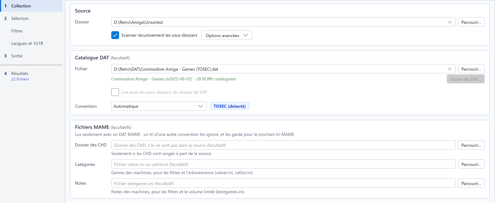

# Conventions de nommage et fichiers DAT

## Choisir la convention

La source, le fichier DAT et la convention se règlent dans l'étape **Collection**, dans cet ordre : le cadre **Source**
(seul champ obligatoire), puis le cadre **Catalogue DAT** (facultatif), qui porte aussi la convention, et, avec la
convention MAME, le cadre **Fichiers MAME** (facultatifs). Sans DAT, une phrase sous le champ rappelle que les jeux ne
sont alors reconnus que par le nom de leurs fichiers. Une croix au bout d'un champ de fichier ou de dossier le vide :
c'est ainsi qu'on cesse d'utiliser un DAT, un dossier de CHD ou un fichier de catégories ou de notes.



La liste **Convention**, dans le cadre *Catalogue DAT*, propose :

* **Automatique** : la convention est déduite de l'en-tête du DAT, ou des noms de fichiers. Le
  badge à côté de la liste affiche le résultat, par exemple *No-Intro (détecté)*. Il s'affiche dès le choix du DAT,
  d'après son en-tête et ses premiers jeux ; le DAT est ensuite lu en entier en arrière-plan (« lecture du DAT… »
  sous le champ) pour afficher son nom, sa version et le nombre de ROMs qu'il catalogue.
* **TOSEC**, **No-Intro** ou **Redump** : impose la convention.
* **MAME** : trie des sets d'arcade avec un DAT MAME (voir [DAT MAME](#dat-mame)).
* **Liste de logiciels MAME** : trie les logiciels d'une liste de consoles ou de micros de MAME avec le DAT de cette
  liste (voir [Listes de logiciels MAME](#listes-de-logiciels-mame)).

La convention effective choisit aussi les réglages affichés dans la page **Filtres** (TOSEC, ou No-Intro / Redump,
également utilisés pour MAME et ses listes de logiciels). Avec un [lot de DAT](#plusieurs-dat), chaque DAT garde sa
propre convention ; la convention effective est celle de la plupart des DAT cochés.

## Lecture des noms

### TOSEC

Un nom TOSEC range ses informations dans un ordre fixe :

```
Titre v1.1 (demo) (1991)(Éditeur)(Système)(Vidéo)(Pays)(Langue)(Copyright)(Statut)(Support)[drapeaux].ext
```

Par exemple `Another World v1.1 (1991)(Delphine)(FR)(Disk 1 of 2)[cr Quartex].adf`. RomSieve lit le titre, la
version, la date, l'éditeur, le système (A500, AGA, C64...), le standard vidéo (PAL, NTSC), les pays, les langues
(`en`, `fr-de`, `M3` pour « 3 langues »), le support (*Disk 1 of 2*, *Side B*, *Tape 1*) et les drapeaux entre
crochets :

| Drapeau | Signification |
|---|---|
| `[!]` | Dump vérifié |
| `[a]`, `[a2]` | Dump alternatif (variante) |
| `[b]` | Mauvais dump (*bad dump*) |
| `[o]`, `[u]` | Overdump, underdump |
| `[v]` | Infecté par un virus |
| `[cr]`, `[t]`, `[h]`, `[f]`, `[m]`, `[p]` | Crack, trainer, hack, correctif, modification, version pirate |
| `[tr Fr]` | Traduction |

Un fichier dont le nom ne suit pas au moins la forme `Titre (date)(éditeur).ext` est **non conforme**.

### No-Intro et Redump

```
Titre (Région) (Langues) (Rev 1) (Beta) (Disc 2).ext
```

Par exemple `Super Mario World (USA).sfc` ou `Final Fantasy VII (Europe) (Disc 1).cue`. RomSieve lit les régions,
les langues, la révision, le statut de développement (Beta, Proto, Sample...), les parutions non officielles (Unl,
Pirate, Hack...), les rééditions modernes (Virtual Console, Switch Online, Classic Mini...) et le numéro de disque.

Les DAT No-Intro de disquettes (Acorn Archimedes...) numérotent les disquettes `(Disk 1)`, `(Disk 2)`..., parfois avec
un libellé : `(Disk 1, Game Disk)`, `(Disk 2 - Courses)`. RomSieve les lit comme les disques d'un même set, gardés ou
écartés ensemble par le 1G1R, même quand le DAT décrit chaque disquette comme un jeu et fait des disquettes les clones
de l'une d'elles. Sans total dans le nom, le set compte autant de disques que le plus grand numéro trouvé.

### Supports optiques

Un descripteur (`.cue`, `.gdi`, `.ccd`) et ses pistes (`.bin`, `.img`, `.sub`...) forment un **set** : ils sont
analysés, renommés et transférés ensemble, sur le disque comme dans les archives. Lorsqu'un set doit être renommé pour
éviter un conflit, le descripteur est réécrit pour désigner les pistes renommées.

## Fichiers DAT

Un fichier DAT liste les ROMs d'une collection avec leur nom, leur taille et leurs sommes de contrôle (CRC32, souvent
MD5 et SHA-1). RomSieve lit les formats **Logiqx XML** (`.dat`, `.xml`) et **ClrMamePro** (`.dat`) publiés par TOSEC,
No-Intro et Redump.

Avec un DAT :

* chaque fichier est identifié par sa **taille et son CRC32**, même s'il est mal nommé ; c'est alors son nom dans le
  DAT qui est utilisé ;
* un fichier absent du DAT est **non conforme** et va dans `_unmatched/` ;
* les relations **parent / clone** du DAT aident à regrouper les versions d'un jeu pour le 1G1R ;
* le bandeau affiche la **complétude** de votre collection, et vous pouvez [exporter les ROMs manquantes](exports.md).

Quelques détails :

* Le CRC32 n'est calculé que pour les fichiers dont la taille figure dans le DAT, ce qui fait gagner du temps sur les
  grosses collections.
* Les **en-têtes copieurs** (par exemple l'en-tête de 16 octets des ROMs NES) sont détectés : lorsque c'est la taille
  sans l'en-tête qui figure dans le DAT, la somme de contrôle est calculée sans lui.
* Une ROM présente dans plusieurs jeux du DAT les marque tous comme trouvés.

### Vérifier le SHA-1

Le CRC32 est court : deux fichiers différents peuvent le partager. Avec **Vérifier le SHA-1** (dans les
[options avancées](settings-and-profiles.md)), RomSieve calcule aussi
le SHA-1 de chaque fichier identifié par son CRC32 quand le DAT en fournit un (c'est le cas des DAT Redump), et rejette
la correspondance s'il diffère. C'est plus sûr mais plus lent, puisque chaque fichier identifié est relu (un fichier
dans un ZIP doit être décompressé).

### Vérifier le contenu des archives

Un fichier dans une archive (ZIP, 7z, RAR) est reconnu par le CRC32 que l'archive enregistre pour lui, sans être lu, et
un set MAME est copié tel quel : une archive abîmée dont l'en-tête est juste passe pour complète. Avec **Vérifier le
contenu des archives** (dans les [options avancées](settings-and-profiles.md)), RomSieve décompresse chaque fichier de
chaque archive et compare son contenu à ce CRC32, comme le *full scan* d'un gestionnaire de ROMs. Un fichier abîmé est
non conforme (« Fichier abîmé dans son archive »), et le jeu dont une piste est abîmée l'est tout entier ; un set MAME
abîmé est non conforme (« Archive abîmée »), ses ROMs comptées manquantes : réparez-le avec un gestionnaire de ROMs.
La première analyse est beaucoup plus lente, puisque chaque archive est décompressée ; le résultat est ensuite gardé
dans le cache des en-têtes, et seule une archive nouvelle ou modifiée est relue. Un fichier d'un 7z ou d'un RAR qui
n'enregistre pas de CRC32 ne peut pas être vérifié.

### Vitesse de calcul

**Calcul des CRC**, dans la [fenêtre des préférences](settings-and-profiles.md), fixe le nombre de fichiers analysés en même temps : *1 fichier à la fois* convient mieux à un disque
dur mécanique ; 2, 4, 8 ou *Automatique* accélèrent l'analyse sur un SSD, un disque NVMe ou un NAS rapide. Le résultat
n'en dépend jamais. C'est une option de tri : elle est enregistrée dans les profils, et charger un profil peut la
modifier. Les sommes de contrôle sont mises en cache : une deuxième analyse de fichiers inchangés est bien plus
rapide.

### DAT MAME

Un DAT MAME (la sortie de `mame -listxml`, ou un DAT *non-merged* ou *merged* produit par SabreTools) fait détecter la
convention **MAME** : le badge affiche *MAME (détecté)*. Elle peut aussi être choisie dans la liste, mais elle exige
un DAT MAME.

Avec cette convention, l'unité est le **set** : une archive (ZIP ou 7z) qui porte le nom court d'une machine
(`sf2.zip`).

* Une archive est identifiée par son nom, ou à défaut par les ROMs qu'elle contient : une archive renommée est écrite
  sous le nom court de sa machine. Les ROMs sont comparées par leur taille et le CRC32 enregistré dans l'archive, sans
  décompression.
* Le titre, la région, la date, la révision, la version et le statut (bootleg, hack, prototype) viennent de la
  **description** de la machine dans le DAT, l'année et le fabricant (`{year}`, `{publisher}`) aussi.
* Un CHD rangé dans le dossier de son set (`area51/area51.chd`) est identifié par le SHA-1 de son en-tête et suit son
  set, dans un dossier du même nom. Le disque d'un clone rangé dans le dossier de son parent (CHD *merged*) y reste :
  MAME l'y cherche aussi. Quand les CHD sont rangés à part (un dossier `CHD` à côté des ROMs, comme dans un
  *full set*), indiquez ce dossier dans le champ **Dossier des CHD** du cadre *Fichiers MAME* de l'étape *Collection* (toujours affiché, aux couleurs de MAME avec la convention MAME) : ses
  CHD sont lus en plus de la source, et ses autres fichiers ignorés. La destination ne doit pas chevaucher ce dossier,
  pas plus que la source. Un tri d'une autre convention ne le lit jamais : le dossier reste dans les réglages pour le
  prochain tri MAME, sans rien dire au journal.
* Le DAT ne dit pas le genre d'une machine : indiquez un fichier de catégories dans le champ **Catégories** du cadre
  *Fichiers MAME* de l'étape *Collection* (voir [Genre des machines](#genre-des-machines)).
* Un set auquel il manque des ROMs ou un disque est **incomplet** ; avec **Sets complets uniquement**, il est exclu.
  Les ROMs qu'un jeu partage avec son BIOS peuvent rester dans le set du BIOS (`neogeo.zip`), comme dans les
  collections *merged* et *split* : le jeu est complet si ce set est dans la source, et signalé s'il en est absent.
  Il en va de même des *devices* à ROMs qu'utilise un jeu (`qsound` pour les jeux CPS2) : sauf si son set contient
  leurs ROMs (set *fully non-merged*), le jeu a besoin de leurs sets, et il est incomplet sans eux.
* Les sets dont un set retenu a besoin pour fonctionner (son BIOS, ses *devices*, le parent d'un clone *split*) sont
  **triés avec lui**, même quand un filtre ou le 1G1R les exclut ; la table les signale par la pastille **Requis** et en donne la raison (*le set … en a
  besoin*). Un [tri partiel](simulation-table.md#trier-une-partie-de-la-simulation) les ajoute de même aux jeux choisis.
* Pour le 1G1R, un clone rejoint son parent (relations `cloneof` du DAT ; un DAT SabreTools n'en a pas, ses sets sont
  regroupés par titre). Deux jeux de même titre mais de parents différents restent distincts, et un BIOS ou un *device*
  est un jeu à part.
* Les filtres utilisent les réglages **No-Intro / Redump** (un bootleg y compte comme une version pirate) et le groupe
  [Machines MAME](filters.md#machines-mame) : BIOS, *devices*, machines mécaniques, machines à habillage externe,
  statuts d'émulation gardés, son, et la borne (orientation et type d'écran, joueurs, commandes, boutons). Le 1G1R préfère la meilleure émulation (critère *Émulation MAME*).
* Une archive est transférée telle quelle, même en mode ZIP, et n'est jamais renommée : en conflit avec le mode
  *Renommer*, elle est ignorée comme un doublon, car MAME ne trouve un set que par son nom.
* MAME ne cherche pas les sets dans des sous-dossiers : choisissez **Tout à la racine** (ligne *Organisation* du cadre *Arborescence*, étape *Sortie*) ; l'aperçu du modèle le rappelle.

#### Types de romsets

RomSieve trie les archives telles qu'elles sont : il ne reconstruit, ne répare ni ne convertit jamais un set.

| Romset | Une archive contient | Avec RomSieve |
|---|---|---|
| *non-merged* | Toutes les ROMs de sa machine, BIOS compris | Chaque parent et chaque clone est un set à part : le 1G1R et les filtres choisissent entre eux. |
| *merged* | Le parent et tous ses clones | Trié tel quel, avec ses clones : le 1G1R et les filtres choisissent l'archive entière, pas un clone. |
| *split* | Les seules ROMs propres à sa machine | Un parent est trié normalement. Un clone ne fonctionne pas sans le set de son parent : il est signalé, et en 1G1R il perd toujours face à son parent complet. |

Dans une collection *merged* ou *split*, les jeux prennent dans les sets de BIOS les ROMs qu'ils partagent avec leur
BIOS : placez les sets de BIOS et de *devices* dans la source, RomSieve trie ceux dont les jeux retenus ont besoin. Pour changer de type de romset, utilisez un gestionnaire de romsets comme clrmamepro ou RomVault.

Les *samples* ne sont pas gérés, et un fichier hors d'une archive (sauf un CHD) n'est pas un set MAME.

#### Genre des machines

Le DAT de MAME ne dit pas le genre d'une machine. La communauté publie des fichiers de catégories, que RomSieve lit
quand vous en indiquez un dans le champ **Catégories** de l'étape *Collection* (option `--categories` en ligne de
commande) :

* `catver.ini` : une section `[Category]` de lignes `machine=Genre / Sous-genre` ;
* `catlist.ini` et `genre.ini` de progettosnaps : une section par catégorie, suivie de ses machines. `catlist.ini`
  marque les machines d'arcade (`Arcade: Shooter / Flying Vertical`) : il permet d'exclure les consoles, ordinateurs
  et autres machines hors arcade d'un *full set*.

Une catégorie suivie de `* Mature *` signale une machine pour adultes. Un clone que le fichier ne cite pas prend la
catégorie de son parent. Les catégories servent aux [filtres](filters.md#filtres-de-genre), à la recherche du tableau et aux
variables `{genre}` et `{category}` du [modèle de dossiers](destination-and-transfers.md). Un fichier introuvable ou
illisible est signalé au journal, et le tri continue sans catégories.

#### Notes des machines

progettosnaps publie aussi `bestgames.ini`, qui note quelques milliers de jeux d'arcade sur 100, par tranche de dix
(de `0 to 10 (Worst)` à `90 to 100 (Best Games)`). Indiquez-le dans le champ **Notes** de l'étape *Collection* (option
`--ratings` en ligne de commande) : un clone prend la note de son parent, et une machine que le fichier ne cite pas est
*non notée*. Les notes servent aux [filtres de notes et au volume limité](filters.md#notes-et-volume) ; le panneau de
détail du tableau les affiche.

### Listes de logiciels MAME

En plus de ses machines d'arcade, MAME émule des consoles et des micro-ordinateurs, dont il décrit les cartouches,
disquettes et cassettes dans des *listes de logiciels* (*software lists*) : une liste par type de support (`megadriv`
pour les cartouches Mega Drive, `a2600`, `cpc_flop`...). Une collection *Software List ROMs* contient un dossier par
liste, et une archive par logiciel dans ce dossier (`megadriv/sonic.zip`). RomSieve lit deux sortes de DAT pour une
liste :

* le **DAT SabreTools** de la liste (Pleasuredome, ROMVault : `megadriv.xml`), dont l'en-tête porte le nom de la liste ;
* le **fichier hash** de la liste que MAME livre dans son dossier `hash` (`hash/megadriv.xml`), qui donne en plus le
  parent de chaque clone et la prise en charge de chaque logiciel par MAME ;
* la **sortie de MAME** pour la liste, qui dit la même chose : `mame -getsoftlist megadriv > megadriv.xml`. Dans
  Windows PowerShell, une redirection réécrit les caractères accentués des descriptions : lancez la commande dans
  l'invite de commandes (`cmd`), ou utilisez le fichier hash.

Chacun de ces DAT fait détecter la convention **Liste de logiciels MAME** (le badge affiche *Liste MAME (détectée)*),
d'après l'éditeur que nomment ses logiciels. La convention peut aussi être choisie dans la liste, mais elle exige le
DAT de la liste.

Pour trier **une liste**, choisissez son DAT et, comme source, le dossier de la liste (`Software List ROMs/megadriv`).

Pour trier **plusieurs listes à la fois**, choisissez un **dossier de DAT** : **Parcourir...** à côté du champ du DAT,
puis **Dossier de DAT…**, ou `--dat <dossier>` en ligne de commande. Le dossier contient un
DAT par liste : le dossier *Software List ROMs* du `DatRoot` de ROMVault, ou le dossier `hash` de MAME. Une sortie de
MAME qui contient plusieurs listes (`mame -getsoftlist`, `mame -listsoftware`) fonctionne de même. La source est alors
le dossier qui contient un dossier par liste (`Software List ROMs`), et **Scanner récursivement les sous-dossiers**
doit être coché.

* Chaque archive appartient à la liste de son dossier (`megadriv/sonic.zip`) et n'est cherchée que dans le DAT de cette
  liste : `sonic` de `megadriv` et `sonic` d'une autre liste sont deux logiciels, deux jeux, triés chacun dans son
  dossier. La source peut aussi être le dossier d'une seule liste.
* Un fichier hors du dossier d'une liste (à la racine de la source), ou dans un dossier qu'aucun DAT ne nomme, est
  **non conforme** ; le journal les compte et en nomme quelques-uns.
* La complétude et la Miss List ne comptent que les listes présentes dans la source : un DAT du dossier dont la source
  n'a pas la liste n'ajoute rien de manquant. La Miss List nomme chaque logiciel avec sa liste (`gamegear/shinobi`).
* Le DAT filtré du catalogue, le DAT de votre collection et le fixdat s'écrivent en **un DAT par liste** (comme dans le
  `DatRoot` de ROMVault), à la racine du dossier choisi : `megadriv.xml`, `gamegear.xml`... Lus dans le dossier `hash`
  de MAME, ils s'écrivent comme des listes de logiciels MAME, que MAME lit
  ([Exports](exports.md#listes-de-logiciels-mame)).
* Un dossier de listes de logiciels ne réunit que des listes : des listes mêlées à des DAT d'une autre convention, ou
  deux DAT de la même liste (le DAT SabreTools et le fichier hash de `megadriv`, par exemple), sont refusés, et le
  champ dit pourquoi. Un dossier de DAT No-Intro, Redump ou TOSEC est un [lot](#plusieurs-dat).
* La première analyse d'une collection entière est longue sur un partage réseau (environ 131 000 archives pour
  MAME 0.289) ; les suivantes lisent dans le cache les en-têtes des archives inchangées.

* Comme pour les sets MAME, l'unité est l'archive d'un logiciel, identifiée par son nom court ou à défaut par ses ROMs,
  comparée au DAT (incomplète s'il lui manque une ROM), et transférée telle quelle, jamais réarchivée ni renommée.
* Le titre, les régions, les langues, la révision, la date d'un prototype et les versions à part (pirate, hack, crack,
  trainer, traduction, prototype, démo) viennent de la **description** du logiciel, l'année et l'éditeur du DAT
  (`{year}`, `{publisher}`). Le titre est tout le texte hors des parenthèses et des crochets : *Initiation au Langage
  Basic (CEGOS) - Volume 3* a pour titre *Initiation au Langage Basic - Volume 3*, si bien que chaque volume, niveau ou
  partie est un jeu à part.
* Un logiciel va dans le **dossier de sa liste**, où MAME le cherche : `megadriv/sonic.zip` sous la destination. Avec
  **Tout à la racine**, la destination est le dossier de ROMs de MAME ; les dossiers d'un modèle viennent au-dessus de
  celui de la liste, et l'aperçu du modèle rappelle que MAME n'y trouverait pas le logiciel.
* Pour le 1G1R, les logiciels suivent l'ordre des [Listes MAME](languages-regions-1g1r.md#ordre-des-listes-de-logiciels-mame). Avec un
  fichier hash, un clone rejoint son parent, même sous un autre titre (*Castle of Illusion - Fushigi no Oshiro
  Daibouken* et *Castle of Illusion Starring Mickey Mouse*), et le 1G1R préfère le logiciel que MAME prend le mieux en
  charge. Un DAT SabreTools n'a pas de parents : les logiciels sont regroupés par titre, si bien que les versions d'un
  jeu parues sous d'autres titres restent distinctes.
* Les filtres utilisent les réglages **No-Intro / Redump**. La qualité des dumps est sans effet (une ROM marquée
  *baddump* est le meilleur dump connu), comme les parutions sans licence et les rééditions modernes, que les
  descriptions ne marquent jamais ; le groupe [Machines MAME](filters.md#machines-mame) ne vaut que pour les machines
  d'un DAT MAME.
* Certaines listes de micros décrivent un logiciel disquette par disquette (*Disk 1 of 2*, *Disk 2 of 2*) : chaque
  disquette est alors un jeu à part, pour que le 1G1R les garde toutes, éventuellement de versions différentes.

**Sets split.** Les collections de Pleasuredome sont *split* : l'archive d'un clone ne contient que les ROMs qu'il ne
partage pas avec son parent. Avec le fichier hash, RomSieve le sait : un clone split retenu emporte son parent (pastille
**Requis**), dont MAME a besoin. Un DAT SabreTools ne liste que les ROMs propres d'un clone et ne nomme pas son parent :
le clone paraît complet, et rien ne dit qu'il a besoin de son parent. Dans MAME 0.289, cela concerne 868 des
41 505 clones des listes, surtout dans `nes` (416) et `msx2_flop` (114) ; utilisez le fichier hash pour ces listes.

## Plusieurs DAT

Un pack No-Intro, Redump ou TOSEC compte des centaines, voire des milliers de DAT, un par système. Plutôt que de trier
la source une fois par DAT, choisissez le **dossier** qui les contient : **Parcourir...** à côté du champ du DAT, puis
**Dossier de DAT…** (`--dat <dossier>` en ligne de commande).
Ce dossier est un **lot** : la source est analysée une seule fois, chaque fichier est rangé avec le DAT qui le
reconnaît, et chaque DAT garde sa convention, ses filtres et son 1G1R.

### Choisir les DAT du lot

Sous le champ, la ligne d'information résume le lot : *Lot de 3 111 DAT (2 900 TOSEC, 150 No-Intro, 61 Redump),
3 111 cochés*. Seuls les en-têtes des DAT sont lus pour l'afficher, en général en une fraction de seconde. Pendant
cette lecture, une barre de progression compte les DAT lus (*1 200 / 3 111 DAT lus*), et **Simuler (Dry-Run)** et
**Démarrer le tri** sont grisés : le tri attend de connaître les DAT du lot. Les autres réglages restent modifiables,
et choisir un autre DAT ou vider le champ abandonne la lecture. À droite, le bouton
**Choisir les DAT…** (grisé pour un fichier DAT) ouvre la fenêtre **DAT du lot** ; elle s'ouvre d'elle-même quand vous
choisissez un nouveau dossier par **Parcourir...**, une fois ses DAT lus (pas au lancement, ni au chargement d'un
profil). Elle s'ouvre toujours sur tous les DAT.

* La fenêtre donne le nom et la convention de chaque DAT, avec une case à cocher, et son sous-dossier quand il n'est
  pas à la racine du dossier choisi ; l'infobulle d'une ligne nomme son fichier.
* **Rechercher un DAT** filtre la liste par nom, chemin (fichier compris) ou convention, mot par mot comme la
  [recherche de la table](simulation-table.md#recherche) : `C64 Games D64` montre les DAT qui contiennent les trois
  mots, `-Demos` écarte ceux qui contiennent *Demos* ; la croix au bout du champ efface la recherche.
* La liste à côté de la recherche montre **Tous les DAT**, les seuls **DAT cochés** (pour retrouver d'un coup ceux
  que vous avez choisis) ou les seuls **DAT décochés**, avec la recherche. Une case changée garde sa ligne jusqu'au
  prochain changement de cette liste ou de la recherche, pour pouvoir revenir dessus.
* **Tout cocher** et **Tout décocher** s'appliquent à tous les DAT ; quand la recherche ou la liste en masquent, ils
  deviennent **Cocher les affichés** et **Décocher les affichés**, et ne touchent qu'aux DAT affichés.
* **OK** garde vos choix ; **Annuler** (ou Échap) rétablit les cases telles qu'elles étaient à l'ouverture de la
  fenêtre.
* Un DAT décoché n'est pas lu par le tri : ses fichiers sont non conformes si aucun autre DAT ne les reconnaît. Les DAT
  décochés sont enregistrés dans les réglages et les profils ; en ligne de commande, `--dat-only <nom>` choisit les DAT
  à utiliser.
* **Lire aussi les sous-dossiers du dossier de DAT**, sous la ligne d'information, ajoute au lot les DAT de ses
  sous-dossiers (un pack TOSEC rangé par constructeur, les dossiers No-Intro et Redump d'un même pack ;
  `--dat-recursive`). La case est grisée pour un fichier DAT.

Un dossier est refusé, et la ligne d'information dit pourquoi, quand deux de ses DAT portent le même nom (sans tenir
compte des majuscules), quand il contient un DAT de machines MAME (à choisir seul), quand il mêle des listes de
logiciels MAME à d'autres DAT, ou quand tous ses DAT sont décochés.

### Conventions d'un lot

Chaque DAT garde la convention de son en-tête : un lot peut mêler des DAT TOSEC, No-Intro et Redump, chacun lu avec ses
noms et filtré avec ses réglages de la page **Filtres**. La convention choisie dans la liste **Convention** ne vaut que
pour les DAT qu'aucun en-tête ne reconnaît ; le journal nomme les DAT dont la convention détectée l'emporte sur elle.
Le badge et la page **Filtres** suivent la convention de la plupart des DAT cochés ; **Réglages pour :** montre les
réglages de l'autre famille. Les variables TOSEC du modèle restent actives dès qu'un DAT TOSEC est coché.

### Tri avec un lot

* Chaque fichier est rangé avec le **premier DAT**, dans l'ordre des chemins, qui le reconnaît par sa taille et son
  CRC32 (ou, pour un CHD, par le SHA-1 de son disque). Un descripteur et ses pistes vont ensemble, avec le DAT de leur
  premier fichier reconnu.
* Les autres DAT qui le reconnaissent sont nommés au journal et dans le panneau de détail du
  [tableau de simulation](simulation-table.md) : ses ROMs y comptent comme présentes, mais il n'est écrit qu'une fois,
  avec son DAT.
* Un fichier qu'aucun DAT ne reconnaît est **non conforme**, comme avec un DAT seul.
* Le même titre dans deux DAT fait deux jeux : le 1G1R garde une version dans chacun, un choix 1G1R manuel ne vaut que
  pour son DAT, et un jeu multi-disques n'est complet qu'avec les disques rangés avec son DAT.
* Chaque DAT a par défaut son **dossier** dans la destination ; voir [Un dossier par DAT](destination-and-transfers.md#un-dossier-par-dat).
* La **complétude** du bandeau réunit tous les DAT ; son info-bulle détaille chaque DAT où un jeu a été trouvé. La Miss
  List et le fixdat ne listent que les DAT où il manque des ROMs et où au moins un jeu a été trouvé
  ([Exports](exports.md#lot-de-dat)).

Seuls les DAT qui peuvent reconnaître un fichier de la source sont lus en entier, une fois les sommes de contrôle
calculées : trier une petite source avec un pack TOSEC complet (3 000 DAT, plus d'un million de ROMs) ne garde que
quelques dizaines de Mo en mémoire. Une source qui touche tous les DAT les lit tous, deux fois (le lot, puis chaque
DAT) : environ 1,8 Go de mémoire pour un pack complet.

## Archives

Avec **Inspecter les archives (ZIP, 7z, RAR)** (option avancée, cochée par défaut), RomSieve liste les fichiers contenus dans
chaque archive et les identifie par le CRC32 enregistré dans l'archive, sans rien extraire. Les fichiers retenus sont
extraits lors du tri ; l'archive elle-même reste en place, **même en mode Déplacer**.

* Un fichier d'une archive 7z ou RAR sans CRC32 enregistré ne peut pas être identifié face au DAT.
* Dans un 7z *solide*, extraire un fichier oblige à décompresser son bloc depuis le début : l'extraction est plus
  lente.
* Une archive illisible est traitée comme un fichier ordinaire.
* Un fichier dont le nom dans l'archive est un chemin absolu ou contient `..` n'est jamais écrit : voir
  [Sécurité, purge et annulation](safety-and-undo.md).

## Fichiers CHD

RomSieve lit l'en-tête des fichiers `.chd` (versions 3 à 5) et leur liste de pistes sans les décompresser. Un CHD
illisible ou incomplet est non conforme.

* Avec un DAT de type MAME, qui liste les CHD comme des *disques*, un CHD est identifié par le SHA-1 de son en-tête.
* Un DAT Redump décrit les pistes d'un disque (`.bin`, `.cue`), pas le CHD qui les compresse : un CHD ne peut donc
  jamais y correspondre par sa somme de contrôle. **Identifier les CHD par leur nom** (option avancée) rattache un CHD au
  jeu du DAT qui porte exactement son nom. Le contenu n'est pas vérifié : ces fichiers sont signalés *identifié par le
  nom, non vérifié* et comptés à part dans la complétude.
