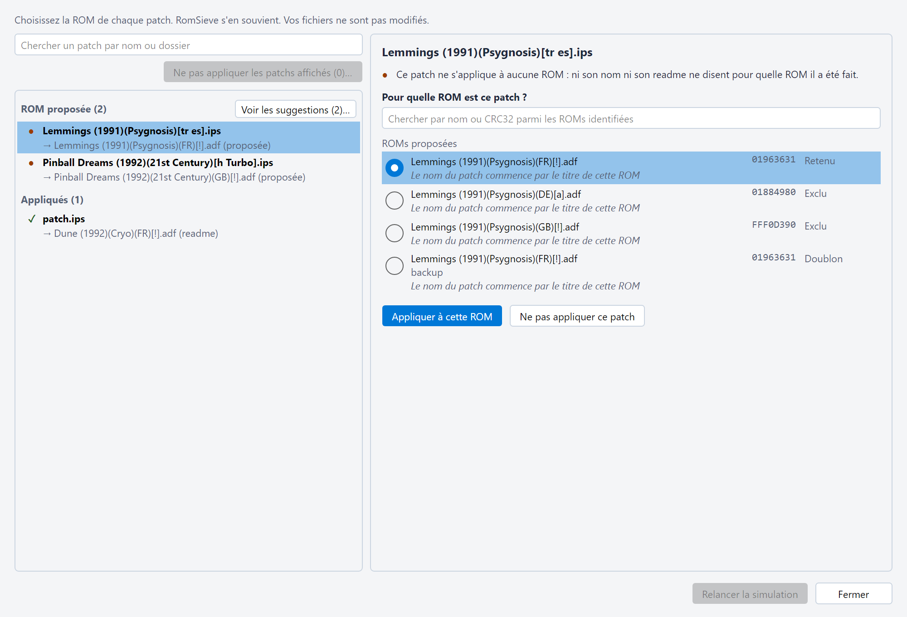

# Patchs

Un patch est un petit fichier qui ne contient que les **différences** entre une ROM et une version modifiée de cette
ROM : une traduction, une correction de bogues, un hack. On le diffuse à la place de la ROM modifiée, puisque diffuser
la ROM reviendrait à diffuser le jeu ; c'est à chacun de l'appliquer à sa propre copie.

RomSieve applique les patchs d'un dossier aux ROMs de votre collection : chaque patch dont la ROM d'origine est
identifiée dans la source donne une **version patchée**, écrite dans la destination à côté de la version d'origine, ou
dans un dossier à part (voir [Un dossier Patchs](#un-dossier-patchs)). La ROM d'origine n'est **jamais modifiée**.

Un patch ne s'applique qu'à la ROM exacte pour laquelle il a été fait : même région, même révision, même dump. RomSieve
la trouve pour vous par sa somme de contrôle (CRC32), ce qui demande un [fichier DAT](naming-conventions-and-dats.md#fichiers-dat).

## Formats pris en charge

| Format | Extension | ROM d'origine trouvée par | Contrôles |
|---|---|---|---|
| **IPS** | `.ips` | votre choix, sinon le CRC32 écrit dans le nom du patch, ou dans son readme (voir [Rapprochement](#rapprochement)) | aucun : le format n'enregistre aucune somme de contrôle |
| **IPS32** | `.ips` ou `.ips32` | votre choix, sinon le CRC32 écrit dans le nom du patch, ou dans son readme | aucun |
| **UPS** | `.ups` | le CRC32 et la taille qu'il enregistre | CRC32 du patch, de la ROM d'origine et du résultat |
| **BPS** | `.bps` | le CRC32 et la taille qu'il enregistre | CRC32 du patch, de la ROM d'origine et du résultat |

Le format est lu dans le contenu du fichier, pas seulement dans son extension. UPS et BPS sont les plus sûrs : ils ne
s'appliquent qu'à la bonne ROM et vérifient leur résultat. Un patch abîmé ou tronqué est refusé avant d'être appliqué.

Les autres formats (xdelta, PPF, APS, BSDiff…) ne sont pas pris en charge : leurs fichiers sont ignorés. Les sets
d'arcade MAME et les logiciels des listes MAME ne sont jamais patchés.

## Dossier des patchs

Dans l'étape **Collection**, le cadre **Patchs** a le champ **Dossier des patchs**, avec son bouton **Parcourir...**. Il
est toujours affiché, quelle que soit la convention. À côté de son titre, **Gérer les patchs…** ouvre la fenêtre
**Patchs** sur la dernière simulation (voir [La liste des patchs](#la-liste-des-patchs)) ; il est grisé tant qu'aucune
simulation n'a trouvé de patch.

* Le dossier est lu avec ses **sous-dossiers**. Seuls les fichiers `.ips`, `.ips32`, `.ups` et `.bps` sont lus, et les
  textes `.txt` et `.nfo` qui peuvent donner la ROM d'origine d'un IPS (voir [Rapprochement](#rapprochement)).
* Les patchs rangés dans des **archives** ZIP, 7z ou RAR du dossier sont lus aussi.
* Le dossier peut se trouver dans la source : ses fichiers ne sont pas triés comme des fichiers de la collection. S'il
  est la source elle-même, seuls les patchs sont mis de côté, et vos ROMs sont triées comme d'habitude.
* La destination ne doit pas chevaucher le dossier des patchs, ni dans un sens ni dans l'autre : sous l'étape **Sortie**,
  une ligne le signale (*Chevauche les patchs*), et la simulation comme le tri sont refusés. Une purge ne touche jamais
  au dossier des patchs.

La case **Appliquer les patchs**, à côté du titre du cadre, est cochée par défaut, et se coche d'elle-même quand vous
choisissez un dossier avec **Parcourir...**. Décochée, aucun patch n'est appliqué, mais le dossier reste dans les
réglages et les profils pour la prochaine fois : il n'est pas lu, **N'écrire que les versions patchées** et le dossier
des versions patchées sont grisés, et le journal dit que l'application des patchs est désactivée. Le reste ne change
pas : un dossier des patchs placé dans la source n'est toujours pas trié comme des ROMs, et la destination ne doit
toujours pas le chevaucher, pour qu'une purge ne mette jamais vos patchs en quarantaine.

Le journal de la simulation dit combien de patchs ont été trouvés et combien ont donné une version patchée.

## Rapprochement

Seule une ROM **identifiée dans le DAT** peut recevoir un patch, quel que soit son statut : une version écartée par le
1G1R reçoit son patch comme une autre. C'est souvent le cas d'une traduction, faite pour la version japonaise d'un jeu
que le 1G1R écarte au profit de la version américaine.

* **Votre choix** passe avant tout : un IPS que vous avez appliqué à une ROM dans la fenêtre **Patchs** s'applique à
  cette ROM, quoi que disent son nom et son readme, et un patch que vous avez écarté n'est jamais appliqué (voir
  [Vos choix](#vos-choix)).
* Un **UPS** ou un **BPS** désigne sa ROM d'origine par le CRC32 et la taille qu'il enregistre.
* Un **IPS** n'enregistre rien : sans votre choix, son nom doit donner le CRC32 de la ROM d'origine, en 8 chiffres
  hexadécimaux, entre crochets, entre parenthèses ou séparé du reste du nom (`Jeu (Japan) (T-En) [47E70E08].ips`,
  `(0x47e70e08)`).
* Un IPS dont le nom ne donne aucun CRC32 le prend dans son **readme**, s'il en a un. La plupart des patchs le donnent,
  sous la forme qu'emploie romhacking.net (`File/ROM CRC32: 47E70E08`) ou une autre (`CRC32 : 0x47e70e08`). Voir
  [Readme des IPS](#readme-des-ips).
* Un IPS sans CRC32, ni dans son nom ni dans son readme, n'est pas appliqué : choisissez sa ROM dans la fenêtre
  **Patchs** (voir [Choisir la ROM du patch](#choisir-la-rom-du-patch)).
* Une ROM avec un **en-tête copieur** (iNES pour la NES, en-tête de 512 octets pour la Super Nintendo, en-tête Lynx)
  est cherchée sous ses deux formes, avec et sans en-tête : un patch fait pour l'une ou pour l'autre trouve sa ROM. Le
  patch s'applique à la forme qu'il attend ; l'en-tête du résultat est décrit dans
  [NES, Lynx et Super Nintendo](#nes-lynx-et-super-nintendo).
* Si plusieurs fichiers de la source ont le même CRC32, le patch s'applique à celui que le tri écrit, sinon au premier
  dans l'ordre des chemins.
* Plusieurs patchs pour une même ROM donnent chacun leur version patchée.

### Readme des IPS

Un readme est un fichier texte `.txt` ou `.nfo` d'au plus 1 Mo, rangé à côté du patch : dans le même dossier du dossier
des patchs, ou dans la même archive, au même endroit. Un readme sur le disque n'accompagne jamais un patch rangé dans
une archive, ni l'inverse.

* Un readme qui porte le nom du patch (`Jeu (T-Fr).txt` pour `Jeu (T-Fr).ips`, sans tenir compte des majuscules) est
  le sien.
* Sinon, les readme d'un dossier ou d'une archive qui ne contient **qu'un seul patch** sont les siens.
* Dans un dossier de plusieurs patchs, un readme qui ne porte le nom d'aucun n'en accompagne aucun : il ne dit pas de
  quel patch il parle.

Pour le CRC32, RomSieve ne lit que les lignes où figure le mot **CRC**, et sur elles les CRC32 qui le suivent. Un readme
donne souvent aussi le CRC32 du résultat patché : il ne désigne aucune ROM de la source, et il est ignoré. Votre choix,
puis le nom du patch, l'emportent toujours sur son readme, et un UPS ou un BPS, qui enregistre lui-même sa ROM
d'origine, ne lit jamais le sien.

Un readme donne parfois le CRC32 d'une ROM **avec et sans son en-tête copieur**, sur deux lignes (par exemple
`File CRC32` et `ROM CRC32`). Un IPS ne dit pas laquelle des deux formes il attend : RomSieve ne l'applique pas. Le
readme dit en général pour quelle forme le patch a été fait : choisissez alors cette forme dans la fenêtre **Patchs**
(voir [Choisir la ROM du patch](#choisir-la-rom-du-patch)).

Le panneau de détail d'une version patchée nomme le readme qui a donné le CRC32.

Un readme nomme souvent aussi la ROM pour laquelle le patch a été fait, sous son nom No-Intro suivi de son extension
(`Make sure to use the "Super Mario Bros. 2 (USA).nes" ROM`, `Mega Man 2 (USA).nes - NOINTRO`, ou après
`Database match:`). Quand aucun CRC32 ne désigne une ROM de la source, RomSieve **propose** la ROM ainsi nommée dans
la fenêtre **Patchs** (« readme.txt cite le nom de cette ROM »), sans jamais l'appliquer seule : un readme peut nommer
une autre révision, ou une ROM qu'il faut d'abord traduire. Le nom est comparé à ceux du DAT sans tenir compte des
majuscules, au nom de fichier comme au nom du jeu (un readme écrit `.nes` là où un DAT sans en-tête écrit `.unh`). Un
nom GoodTools (`(U) [!]`) ou approché ne désigne aucune ROM. Si la ROM nommée est dans le DAT mais pas dans la source,
la raison du patch la nomme.

## La version patchée

* **Nom** : celui de la ROM d'origine, suivi d'un libellé du patch entre crochets, avec l'extension de la ROM
  d'origine (voir [Choix du nom](#choix-du-nom)).
* **Dossier** : celui que la ROM d'origine aurait dans la destination, même quand le 1G1R l'écarte, ou celui que donne
  le champ **Versions patchées** de l'étape **Sortie** (voir [Un dossier Patchs](#un-dossier-patchs)).
* **Jeu** : la version patchée appartient au jeu de sa ROM d'origine. Elle reste en dehors du 1G1R, des multi-disques
  et des filtres : elle n'est jamais écartée à la place de son origine, ni ne l'écarte.
* **Conflits** : une collision avec un fichier déjà présent dans la destination suit le mode de conflit choisi (voir
  [Conflits](destination-and-transfers.md#conflits)). Si deux patchs donnent le même nom (le même patch en IPS et en
  BPS, par exemple), la seconde version patchée prend le suffixe `_01` quel que soit le mode : les deux sont écrites.

### NES, Lynx et Super Nintendo

Un patch fait pour le fichier entier d'une ROM à en-tête copieur donne un résultat qui en a un : il est écrit tel que le
patch le produit. Un patch fait pour les données sans l'en-tête donne des données seules :

* pour la **NES** (en-tête iNES, 16 octets) et la **Lynx** (en-tête Lynx, 64 octets), RomSieve écrit devant elles
  l'en-tête de la ROM d'origine, que la plupart des émulateurs de ces systèmes exigent : la version patchée commence
  comme sa ROM d'origine ;
* pour la **Super Nintendo**, la version patchée reste sans son en-tête copieur de 512 octets, dont les émulateurs se
  passent.

Quand un tel patch change la taille des données (un patch qui agrandit la ROM), l'en-tête est écrit tel quel, et peut ne
plus en donner la bonne taille : le journal le dit pour chaque version patchée concernée. Un patch fait pour le fichier
entier, qui peut mettre l'en-tête à jour lui-même, n'a pas ce défaut.

L'en-tête doit encore être celui de la ROM d'origine quand le patch est appliqué : un en-tête modifié depuis la
simulation passe la version patchée en **Erreur**, sans rien écrire.

**Ancien en-tête iNES 1.0.** Les ROMs NES actuelles ont un en-tête NES 2.0, qui donne des précisions dans ses derniers
octets. Les patchs plus anciens, et les CRC32 que donnent leurs readme et la page romhacking.net de chaque patch, ont été
faits avec l'en-tête iNES 1.0 d'alors, où ces octets étaient à zéro : leur CRC32 n'est celui d'aucun fichier actuel, ni
d'aucune ROM du DAT. RomSieve cherche donc aussi chaque ROM NES sous cet ancien en-tête, recalculé d'après le sien (les
données restent les mêmes). Un patch fait pour lui s'applique alors à la ROM ainsi lue, et le résultat est écrit tel que
le patch le produit, avec l'en-tête qu'il porte. Le panneau de détail le dit (« sous un ancien en-tête iNES 1.0 »). Une
ROM qui a déjà un en-tête iNES 1.0 n'a pas besoin de cette forme, et une ROM sans en-tête ne peut pas la recevoir.

### Choix du nom

Le nom part toujours de celui de la ROM d'origine, tel que le DAT le donne : la région et la révision viennent du DAT,
jamais de l'auteur du patch, et chaque version patchée se range à côté de sa ROM d'origine. Le libellé entre crochets
est tiré du nom du patch :

| Patch | ROM d'origine | Version patchée |
|---|---|---|
| `Jeu (Japan) (T-En).bps` | `Jeu (Japan).sfc` | `Jeu (Japan) [T-En].sfc` |
| `Jeu (T-En v1.2).bps` | `Jeu (Japan).sfc` | `Jeu (Japan) [T-En v1.2].sfc` |
| `Jeu (T-En) [47E70E08].ips` | `Jeu (Japan).sfc` | `Jeu (Japan) [T-En].sfc` |
| `SMB3_eng_v1.2.ups` | `Super Mario Bros. 3 (Japan).nes` | `Super Mario Bros. 3 (Japan) [SMB3_eng_v1.2].nes` |
| `Alpha (1990)(Ocean)[h Hack].bps` | `Alpha (1990)(Ocean).adf` | `Alpha (1990)(Ocean)[h Hack].adf` |

* Ce qui répète la ROM d'origine est retiré : son nom entier ou son titre, quand le nom du patch commence par eux, et
  son CRC32, avec ses crochets ou ses parenthèses. Les parenthèses et crochets qui restent disparaissent.
* Les crochets marquent un dump modifié, comme chez TOSEC (`[h]`, `[tr]`) : les parenthèses décrivent, chez No-Intro et
  Redump, une version officielle. Pour une ROM TOSEC, le libellé suit le nom sans espace, comme un drapeau TOSEC.
* Un nom de patch **générique** (`patch`, `patched`, `hack`, `fix`, `translation`, `rom`, `game`, `english`, `eng`,
  `update`, ou une version seule comme `v1.1`) cède la place au nom de l'archive qui contient le patch, ou de son dossier
  dans cette archive, puis au nom de son dossier dans le dossier des patchs, si ce dossier ne contient pas d'autre patch
  (un dossier de plusieurs patchs les range, par système ou par genre, et ne dit rien de chacun). `Traduction CT/patch.ips`
  donne `Chrono Trigger (Japan) [Traduction CT].sfc`. Sans meilleur libellé, le nom générique est gardé.
* Un patch qui ne donne aucun libellé (nommé comme sa ROM d'origine, comme le demandent les émulateurs qui appliquent
  un patch au lancement) prend le libellé `patched` : `Jeu (Japan) [patched].sfc`. La version patchée ne porte jamais le
  nom de sa ROM d'origine.

### N'écrire que les versions patchées

Cochez **N'écrire que les versions patchées**, dans l'étape **Sortie**, sous le champ **Versions patchées** (cadre
*Arborescence*), pour qu'un jeu qui a une version patchée ne soit écrit
que sous cette forme. Avec le 1G1R, la ROM retenue pour ce jeu n'est pas écrite, même si le patch a été fait pour une
autre version du jeu : un patch fait pour `Jeu (World) (Collection).md`, que le 1G1R écarte au profit de
`Jeu (World).md`, donne la seule version patchée, et `Jeu (World).md` n'est pas écrite. Sans le 1G1R, chaque ROM
retenue est un choix à part, et seule la ROM d'origine du patch est remplacée. Le tableau montre une ROM remplacée
**Exclu**, avec la raison *Remplacée par une version patchée* ; une ROM que le 1G1R écartait déjà garde sa raison.
Option décochée, la ROM retenue et la version patchée sont toutes deux écrites. L'option est grisée sans dossier des
patchs, ou quand **Appliquer les patchs** est décoché.

## Un dossier Patchs

Par défaut, une version patchée va dans le dossier de sa ROM d'origine. Le champ **Versions patchées** de l'étape
**Sortie**, dans le cadre *Arborescence*, sous le **Modèle**, la range ailleurs, pour deux usages :

* **garder un set propre** : un gestionnaire de DAT qui vérifie le dossier d'un DAT n'y trouve aucun fichier inconnu,
  puisque les versions patchées sont rangées hors de ce dossier ;
* **présenter les versions patchées à part** dans un frontend, dans un dossier à elles ou dans un sous-dossier de chaque
  jeu.

Le champ est un modèle de dossiers, comme le **Modèle** (voir [Variables](destination-and-transfers.md#variables)), mais
il part de la **racine de la destination**, même avec **Tout à la racine** : les dossiers d'un lot de DAT ne s'y ajoutent
pas d'eux-mêmes. Ses variables prennent les valeurs de la ROM d'origine (`{title}`, `{dat}`, `{publisher}`…), même
quand le 1G1R l'écarte, et deux variables n'existent que pour lui :

| Variable | Contenu |
|---|---|
| `{origin_folder}` | Le dossier entier où va la ROM d'origine : le dossier de son DAT dans un lot (sous les dossiers de son chemin s'ils sont reproduits), puis les dossiers du modèle ; aucun avec **Tout à la racine** |
| `{dat_folder}` | Le dossier du DAT de la ROM d'origine dans un lot, sous les dossiers de son chemin s'ils sont reproduits ; aucun pour un DAT seul, ou sans **Un dossier par DAT** |

Chacune forme un dossier à elle seule, entre deux `/` : `{origin_folder}/Patchs` est permis, `{origin_folder}-patchs`
ne l'est pas. Vide, le champ (*À côté de la ROM d'origine*) donne le même dossier que `{origin_folder}`.

Exemples avec `Chrono Trigger (Japan).sfc`, le modèle `{title}` et un patch `(T-En)` :

| Versions patchées | DAT seul | Lot, un dossier par DAT | Lot, arborescence des DAT reproduite (`No-Intro/`) |
|---|---|---|---|
| *(vide)* | `Chrono Trigger/` | `Nintendo - SNES/Chrono Trigger/` | `No-Intro/Nintendo - SNES/Chrono Trigger/` |
| `Patchs/{title}` | `Patchs/Chrono Trigger/` | `Patchs/Chrono Trigger/` (tous les DAT ensemble) | `Patchs/Chrono Trigger/` |
| `Patchs/{dat}/{title}` | `Patchs/Nintendo - SNES/Chrono Trigger/` | `Patchs/Nintendo - SNES/Chrono Trigger/` | `Patchs/Nintendo - SNES/Chrono Trigger/` |
| `{dat_folder}/Patchs` | `Patchs/` | `Nintendo - SNES/Patchs/` | `No-Intro/Nintendo - SNES/Patchs/` |
| `{origin_folder}/Patchs` | `Chrono Trigger/Patchs/` | `Nintendo - SNES/Chrono Trigger/Patchs/` | `No-Intro/Nintendo - SNES/Chrono Trigger/Patchs/` |

Le fichier y garde son nom, `Chrono Trigger (Japan) [T-En].sfc` (une archive `.zip` en mode ZIP). Le dossier
`_unmatched` des fichiers non conformes reste à la racine : une version patchée n'y va jamais, puisque sa ROM d'origine
est identifiée.

* **Insérer une variable** insère une variable au curseur du champ : celles du modèle, puis **Dossier de la ROM
  d'origine** (`{origin_folder}`) et **Dossier du DAT** (`{dat_folder}`, grisé hors d'un lot avec **Un dossier par
  DAT**).
* **Préréglages** : **À côté de la ROM d'origine** (champ vide), **Sous-dossier de la ROM d'origine**
  (`{origin_folder}/Patchs`) et **Dossier à la racine** (`Patchs/{dat}/{title}`), qui laisse le dossier de chaque DAT
  sans fichier inconnu.
* Le champ et ses menus sont **grisés sans dossier des patchs**, ou quand **Appliquer les patchs** est décoché,
  puisque rien de patché ne serait écrit ; le champ garde sa valeur, enregistrée dans les réglages et les profils.
* Quand les patchs sont appliqués, l'[aperçu en direct](destination-and-transfers.md) montre, à la place
  de son troisième exemple, où irait la version patchée du premier : *Version patchée : …*.

Rien n'est écrit hors de la destination. Un dossier qui en sortirait, ou qui écrirait dans les dossiers que RomSieve
garde pour lui, est **refusé** : chemin qui commence par `/` ou `\`, lecteur (`C:`), dossier `..`, caractère interdit
dans un nom (`< > : " | ? *`), `_purged` ou `.romsieve` comme premier dossier, `{origin_folder}` ou `{dat_folder}` qui
ne forme pas un dossier à lui seul. L'aperçu dit pourquoi, une ligne le signale sous l'étape **Sortie** (*Patchées :
dossier refusé*), et la simulation comme le tri sont refusés avant d'écrire quoi que ce soit. Une variable inconnue,
une accolade sans paire ou un dossier `_unmatched` ne sont qu'un avertissement de l'aperçu, comme pour le modèle.

Changer le dossier des versions patchées rend la dernière simulation périmée ; la suivante marque *Modifiés* les seules
lignes des versions patchées. **Annuler le dernier tri** les supprime, ainsi que les dossiers vidés.

## Modes de transfert

| Mode | Version patchée |
|---|---|
| **Copier** | Un fichier, écrit à côté de la ROM d'origine ou dans son [dossier](#un-dossier-patchs) |
| **Déplacer** | Un fichier, écrit **avant** que la ROM d'origine ne quitte la source. Avec *N'écrire que les versions patchées*, la ROM remplacée reste dans la source. |
| **Hard link**, **Symlink** | Une **copie** : un lien ne peut pas porter un contenu modifié. Le journal le dit. |
| **ZIP** | Une archive à elle, au format TorrentZip, comme celle de tout autre jeu, rangée dans le même dossier |

Une ROM d'origine rangée dans une archive est extraite à côté de la cible le temps d'appliquer le patch, puis supprimée.
L'archive n'est jamais modifiée.

L'écriture suit les mêmes règles de sûreté que toute autre (voir [Sécurité, purge et annulation](safety-and-undo.md)) :
le fichier n'apparaît sous son nom qu'une fois complet, et un tri arrêté ou en échec ne laisse aucun fichier tronqué. Le
CRC32 de la ROM d'origine est vérifié pendant l'application : une ROM modifiée depuis son identification est refusée,
même pour un IPS. Pour un UPS ou un BPS, le CRC32 du résultat l'est aussi : un résultat faux passe la version patchée
en **Erreur**, sans rien laisser dans la destination. Avec **Vérifier les fichiers copiés**, la version patchée est
relue après son écriture.

## Patchs non appliqués

Un patch qui ne donne aucune version patchée a sa ligne dans le journal, avec sa raison :

| Raison | Ce qu'il faut faire |
|---|---|
| La ROM d'origine, *nom*, manque dans la source (ou : un readme désigne la ROM d'origine, *nom*, …) | Le DAT connaît cette ROM, mais la source ne l'a pas : ajoutez-la à la source. Dans un lot, le DAT de la ROM suit son nom |
| Un readme cite la ROM d'origine, *nom*, qui manque dans la source | Le readme ne donne aucun CRC32 connu, mais nomme une ROM du DAT : ajoutez-la à la source, ou vérifiez dans le readme la révision attendue |
| Aucune ROM du DAT n'a ce CRC32 : le patch a été fait pour un autre dump ou pour un hack | Cherchez la ROM que demande le readme du patch ; pour un IPS, choisissez-lui une ROM dans la fenêtre **Patchs** |
| Aucune ROM du DAT n'a ce CRC32 : … ou pour une autre forme de la ROM que celle que décrit le DAT (avec un autre en-tête copieur, ou sans) | Pour la NES, la Lynx ou la Super Nintendo, le patch a pu être fait pour la ROM avec un en-tête (ou un autre en-tête) quand le DAT la décrit sans, ou l'inverse : un DAT de l'autre forme la nommera. Pour un IPS, choisissez sa ROM et sa **Forme** dans la fenêtre **Patchs** |
| Ni le nom du patch IPS ni un texte qui l'accompagne ne donnent le CRC32 de la ROM d'origine | Choisissez sa ROM dans la fenêtre **Patchs** (voir [Choisir la ROM du patch](#choisir-la-rom-du-patch)) |
| Patch illisible | Le fichier est tronqué, abîmé, ou d'un autre format |
| Le nom du patch donne les CRC32 de plusieurs ROMs de la source | Choisissez la bonne ROM dans la fenêtre **Patchs** |
| Un readme donne les CRC32 de plusieurs ROMs de la source | Choisissez la bonne ROM dans la fenêtre **Patchs** |
| Un readme donne le CRC32 d'une ROM avec et sans son en-tête copieur | Choisissez dans la fenêtre **Patchs** la forme pour laquelle il a été fait |
| La ROM que vous avez choisie pour ce patch n'est pas identifiée dans la source | Elle a quitté la source, ou le DAT ne l'identifie plus : choisissez-en une autre, ou revenez au choix automatique |
| La ROM d'origine fait partie d'un jeu en plusieurs fichiers | Un `.cue` et ses pistes, ou un jeu en plusieurs disques : ces jeux ne sont pas patchés |
| La ROM n'a pas la taille que le patch attend | Ce n'est pas la ROM pour laquelle le patch a été fait |

Un patch que vous avez écarté n'y figure pas : le journal le dit à part (*Patch écarté à votre demande*). Pour faire
taire un patch que rien ne répare, écartez-le (voir [Ne pas appliquer un patch](#ne-pas-appliquer-un-patch)).

Sans DAT, les patchs ne sont pas lus : le journal le dit.

## La liste des patchs

La fenêtre **Patchs** montre tous les patchs de la dernière simulation, et c'est là que vous dites à RomSieve ce qu'il
doit en faire. Elle s'ouvre après une simulation :

* par **Gérer les patchs…**, dans le cadre **Patchs** de l'étape **Collection** ;
* par « *n* patchs non appliqués » dans le bandeau des résultats, ou par **Voir les patchs** quand aucun patch n'est
  resté non appliqué ;
* par le menu contextuel d'une version patchée du tableau, qui sélectionne son patch.

À gauche, les patchs sont groupés par état :

* **ROM proposée** (●) : les IPS qui ne s'appliquent à aucune ROM, mais pour lesquels la simulation propose une ROM ;
  chacun la nomme sous son nom (« → *ROM* (proposée) ») ;
* **Sans ROM proposée** (●) : les autres IPS qui ne s'appliquent à aucune ROM, et auxquels vous pouvez en choisir une ;
* **Appliqués** (✓) : chacun suivi de sa ROM (« → *ROM* »), avec « (readme) » ou « (votre choix) » quand c'est son
  readme ou vous qui la désignez ;
* **Choix automatique** (↺) : les patchs dont vous venez d'oublier le choix ; la prochaine simulation dira ce qu'ils
  font ;
* **Écartés** (–) : les patchs que vous avez écartés ;
* **Non réparables** (✗) : un UPS ou un BPS dont la ROM manque, un patch illisible… Le détail en donne la raison.

La **recherche** au-dessus de la liste garde les patchs dont le nom ou le dossier contient tous les mots, dans n'importe
quel ordre (`-mot` écarte) : `FF3 extra` ne montre que les patchs du dossier `Extra & Visual Patches` de FF3. Les
groupes, leurs comptes et **Voir les suggestions** ne gardent que les patchs trouvés. La croix efface la recherche.

À droite, le détail du patch sélectionné dit en clair où il en est (pour un patch appliqué : ce qui désigne sa ROM, et
le nom de sa version patchée), puis donne ses actions.

Le pied compte les patchs modifiés. **Relancer la simulation** relance la simulation, qui suit vos choix : la fenêtre
reste ouverte et montre ses résultats, sur le même patch. Si vous fermez la fenêtre avec des choix que la simulation n'a
pas encore vus, elle est relancée : le tableau montre toujours ce que donnent vos choix.

## Choisir la ROM du patch

Un UPS ou un BPS désigne lui-même sa ROM et la vérifie : on ne lui en choisit pas d'autre. Pour un IPS, le détail
demande **Pour quelle ROM est ce patch ?** :

* **ROMs proposées** : les ROMs identifiées dont le nom ou le titre commence le nom du patch, ou celui de son archive,
  ou celui de son dossier quand ce dossier ne contient que lui (`Traduction CT/patch.ips`). Les noms génériques
  (`patch`, `fix`, `v1.1`…) ne comptent pas. La ROM entière passe avant le titre seul, puis la ROM que le tri écrit.
  Pour un patch dont le nom ou le readme désigne plusieurs ROMs, ce sont ces ROMs ; pour un patch appliqué, la ROM à
  laquelle il l'est. Sous chaque ROM, son dossier dans la source distingue deux fichiers du même nom, et une ligne dit
  pourquoi elle est proposée (« Le nom de son archive commence par le titre de cette ROM », « readme.txt désigne cette
  ROM », « readme.txt cite le nom de cette ROM »…). Les ROMs que nomme le readme passent avant celles du nom du patch. À
  droite, son CRC32 (dans le DAT) et son statut dans la simulation (**Retenu**, **Exclu**, **Doublon**, comme dans le
  tableau), avec sa raison en infobulle : une ROM que le 1G1R ou un filtre écarte est proposée elle aussi, puisqu'une
  traduction est souvent faite pour elle. La première est choisie, mais jamais appliquée sans votre clic.
* Une **traduction** n'est pas faite pour une ROM déjà dans sa langue : quand le nom du patch porte une étiquette de
  traduction (`[tr fr]` chez TOSEC, `(T-En)`, `[T+Eng]`), les ROMs déjà dans cette langue (d'après leurs langues, sinon
  leur pays) passent après les autres, et le disent. Un patch `Jeu (T-En).ips` propose ainsi `Jeu (Japan)` avant
  `Jeu (USA)`.
* La **recherche**, au-dessus, cherche par nom ou par CRC32 (au moins 6 chiffres hexadécimaux, avec ou sans `0x`) parmi
  toutes les ROMs identifiées par la simulation, quand aucune ROM proposée n'est la bonne : un titre traduit
  (`Super Mario Frères.ips` pour `Super Mario Bros.`) ou abrégé n'en propose aucune. Tous les mots, dans n'importe quel
  ordre. Chaque résultat (**Autres ROMs**) donne à droite son CRC32 et son statut, avec son chemin complet en infobulle.
  Une ROM trouvée (clic, ou Entrée pour la première) rejoint les ROMs proposées et devient le choix. Ctrl+F mène à la
  recherche.
* **Forme** n'apparaît que pour une ROM à en-tête copieur (NES, Super Nintendo, Lynx) : le CRC32 avec ou sans l'en-tête,
  et pour une ROM NES à en-tête NES 2.0, le CRC32 sous un ancien en-tête iNES 1.0
  (voir [NES, Lynx et Super Nintendo](#nes-lynx-et-super-nintendo)). Le fichier entier vient en premier. Un IPS ne dit
  pas pour laquelle il a été fait : son readme le dit en général. Les patchs NES sont presque toujours faits pour le
  fichier entier, en-tête compris : une ROM NES identifiée sans son en-tête est proposée sous sa forme entière. Une ROM
  d'un set sans en-tête n'a qu'une forme : un IPS fait pour le fichier entier s'y appliquerait décalé de 16 octets, sans
  que rien ne le signale. Gardez pour ces patchs une ROM avec son en-tête.

**Appliquer à cette ROM** enregistre votre choix : la prochaine simulation applique le patch à cette ROM, quoi que
disent son nom et son readme. Le fichier du patch n'est pas modifié, et un patch rangé dans une archive se choisit
comme les autres. Tant que la ROM actuelle d'un patch appliqué est choisie, le bouton est grisé. La touche Entrée
n'enregistre jamais rien.

Si une version patchée ne fonctionne pas, parce que le patch a été fait pour une autre ROM, choisissez-lui la bonne de
la même façon : votre choix l'emporte sur le CRC32 de son nom et sur son readme.

**Voir les suggestions (*n*)…**, sur le titre du groupe **ROM proposée**, n'applique rien : il montre pour chaque patch
la ROM choisie, puis le dossier du patch et la raison de la proposition (« Le nom du patch commence par le titre de cette
ROM »…), de quoi juger chaque suggestion. Rien n'y est coché d'avance. Cochez ceux à appliquer (ou **Tout cocher**),
puis **Appliquer (*n*)** ; **Retour** revient au détail sans rien enregistrer.

## Ne pas appliquer un patch

**Ne pas appliquer ce patch** écarte le patch sélectionné, quel que soit son format : la prochaine simulation ne
l'applique pas, et ne le compte plus parmi les patchs non appliqués. C'est aussi la façon de faire taire un patch qui
ne s'applique à rien et que vous voulez garder dans le dossier. Le menu contextuel d'une version patchée du tableau
propose la même action, qui relance aussitôt la simulation.

Pour écarter d'un coup les patchs qui ne s'appliqueront jamais (ceux qui s'appliquent à une ROM déjà patchée, par
exemple), cherchez-les, puis cliquez sur **Ne pas appliquer les patchs affichés (*n*)…**, sous la recherche. Le bouton
est grisé sans recherche, qui montrerait tous les patchs. Il montre la liste des patchs trouvés, tous cochés, avec leur
dossier : décochez ceux à garder, puis **Ne pas appliquer (*n*)** ; **Retour** n'enregistre rien. Chaque patch écarté
peut ensuite revenir au choix automatique.

**Revenir au choix automatique** oublie votre choix pour un patch (une ROM choisie, ou un patch écarté) : la prochaine
simulation l'applique de nouveau d'après ce qu'il enregistre, son nom ou son readme.

La version patchée qu'un tri a déjà écrite dans une destination reste en place : **Annuler le dernier tri** la supprime,
si ce tri est le dernier.

## Vos choix

* RomSieve garde vos choix dans le fichier `patch_links.json`, à côté de ses réglages (voir
  [l'emplacement des fichiers de RomSieve](installation.md#emplacement-des-fichiers-de-romsieve)). Ils valent pour
  tous les profils.
* Un patch y est reconnu par son contenu, pas par son nom : votre choix le suit s'il est renommé, déplacé, ou rangé dans
  une archive. Deux copies du même patch ont le même choix.
* Aucun choix ne modifie de fichier. **Annuler** défait votre dernier changement pour le patch sélectionné, tant que la
  fenêtre est ouverte ; plus tard, **Revenir au choix automatique** fait de même. Les choix ne sont pas inscrits au
  journal des tris, et **Annuler le dernier tri** ne les défait pas.
* Un fichier `patch_links.json` illisible n'est jamais perdu : RomSieve en garde une copie à côté
  (`patch_links.unreadable-<date>-<heure>.json`), le dit dans le journal, et repart sans choix.
* **Pour d'autres outils**, **Écrire la ROM dans le nom du fichier (pour d'autres outils)** renomme un IPS appliqué à
  une ROM que son nom ne donne pas encore : le CRC32 de la ROM s'ajoute avant l'extension (`Jeu (T-Fr).ips` devient
  `Jeu (T-Fr) [47e70e08].ips`), ou remplace celui que le nom donnait. RomSieve n'en a pas besoin, mais les outils qui
  appliquent un IPS d'après son nom l'appliqueront aussi. Un patch rangé dans une archive n'est jamais renommé, et rien
  n'est écrasé : un nom déjà pris laisse le patch tel quel, et le détail le dit. **Annuler** lui rend son ancien nom. Le
  CRC32 ajouté n'apparaît pas dans le nom de la version patchée (voir [Choix du nom](#choix-du-nom)).
* **Retirer la ROM du nom du fichier** fait l'inverse, pour tout IPS du disque dont le nom désigne une ROM, écrit par
  RomSieve ou par un autre : `Jeu (T-Fr) [47e70e08].ips` redevient `Jeu (T-Fr).ips`. C'est ainsi qu'on revient sur un
  nom écrit avant une nouvelle simulation, quand **Annuler** ne le peut plus. RomSieve applique le patch comme avant :
  un patch que seul son nom appliquait reçoit d'abord votre choix pour la même ROM. Pour qu'il ne s'applique plus,
  écartez-le (voir [Ne pas appliquer un patch](#ne-pas-appliquer-un-patch)).

## Dans les résultats

* Le tableau marque chaque version patchée d'une pastille **Patchée**. Dans la vue groupée, elle suit la version retenue
  de son jeu. Le panneau de détail nomme le patch, son format et la ROM d'origine ; celui d'une ROM d'origine nomme ses
  versions patchées. Une version patchée ne peut pas être choisie comme gagnant 1G1R.
* Le bandeau compte les versions patchées dans la pastille **Patchées**, qui n'affiche qu'elles, et les patchs non
  appliqués dans « *n* patchs non appliqués », dont l'infobulle donne la liste avec leurs raisons et qu'un clic ouvre
  dans la fenêtre **Patchs** (voir [La liste des patchs](#la-liste-des-patchs)). Sans patch non appliqué, **Voir les
  patchs** ouvre la fenêtre.
* Le menu contextuel d'une version patchée ouvre la fenêtre sur son patch (**Changer la ROM de ce patch…** pour un IPS,
  **Voir ce patch…** pour un UPS ou un BPS), et propose **Ne pas appliquer ce patch**, qui écarte le patch et relance
  la simulation (voir [Ne pas appliquer un patch](#ne-pas-appliquer-un-patch)).
* Dans un [tri partiel](simulation-table.md#trier-une-partie-de-la-simulation), une version patchée suit la case de son
  jeu.
* Les [exports](exports.md) la décrivent : le rapport nomme son patch, et le DAT de votre collection l'écrit avec ses
  propres sommes de contrôle.

## Annulation

Chaque version patchée est inscrite au journal du tri : **Annuler le dernier tri** la supprime, sauf si elle a été
modifiée depuis le tri. Vos choix pour les patchs ne sont pas inscrits au journal : **Annuler le dernier tri** ne les
défait pas (voir [Vos choix](#vos-choix)).

## En ligne de commande

`--patches <dossier>` donne le dossier des patchs et les applique, même quand **Appliquer les patchs** est décoché
dans les réglages ; `--no-patches` n'en applique aucun, sans changer les réglages ; `--patch-only` n'écrit que les
versions patchées (voir [Ligne de commande](command-line.md)). Le dossier des versions patchées vient du fichier de
réglages ou du profil ; un dossier refusé arrête `run` comme `patches`, en code 3. Le bilan compte les versions
patchées et les patchs non appliqués.

`romsieve-cli patches` simule le tri et liste tous ses patchs : ceux qu'il n'applique pas, avec les ROMs proposées,
ceux qu'il applique et ce qui désigne leur ROM, et ceux que vous avez écartés. Les choix de la fenêtre s'y font aussi,
enregistrés avec `--yes` : `--link <patch> --rom <ROM>` applique un IPS à une ROM (son nom, ou le CRC32 de la forme
pour laquelle le patch a été fait, obligatoire pour une ROM à en-tête copieur), `--ignore <patch>` écarte un patch,
`--auto <patch>` oublie votre choix. `--name-from-notes --yes` écrit le CRC32 dans le nom des IPS appliqués grâce à leur
readme, pour d'autres outils.
