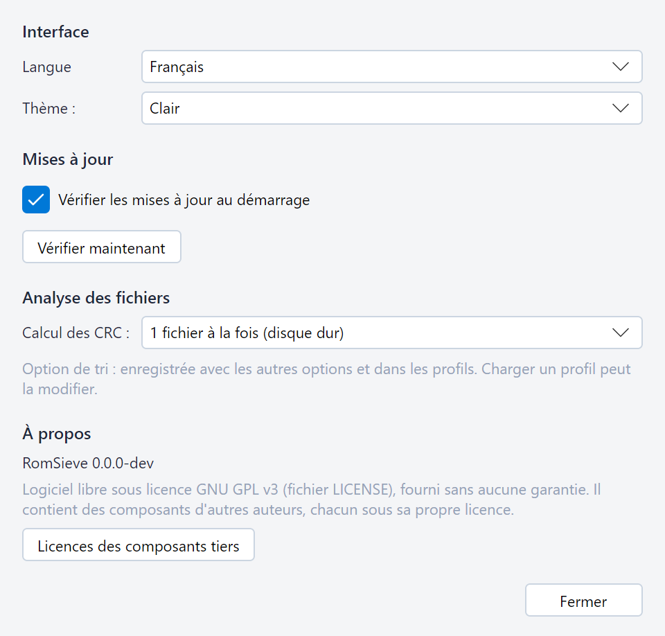
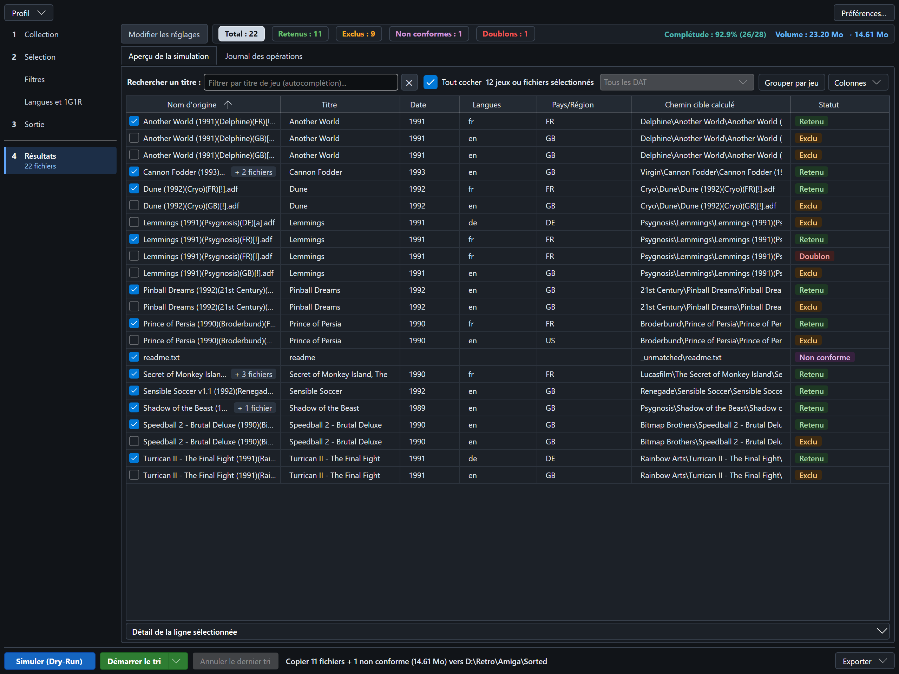

# Réglages et profils

## Préférences

La barre en haut de la fenêtre contient le menu **Profil**, avec **Enregistrer comme profil…** et
**Charger un profil…** (voir les profils nommés, plus bas), et le bouton **Préférences…**, qui ouvre la fenêtre des
préférences. Ses changements s'appliquent aussitôt ; **Fermer** la referme.

* **Interface** :
  * **Langue** : English, Français ou Español. Au premier lancement, RomSieve prend la langue du système (l'anglais
    pour une autre langue). Toute l'interface bascule aussitôt, y compris les lignes déjà écrites dans le journal des
    opérations et les statuts du tableau.
  * **Thème** : *Clair*, *Sombre*, ou *Système* (suit le réglage du système d'exploitation).
* **Mises à jour** : **Vérifier les mises à jour au démarrage** et **Vérifier maintenant** (voir
  [les nouvelles versions](#nouvelles-versions)).
* **Analyse des fichiers** : **Calcul des CRC** (voir les réglages de performance, plus bas). Contrairement aux autres
  préférences, c'est une option de tri : elle est enregistrée dans les profils, et charger un profil peut la modifier.
* **À propos** : la version de RomSieve et sa licence (logiciel libre sous GNU GPL v3, fourni sans aucune garantie).
  **Licences des composants tiers** ouvre `THIRD-PARTY-NOTICES.txt`, livré à côté de RomSieve : les mentions de droits
  d'auteur et les textes des licences des composants qu'il contient (voir [l'installation](installation.md)). Si
  aucune application ne l'ouvre, RomSieve donne son chemin, pour l'ouvrir avec un éditeur de texte.

## Options avancées

Dans l'étape *Collection*, le bouton **Options avancées**, à droite de *Scanner récursivement les sous-dossiers*,
ouvre un panneau par-dessus la page avec les réglages d'identification dont la plupart des collections n'ont pas
besoin : **Inspecter les archives (ZIP, 7z, RAR)**, **Vérifier le SHA-1**, **Vérifier le contenu des archives** et
**Identifier les CHD par leur nom**.
**Vérifier les fichiers copiés** est une case de l'étape *Sortie*, sous *Conflits*.
Cliquez en dehors du panneau pour le refermer.

Le bouton indique combien de ces options diffèrent de leur valeur par défaut, par exemple
**Options avancées (2 modifiées)**, et son infobulle les nomme : une option qui agit ne passe pas inaperçue.

## Réglages enregistrés

Vos dossiers, filtres, choix 1G1R, modèle d'arborescence, langue, thème et disposition de la fenêtre sont enregistrés
dans `config.json` à la fermeture de RomSieve et avant chaque tri réel, et restaurés au lancement suivant (voir
[l'emplacement des fichiers de RomSieve](installation.md#emplacement-des-fichiers-de-romsieve)). RomSieve s'ouvre
toujours sur l'étape **Collection**, quelle que soit l'étape affichée à sa fermeture.

Pour revenir aux réglages par défaut, fermez RomSieve et supprimez `config.json`.

Un `config.json` illisible (modifié à la main et devenu un JSON invalide, par exemple) ne bloque pas RomSieve : il
s'ouvre avec les réglages par défaut et le signale par un avertissement dans le journal. Comme ces réglages remplaceront
le fichier à la fermeture, RomSieve en garde d'abord une copie à côté, `config.unreadable-<date>-<heure>.json`. Pour
retrouver vos réglages, fermez RomSieve, corrigez la copie et renommez-la `config.json`. Si même la copie est
impossible (fichier verrouillé par un autre programme), RomSieve ne remplace pas le fichier de toute la session.

## Profils nommes

Un profil enregistre les **options de tri** des étapes de réglage (dossiers, DAT, mode, filtres, 1G1R,
modèle...) sous un nom, pour passer d'une collection ou d'une configuration à l'autre en un clic. Il n'enregistre ni la
langue, ni le thème, ni la disposition de la fenêtre, mais il enregistre le **Calcul des CRC** de la fenêtre des
préférences, qui est une option de tri : charger un profil peut le modifier.

* **Enregistrer comme profil…** : enregistre les options actuelles. La boîte de dialogue s'ouvre dans le dossier
  `profiles` à côté de `config.json` ; donnez un nom au profil (par exemple `Amiga 1G1R.json`). RomSieve affiche
  ensuite la commande qui l'utilise en [ligne de commande](command-line.md) :
  `romsieve-cli run --profile "Amiga 1G1R"`.
* **Charger un profil…** : remplace les options des étapes par celles d'un profil. Une option absente du fichier prend
  sa valeur par défaut. Charger un profil avec un autre dossier source oublie les choix 1G1R manuels.

Les profils sont de simples fichiers JSON, au même format que `config.json` : vous pouvez les copier sur un autre
ordinateur, les versionner ou les modifier à la main. Seuls les profils du dossier `profiles` sont utilisables avec
`--profile` ; un profil enregistré ailleurs peut tout de même être chargé depuis l'interface.

`config.json` et les profils portent la version de leur format, `config_version`. Un fichier qui ne l'a pas (écrit à la
main) est lu au format actuel : une option qui lui manque garde sa valeur par défaut. Un fichier écrit par une version
plus récente de RomSieve est lu avec un avertissement,
dans le journal de l'interface ou dans la sortie de la ligne de commande : les options que cette version ne connaît pas
sont ignorées, et le `config.json` qu'elle enregistre ne les contient plus.

Un nom de profil peut contenir des lettres, des chiffres, des espaces, des tirets et des parenthèses, mais aucun des
caractères `/ \ : * ? " < > |` ni aucun nom réservé de Windows (`CON`, `NUL`...).

## Nouvelles versions

RomSieve peut vous signaler la publication d'une nouvelle version sur GitHub :

* **Vérifier maintenant**, dans la fenêtre des préférences, vérifie aussitôt, et vous indique si vous avez déjà la
  dernière version.
* **Vérifier les mises à jour au démarrage** (activé par défaut) vérifie au lancement de RomSieve, en arrière-plan,
  si la dernière vérification date de plus de 6 heures. Rien ne s'affiche si aucune nouvelle version n'est
  disponible, ni si GitHub est injoignable : une vérification qui échoue est retentée au lancement suivant.

Quand une nouvelle version est disponible, un bandeau apparaît en haut de la fenêtre. RomSieve se souvient de cette
version : le bandeau revient à chaque lancement, sans nouvelle vérification, tant que la version n'est ni installée ni
ignorée.

* **Voir la version** ouvre la page de la version dans votre navigateur, avec ses notes et ses téléchargements.
* **Ignorer** masque le bandeau et n'annonce plus cette version au démarrage ; la suivante sera annoncée.
  **Vérifier maintenant** l'affiche toujours.
* La croix masque le bandeau jusqu'au prochain lancement.

RomSieve ne télécharge et n'installe jamais rien de lui-même. Une vérification demande seulement à l'API de GitHub la
dernière version publiée ; la requête transmet la version de RomSieve et aucune information sur votre collection. Les
préversions ne sont pas annoncées. Décochez **Vérifier les mises à jour au démarrage** pour que RomSieve n'accède à
Internet que si vous le lui demandez.

## Réglages de performance

Deux options n'agissent que sur la vitesse, jamais sur le résultat :

* **Calcul des CRC**, dans la fenêtre des préférences : nombre de fichiers analysés en même temps (1 pour un disque dur
  mécanique, davantage pour un SSD ou un NAS).
* **Inspecter les archives (ZIP, 7z, RAR)**, dans les options avancées de l'étape *Collection* :
  désactivez-la si vos archives ne contiennent pas de ROMs, pour gagner du temps.

Trois autres options échangent de la vitesse contre de la sûreté : **Vérifier le SHA-1** et **Vérifier le contenu des
archives** (options avancées de l'étape *Collection*), et **Vérifier les fichiers copiés** (étape *Sortie*)
(voir [Conventions de nommage et fichiers DAT](naming-conventions-and-dats.md) et
[Destination et transferts](destination-and-transfers.md)).
