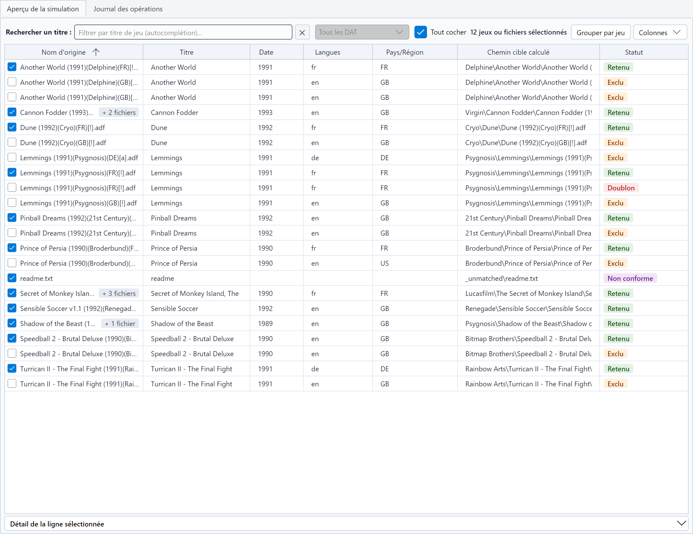
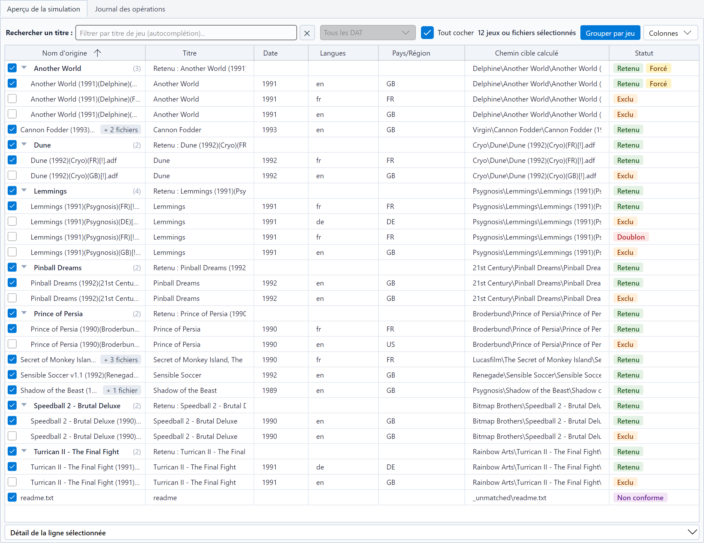

# Le tableau de simulation

Après une simulation ou un tri, l'étape **Résultats** s'affiche : son onglet **Aperçu de la simulation** affiche une ligne par fichier analysé. C'est là
que l'on vérifie un résultat avant d'écrire quoi que ce soit.

## Colonnes

| Colonne | Contenu |
|---|---|
| **Nom d'origine** | Nom du fichier, ou du fichier dans l'archive, après la case qui [choisit son jeu](#choisir-des-jeux) pour un tri partiel ; une pastille compte les [fichiers associés](#fichiers-associes) |
| **CRC32** | Somme de contrôle, quand elle a été calculée (masquée par défaut) |
| **Titre** | Titre lu dans le nom ou dans le DAT |
| **Média** | Position du fichier dans un jeu en plusieurs parties (disquettes, cassettes, CD, faces), *1 sur 2*, ou à défaut l'étiquette du média lue dans le nom, *Side A* (masquée par défaut) |
| **Associés** | Nombre de [fichiers associés](#fichiers-associes) transférés avec le fichier (masquée par défaut) |
| **Éditeur** | Éditeur TOSEC (masquée par défaut) |
| **Date** | Date TOSEC |
| **Langues**, **Pays/Région** | Langues et régions détectées |
| **Chemin cible calculé** | Où le fichier est (ou serait) écrit, relativement à la destination |
| **Statut** | Pastille Retenu, Exclu, Non conforme, Doublon ou Erreur |
| **DAT** | DAT du [lot](naming-conventions-and-dats.md#plusieurs-dat) avec lequel le fichier est rangé, vide avec un DAT seul (masquée par défaut) |

Cliquez sur un en-tête de colonne pour trier le tableau ; le tri par statut range aussi les lignes selon leur raison.
Survolez une ligne pour afficher une info-bulle avec la taille, la somme de contrôle, la raison du statut, les pistes
compagnes d'un set optique, ou le détail d'un CHD.

Le bouton **Colonnes**, à droite de la recherche, affiche ou masque chaque colonne sauf **Nom d'origine** et
**Statut** ; **Colonnes par défaut** rétablit le choix initial. Le **Chemin cible calculé** prend la largeur libérée.
Votre choix est conservé d'une session à l'autre.

## Fichiers associes

Certaines lignes emportent d'autres fichiers avec elles : les pistes d'un descripteur `.cue` ou `.gdi`, les CHD d'un set
MAME, les autres fichiers d'un jeu du DAT. Une pastille après le nom d'origine les compte par sorte : *+ 2 pistes*,
*+ 1 CHD*, *+ 3 fichiers*. La colonne **Associés**, affichée depuis le menu **Colonnes**, donne leur nombre ; un tri sur
elle réunit les lignes qui n'en ont pas, puis celles qui en ont le plus. Le panneau **Détail de la ligne sélectionnée**
les énumère.

## Grouper par jeu

Le bouton **Grouper par jeu**, à gauche de **Colonnes**, réunit les fichiers de chaque jeu sous une ligne d'en-tête.
L'en-tête donne le titre du jeu et son nombre de fichiers, *(3)*, ou *(1/3)* quand une pastille ou la recherche en
masque, la version retenue (**Retenu : …**), sa cible et son statut. Sous l'en-tête viennent la version retenue
(tous ses disques, dans l'ordre), puis les autres versions. Le tableau correspond ainsi au [1G1R](languages-regions-1g1r.md) :
on voit d'un coup d'œil quelle version l'a emporté sur quelles autres.

* Un jeu d'un seul fichier reste une ligne simple, sans en-tête.
* Les fichiers sans jeu identifié (noms non conformes) sont réunis à la fin, sous **Sans jeu identifié**.
* Le tri par colonne range les jeux selon leur version retenue (ou leur premier fichier), et les autres versions de
  chaque jeu ; la version retenue reste toujours en tête de son jeu.
* Le chevron d'un en-tête replie ou déplie le jeu. Au clavier, sur un en-tête sélectionné : flèche gauche pour replier,
  flèche droite pour déplier, Espace pour basculer. Le clic droit sur un en-tête propose **Replier ce jeu** (ou
  **Déplier ce jeu**), **Replier tous les jeux** et **Déplier tous les jeux**.
* Pendant une exécution, les lignes arrivent dans l'ordre du traitement ; les jeux sont regroupés à la fin.
* Avec un lot de DAT, les jeux sont rangés par DAT, puis dans l'ordre du tri : le même titre dans deux DAT fait deux
  jeux.

Les jeux repliés le restent d'une simulation à l'autre de la même source. Le choix de la vue est conservé d'une session
à l'autre.

## Détail de la ligne sélectionnée

Sous le tableau, le panneau **Détail de la ligne sélectionnée** (cliquez sur son titre pour le déplier) affiche pour la
ligne sélectionnée son nom d'origine, le chemin complet du fichier source et du chemin cible, son statut avec la raison
complète (filtre, décision 1G1R, identification par le nom) et sa somme de contrôle : le CRC32 d'un fichier, le SHA-1
d'un CHD (celui qui l'identifie dans le DAT, avec sa version, son média et ses pistes sous **CHD**), rien quand elle n'a
pas été calculée (un fichier absent du DAT) ou n'existe pas (une archive MAME, qui est un set entier). Pour un set MAME,
la ligne **Set MAME** dit à quelle machine il correspond et s'il est complet, puis ce qui lui manque (ROM, CHD, BIOS ou
devices absents de la source), le set dont dépend un clone *split*, les autres sets dont il a besoin, les clones que
contient un set *merged* et les fichiers que le DAT ne connaît pas : *brubber : complet*, *mslug : complet (a besoin de
neogeo)*. Une seconde ligne décrit la borne de la machine (écran, joueurs, commandes, boutons) quand le DAT la donne. La
ligne **Utilisé par** compte les machines qui prennent des ROM dans le set, d'après le DAT (ses clones, les jeux d'un
BIOS, les machines qui utilisent un *device*), celles qui sont dans la source et celles qui sont retenues, qu'elle
nomme : *389 machine(s), dont 389 dans la source ; 120 retenue(s) : 1944, 19xx, armwar et 117 autres*. Sous **Fichiers associés**, il énumère les
[fichiers transférés avec elle](#fichiers-associes), chacun avec sa taille, sa cible (avec son nouveau nom quand une
collision l'a renommé) et, pour un CHD, sa version, son média et ses pistes. Avec un lot de DAT, la ligne **DAT** nomme le DAT du
fichier et, quand d'autres DAT le reconnaissent, ceux-ci, où ses ROMs comptent comme présentes. Tant que des jeux sont
[décochés](#choisir-des-jeux), une ligne **Sélection** dit en plus si la ligne sera triée : *Cochée*, *Décochée*, ou
*Triée avec le set …, qui en a besoin* pour un set MAME emporté par les jeux cochés ; l'info-bulle de la ligne la
reprend. Le statut décrit toujours la simulation entière, la ligne **Sélection** le tri partiel. Les textes peuvent être
sélectionnés et copiés. Le panneau est replié par défaut ; il reste ouvert ou fermé d'une session à l'autre.

## Pastilles de statut

Le bandeau au-dessus du tableau compte les fichiers : **Total**, **Retenus**, **Exclus**, **Non conformes**,
**Doublons**. Cliquez sur une pastille pour n'afficher que ces lignes ; cliquez-en plusieurs pour les combiner ;
**Total** réaffiche tout.

Tant que des jeux sont [décochés](#choisir-des-jeux), une pastille **Sélection** compte les jeux cochés (fichiers non
conformes compris). Elle ne change pas les autres pastilles : un jeu décoché reste **Retenu**, c'est la version que le
tri garderait, vous ne le triez simplement pas cette fois. Cliquez sur **Sélection** pour n'afficher que les lignes que
trie la sélection (avec les sets MAME requis) ; elle se combine avec les pastilles de statut et la recherche. Une ligne
décochée pendant ce filtre reste affichée, pour pouvoir la recocher, jusqu'au prochain changement de filtre.

Avec un DAT, le bandeau affiche aussi la **Complétude** de votre collection (ROMs du DAT trouvées / total). Avec un
lot de DAT, elle réunit tous ses DAT, et son info-bulle détaille chaque DAT où un jeu a été trouvé, puis compte les
autres.

## Volume

Après une exécution, **Volume** donne deux tailles : à gauche, celle de tous les fichiers analysés ; à droite, après
la flèche, ce que le tri écrit dans la destination, c'est-à-dire les fichiers retenus et les fichiers non conformes
(isolés dans `_unmatched`). Vous savez ainsi si la collection triée tient sur une clé USB ou une carte SD. Son
info-bulle donne la taille exacte en octets.

* Les tailles sont en unités binaires : 1 Go = 1 024 Mo = 1 073 741 824 octets. Une clé vendue « 64 Go »
  (64 milliards d'octets) en contient environ 59,6.
* En mode **ZIP**, les tailles sont celles d'avant compression : le volume est suivi de **max.**, les archives
  occupent moins.
* Les liens physiques et symboliques n'occupent presque pas de place : le volume est celui des fichiers liés.
* Ce que la destination contient déjà (**Compléter une destination non vide**) n'est pas compté.
* Tant que des jeux sont [décochés](#choisir-des-jeux), la taille de droite est celle du tri des jeux cochés, suivie
  de **(sélection)**, et l'alerte FAT32 ne compte que leurs fichiers.

## Alerte FAT32

Beaucoup de clés USB et de cartes SD sont formatées en FAT32, qui n'accepte pas les fichiers de 4 Go ou plus. Quand le
tri écrit de tels fichiers (image de DVD, grosse piste de CD), le bandeau affiche **⚠ FAT32 : N fichiers > 4 Go**, et
le journal donne un seul avertissement avec leur nombre et au plus trois noms, les plus gros d'abord. L'info-bulle nomme
aussi les plus gros. Formatez le support en exFAT ou NTFS si votre matériel les lit.

En mode **ZIP**, une archive est mesurée avant compression : elle peut finalement tenir. Avec des liens physiques ou
symboliques, aucune alerte n'est affichée, puisqu'on ne peut de toute façon pas en créer sur un support FAT32.

## Place dans la destination

Avant d'écrire le premier fichier, la simulation comme le tri comparent ce qu'ils écrivent sur le disque de la
destination à la place qui y reste. S'il en manque, le journal le dit, avec les deux volumes, et la confirmation du tri
le répète : un tri qui manque de place s'arrête dès que la destination est pleine (voir
[Dépannage](troubleshooting.md)). Les liens et les fichiers déplacés sur un même disque ne prennent pas de place ; en
mode **ZIP**, les fichiers sont comptés avant compression, et les fichiers déjà présents dans la destination le sont
aussi : le volume compté est le plus que le tri puisse écrire. La place d'un partage réseau n'est pas toujours connue :
rien n'est alors signalé.

## Destination non vide

Quand des fichiers retenus sont déjà dans la destination avant le tri (un tri précédent, un autre outil) et que les
conflits sont réglés sur **Ignorer (Skip)**, ils ne sont pas réécrits : ils comptent parmi les **Doublons**, et le
bandeau affiche aussi **N déjà dans la destination (non réécrits)**. Leur ligne indique *Déjà présent dans la
destination (non réécrit)*, le journal ajoute un seul avertissement, et la ligne de commande une ligne à son bilan. Un
set MAME n'étant jamais renommé, il est aussi ignoré avec **Renommer automatiquement (suffixe _01)**.

Pour les écrire, choisissez une destination vide, purgez-la (son contenu est mis en quarantaine, et l'annulation du tri
le remet en place ; voir [Destination et transferts](destination-and-transfers.md)), ou réglez les conflits sur
**Écraser (Overwrite)**. Deux fichiers d'un même tri qui mènent à la même cible restent de simples doublons.

## Recherche

Tapez une partie d'un titre dans **Rechercher un titre** : le tableau est filtré au fil de la frappe, avec des
suggestions. Le bouton ✕ efface la recherche. La recherche porte aussi sur le nom d'origine, le nom du DAT d'un lot
et, pour un set MAME, sur sa catégorie (`shooter`, `flying vertical`). Le panneau de détail donne la catégorie d'un set en tête de sa seconde
ligne.

Avec un lot de DAT, la liste **Tous les DAT**, à droite de la recherche, ne montre que les fichiers rangés avec le DAT
choisi ; elle est grisée avec un DAT seul.

## Forcer un gagnant 1G1R

Quand le [1G1R](languages-regions-1g1r.md) ne garde pas la version que vous préférez, faites un clic droit sur une
ligne :

| Commande | Effet |
|---|---|
| **Isoler toutes les versions de « … »** | N'affiche que les versions de ce jeu, pour les comparer |
| **Retenir cette version comme gagnante 1G1R** ⭐ | Garde cette version ; les autres versions du jeu deviennent Exclues |
| **Rétablir le choix 1G1R automatique pour ce jeu** | Annule votre choix pour ce jeu |
| **Réinitialiser tous les forçages 1G1R manuels** | Annule tous vos choix |
| **Effacer le filtre de recherche par titre** | Réaffiche toutes les lignes |

Le tableau et les compteurs sont mis à jour aussitôt, sans réanalyser les fichiers. Une version choisie à la main porte
la pastille **Forcé** à côté de son statut, et, dans la vue groupée, l'en-tête de son jeu aussi : le clic droit sur cet
en-tête propose **Rétablir le choix 1G1R automatique pour ce jeu**. Vos choix sont conservés pour les
simulations suivantes et utilisés par le tri réel ; ils sont oubliés quand vous choisissez un autre dossier source.

Avec MAME, un set gardé seulement parce qu'un set retenu en a besoin pour fonctionner (son BIOS, un *device*), alors
qu'un filtre ou le 1G1R l'excluait, porte la pastille **Requis** à côté de son statut, et, dans la vue groupée, l'en-tête
de son jeu aussi ; sa raison nomme les sets retenus qui en ont besoin (les trois premiers, puis leur nombre : *les sets
2020bb, 3countb, aof et 149 autres en ont besoin pour fonctionner*).

## Simulations successives

Quand vous simulez à nouveau la **même source** (après avoir changé un filtre, par exemple), RomSieve met à jour les
lignes existantes au lieu de recharger le tableau : votre sélection, votre tri et la position de défilement sont
conservés. Les nouvelles lignes, et celles dont le statut, la cible ou la raison a changé, sont marquées, et la pastille
**Modifiés** n'affiche qu'elles. Survolez une ligne marquée pour voir son statut et sa cible précédents, ou sa raison
précédente quand seule la raison a changé (une autre version l'emporte, une autre règle s'applique).

Un tri réel, une autre source, ou une simulation interrompue repartent d'un tableau vide.

## Simuler, trier, exporter

Les actions sont en bas de la fenêtre, quelle que soit l'étape affichée :

| Bouton | Effet |
|---|---|
| **Simuler (Dry-Run)** | Lance une simulation. Pendant une simulation ou un tri, il devient **Arrêter**. |
| **Démarrer le tri** | Lance le tri réel, après confirmation. Il passe au premier plan après une simulation des réglages actuels. Tant que des jeux sont décochés, il devient **Trier la sélection** et ne trie que les jeux cochés. La flèche à côté ouvre le menu des [tris partiels](#trier-une-partie-de-la-simulation). |
| **Annuler le dernier tri** | Défait le dernier tri réel : voir [Sécurité, purge et annulation](safety-and-undo.md). |
| **Exporter** | Menu des exports : voir [Exports](exports.md). |

Après une simulation, une phrase résume ce que fera le tri : le mode, le nombre de fichiers retenus (et de fichiers non
conformes, isolés dans `_unmatched`), le volume écrit et la destination, par exemple « Copier 11 fichiers + 1 non conforme (14.61 Mo)
vers D:\Retro\Amiga\Sorted ». Modifier un réglage la masque jusqu'à la prochaine simulation ; un tri réel reste
possible sans simulation, avec les mêmes confirmations.

La barre de progression, le nombre de fichiers traités et le temps restant s'affichent au-dessus de ces boutons, et
seulement pendant une exécution. À côté, une ligne nomme l'étape en cours : *Recherche des fichiers : 16277 trouvés*
pendant l'inventaire de la source (plusieurs minutes pour une grosse collection sur un partage réseau), *Chargement du
DAT*, *Analyse* ou *Identification* suivies du nom du fichier, *Sélection des versions...*, puis *Calcul des chemins
cibles...* pour une simulation, ou *Copie*, *Déplacement*, *Lien physique*, *Lien symbolique* ou *Compression* suivis
du nom du fichier pour un tri réel.

Le bouton **Modifier les réglages**, à gauche du bandeau, ramène à la dernière étape de réglage affichée. Le tableau
n'est ni rechargé ni vidé quand vous changez d'étape : sélection, tri, défilement et jeux repliés sont conservés. Si un
réglage change après une simulation, l'étape **Résultats** l'indique (« 22 fichiers, périmés ») jusqu'à la simulation
suivante.

## Trier une partie de la simulation

Pour ne copier que quelques jeux (sur une carte SD, pour un essai), filtrez le tableau, puis ouvrez le menu de la
flèche à côté de **Démarrer le tri** et choisissez **Trier les jeux cochés affichés**. Seuls les jeux cochés parmi les
lignes affichées sont transférés, après une recherche ou avec les pastilles de statut (le défilement du tableau ne
compte pas), et chacun en entier : tous ses disques (y compris les disques empruntés à une autre version), les pistes
de son descripteur, sa playlist `.m3u` et les sets MAME dont il a besoin. Sans filtre, ce sont tous les jeux cochés.
Une ligne que le tri n'écrit pas (une version exclue, un doublon) ne choisit pas son jeu, et un set MAME requis
affiché seul n'est jamais trié sans le jeu qui en a besoin. Un fichier non conforme ne va dans `_unmatched` que si sa
propre ligne est affichée et cochée (et jamais quand **Isoler les fichiers non conformes dans _unmatched** est
décochée).

L'entrée est disponible après une simulation des réglages actuels, dès qu'un jeu coché est affiché. Sous son nom, elle
dit ce qu'elle écrira : le nombre de jeux et de fichiers, le volume et la destination, et, si elle laisse des jeux de
côté, qu'il s'agit d'une partie de la simulation. Quand elle n'est pas disponible, elle dit pourquoi. Les fichiers trop
gros pour FAT32 parmi eux sont comptés dans la même phrase, qui donne aussi la place libre de la destination quand elle
ne suffit pas.

### Choisir des jeux

Chaque ligne commence par une case, qui dit si son jeu est trié. Après une simulation, tous les jeux que le tri écrirait
sont cochés : **Démarrer le tri** trie toute la simulation. Décocher un fichier écarte tout son jeu (toutes ses lignes
sont décochées), et, dans la vue groupée par jeu, décocher un en-tête écarte tous ses fichiers. Un fichier non conforme,
qui part dans `_unmatched` à part de son jeu, a sa propre case, même quand son nom donne son jeu : le décocher laisse
cochée la version retenue de son jeu, et inversement. Pour changer plusieurs
lignes d'un coup, sélectionnez-les avec Ctrl ou Maj + clic, puis appuyez sur Espace, ou faites un clic droit et
choisissez **Cocher les lignes sélectionnées** ou **Décocher les lignes sélectionnées**. **Tout cocher**, au-dessus du
tableau, agit sur les jeux des lignes affichées (après une recherche ou avec les pastilles de statut) : elle est cochée
quand ils le sont tous, partiellement cochée quand seuls certains le sont, et un clic les décoche tous (quand elle est
cochée ou partiellement cochée) ou les coche tous. Sans recherche ni pastille de statut, la décocher vide la sélection.
À côté, le nombre de jeux sélectionnés compte tous les jeux cochés, affichés ou non, et dit combien sont masqués (« 12
jeux sélectionnés, dont 9 masqués ») : les jeux masqués restent cochés et sont triés eux aussi. Il compte des jeux, pas
des fichiers : un jeu de plusieurs fichiers (les faces d'une cassette, les disques d'un set) compte une fois, si bien
qu'il peut être inférieur au nombre de fichiers retenus du bandeau. Un jeu que le tri n'écrirait pas (toutes ses
versions exclues) ne peut pas être coché, pas plus qu'une version exclue d'un jeu : sa case reste vide, car seule la
version retenue est triée.

Dès qu'un jeu est décoché, **Démarrer le tri** devient **Trier la sélection** : il ne trie que les jeux cochés, et la
phrase à côté, la pastille **Sélection** et le volume du bandeau les décrivent. Sans aucun jeu coché, il n'y a rien à trier. Pour trier
quand même toute la simulation, recochez tous les jeux, ou choisissez **Trier toute la simulation** dans le menu de la
flèche. Les jeux décochés sont conservés quand vous changez la recherche, les pastilles de statut ou le regroupement,
et quand vous simulez à nouveau la même source, dont les nouveaux jeux arrivent cochés ; tous les jeux sont cochés à
nouveau quand vous choisissez une autre source, et après un tri réel. Les lignes d'un tri réel montrent ses résultats
et ne peuvent pas être cochées.

Toute la collection est analysée à nouveau, comme pour un tri complet : la version retenue d'un jeu est celle que
montre la simulation, jamais une version choisie en fonction de ce qui est affiché. Si un jeu a changé depuis la
simulation (une autre version retenue, un disque manquant) ou ne se trouve plus dans la source, il est signalé dans le
journal et rien n'est écrit pour lui ; le reste de la sélection est trié. Les fichiers laissés de côté ne sont pas
touchés ; ils sont comptés comme *Hors sélection* dans le bilan du journal. Un jeu MAME emporte les sets dont il a
besoin pour fonctionner (son BIOS, ses *devices*), même décochés. Leur case reste cochée et grisée tant qu'un jeu coché
en a besoin (son infobulle nomme les jeux cochés qui en ont besoin), le compteur les ajoute (*1 jeu sélectionné + 1 set requis*, l'infobulle les
nomme), et la phrase à côté du bouton aussi (*Copier 1 jeu et le set requis neogeo (2 fichiers)…*).

Un tri partiel ne purge jamais la destination : il la complète toujours, quelle que soit l'option choisie, et le dit
dans sa confirmation. Il est inscrit au journal comme tout tri, et **Annuler le dernier tri** le défait. Les lignes
affichées ne sont jamais enregistrées, ni dans les réglages ni dans un profil, pas plus que les jeux cochés.

## Le journal des opérations

L'onglet **Journal des opérations** liste chaque étape de l'exécution, avec un niveau :

| Niveau | Signification |
|---|---|
| `INFO` | Information de progression |
| `OK` | Opération réussie : le fichier est écrit |
| `PLANNED` | Ce qu'une simulation écrirait (elle n'écrit rien) |
| `SKIP` | Fichier exclu ou ignoré |
| `UNMATCHED` | Fichier non conforme, isolé dans `_unmatched` |
| `WARN` | Problème qui n'a pas interrompu l'exécution |
| `ERROR` | Opération en échec |

Le journal n'est pas vidé entre deux exécutions : les lignes d'une simulation restent au-dessus de celles du tri qui la
suit. Leur niveau les distingue, `PLANNED` pour la simulation, `OK` pour les fichiers réellement écrits ; un jeu laissé
de côté par un tri partiel n'a pas de ligne à lui.

Le journal garde les 2 000 dernières lignes ; le bouton **Effacer les messages** de l'onglet (ou son menu contextuel)
le vide, sans rien toucher sur le disque. Il suit la langue de l'interface, y compris
pour les lignes déjà écrites.
